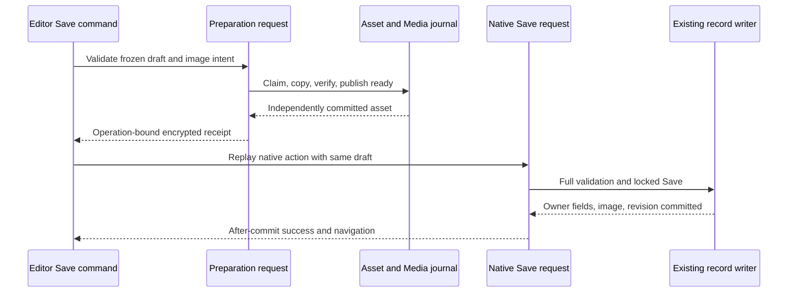

# Phase 1 catalog images — execution blueprint

**Status:** P0–P2 implemented and verified in the attached managed worktree on 2026-10-23. P0/P1 evidence is in section 13; the separately authorized P2 source-intake/scanner/preview checkpoint is in section 14. P3–P10, shared library, actual D60 import, normal-environment migrations, commits, push and deployment remain outside this execution. Image editor and catalog display UI are not connected yet.

**Requirements and audit source:** [Phase 1 implementation plan](IMAGE_ASSIGNMENT_PHASE_1_IMPLEMENTATION_PLAN.md), read in full, including IA-01–08, LA-01–02 and AR-01–08. This companion turns those findings into ordered work and precise contracts. The source plan remains the requirements/audit record; this document refines its technical interfaces where explicitly listed in section 12. Later operator instructions take precedence. Do not infer approval from a checklist.

**Fresh snapshot:** Primary checkout `/Users/studioycm/Herd/configurator`, `master`, with unrelated planning documents preserved. Initial HEAD and local `origin/master` were `4e82c222da421d098e8d1a9b5e50ef5a442b6ecc`. A read-only `git ls-remote origin refs/heads/master` confirmed that pushed SHA. During execution the primary checkout advanced locally to `244b305d083a90c731cd4bde23d996b4db0f8f3d` (Preview & Test inspection/safe saves). The isolated image worktree was fast-forwarded to that commit only after verifying zero overlapping files; final tests below use `244b305`. No fetch, push or merge into primary was performed. PHP 8.4; Laravel 13.35.0; Filament 5.9.0; Livewire 4.4.7; Media Library 11.23.9; Blueprint 2.4.0; Pest 5.3.0; MySQL. Versions checked through Composer/Boost and installed source. Earlier browser visits/prototype tests are historical evidence; no new browser, performance or concurrency claim follows from foundation tests.

All application paths below are relative to `/Users/studioycm/Herd/configurator`. Read AGENTS and any newly added `.ai/rules/index.md` plus matching rules before execution; `.ai/rules` is absent at this snapshot. Use the LaravelDaily structure audit and Laravel architecture guidance throughout; the Filament Blueprint checklist and testing guidance have been incorporated below.

## 1. Fixed scope and execution rules

| Contract | Required behavior |
| --- | --- |
| Association | One main image per Product/Group. `CatalogAsset` + nullable `main_image_id` now; attachments later. Keep main-image IDs out of browser-writable/fillable fields |
| Completion | Individual full-record Save; batch explicit Apply. Finding/uploading/checking never associates an image. One-record replacement never replaces another record's asset |
| Source/storage | Private local inbox plus public managed-image disk. Folders are import inputs, approved bytes are copied and originals preserved. Existing D60 folder is an allowlisted read-only source |
| Limits | JPEG/PNG/WebP; 3,145,728 bytes and 25,000,000 pixels; preserve original; non-upscaled contain-fit 160/480/960. Sources: 2000 files / 524,288,000 bytes. Selection/review: 5000 records. Apply: 1–50 assignments |
| Foreground execution | Sequential ordinary requests, one accepted item per processing request. No assignment/scan/review/conversion Job, deferred post-response work, request fan-out or automatic restart |
| Search | Code-only, All whitespace fragments, Contains, ignore case/separators, entire code. `el 6` intentionally matches `D60-EL-P10-01` via its family prefix. Exact pasted codes remain exact |
| Paging/navigation | Presets 5/10/15/25/50/100/200 and Custom 1–500; default 10, separate selection/review preferences. Results/Checked navigation crosses pages; dirty choices stay inline |
| Expiry/retention | New Apply requires review younger than 24 hours; accepted work remains resumable with fresh checks. Retain sources/working files/managed assets; operator cleanup only |
| Display | Group image beside text, compact Product thumbnail/header, light/dark, contain fit. Image-free warm cards retain two SELECTs; image-bearing cards propose three |
| Deferrals | Shared library/global replacement phase 2. No attachments/gallery/additional entities/PDF handling/ZIP/remote fetching/ERP autoimport/catalog-tree redesign |

Use feature-specific configuration, not a new package or root namespace. Existing Product identity/membership rules, profile-field ownership, Group settings including result_settings.editor_properties, catalog availability, configurator inputs and scoped revision behavior stay authoritative.

## 2. Responsibilities, dependencies and file ownership

### 2.1 Laravel boundaries

| Class/location | Owns | Must not own |
| --- | --- | --- |
| `App\Models\CatalogAsset` | Stored lifecycle, ready metadata, `originalMedia()` and Media Library integration | Product/Group writes, cleanup policy, UI |
| `App\Models\CatalogAssetImportSource` | Actor-owned source/version/cursor/claim/upload ledger | Managed library or owner pointers |
| `App\Models\CatalogAssetBatch` / `CatalogAssetBatchItem` | Review, acceptance, request-step and result journals | Implicit background execution |
| `App\Services\CatalogAssetTargets` | Allowlisted target/role, eligible owner query/context, image policy | A second Product field registry or arbitrary model names |
| `App\Services\CatalogAssetSources` | Actor/context authorization, source registration, upload ledger, claims, scan-step orchestration, immutable manifests, private streams | Managed Media or catalog associations |
| `App\Services\CatalogAssetSourceFiles` | Bounded local paths/content and persisted directory-frontier observations | Actors, SQL, claims, manifests, Media or owner writes |
| `App\Services\CatalogAssetStorage` | Import-key identity, attempt claim/copy/decode/conversion/reconciliation/publication | Full-form validation, owner Save, UI navigation |
| `App\Services\CatalogAssetMatcher` | Pure identifier/normalization/index/candidate computation | SQL, file I/O, authorization or pointer writes |
| `App\Services\CatalogAssetRecordSearch` | Validated, scoped query composition and scalar sort descriptors | File matching or list component state |
| `App\Services\CatalogAssetAssignments` | Ready/target invariant checks and in-memory pointer change on a fresh locked owner | File I/O, transaction creation, save/revision/events |
| `App\Services\CatalogAssetDisplay` | One bounded ready-asset/winner-Media read projection | Source probing, mutation, filesystem checks during render |
| `App\Services\CatalogAssetPathGenerator` | Media-ID-relative paths for this owner only | Changing global Media paths |
| `App\DTO\CatalogAssetChange` | Internal `keep`/`set`/`remove` + server-derived ready asset ID | Authorization by construction or client hydration |
| Existing `SaveCatalogProduct` / `SaveCatalogGroup` | Full-record locked Save, all current validators/fingerprints/revisions | Managed preparation inside their retryable transaction |
| `ReviewCatalogAssets` / `ApplyCatalogAssets` | Frozen review/build steps; issue/accept bounded intent | Hydrating a Filament form for batch persistence |
| `ProcessNextCatalogAssetBatchItem` / `AssignCatalogAsset` | One request's claim/preparation orchestration; one locked pointer/revision/result outcome | Choosing a different row when retrying the same request |
| Filament factories and focused host traits | Components, current UI context, draft/receipt adapters | Source traversal algorithms or domain writers |
| `App\Livewire\Catalog\AssetAssignment` | Inline source/review/result state and authorized command adapters | Complete serialized manifests or direct pointer updates |

Use constructor property promotion and explicit parameter/return types. Concrete Services/Actions resolve through the container without a binding per class. Pass actor/context at invocation; no singleton captures an actor/request. Retain the existing scoped `CatalogRevisions` registration in `app/Providers/AppServiceProvider.php:43`. Do not add a Service base class, repository wrapper, generic claim engine, helper globals, Media subclass/observer, per-service interface or extra database connection.

Model casts/relationships stay on models. Static `make()`/`configure()` Filament factories remain valid UI factories. There is one internal `CatalogAssetChange` DTO; document array shapes for recipes/manifests/results instead of inventing a type per array.

### 2.2 Existing integration anchors to preserve

- `SaveCatalogProduct::handle` at `app/Actions/SaveCatalogProduct.php:26` requires both owner and effective Product editor-field fingerprints. Product data is `profile_fields` with Properties/Parts/Others editor projections.
- `SaveCatalogGroup` locks ordered Groups; add its specified locked owner-fingerprint guard for image-changing edits. Keep `EditGroup::handleRecordUpdate` at `app/Filament/Resources/Groups/Pages/EditGroup.php:63` atomic across Group fields/settings and `CatalogRevisions::batch()`.
- `CatalogIntegrity::lockGroups()` supplies deterministic Group locks. Do not introduce reverse Product→Group acquisition.
- `ProductFields` / `ProductFieldQuery` own exact field keys/query expressions. Use exact `profile_fields` key `product_pic`; a key containing a dot is a literal key.
- `ItemLists::definition()` supplies drawer queries. Reuse its `group-products`, `configurator-products` and `configurator-groups` membership; never start an unscoped Product query in a drawer.
- `CatalogCards::get()` owns coherent revision + Product reads. Add image projection inside that transaction.
- `TableBrowserProfile` caps restored JSON at 32 KiB. Persist compact preferences, not selected IDs or a 512-KiB pasted-code list.

**Upstream contract refresh (4e82c22):** `ProductEditorData::editorFields()` uses the ordered exact keys in `result_settings.editor_properties`; missing/empty selection falls back to ordered Group filter keys/labels. `groupFingerprint()` covers Group ID and that effective editor key/label list, not every filter or every setting. Preserve both Product writer fingerprint arguments. Unrelated filter changes must not reject an explicitly classified editor; a selected key/label/order change must. Keep editor_properties in full Group draft receipts/settings saves, but do not restrict image-reference lookup to displayed Properties or reconstruct profile_fields from visible fields. No business decision blocks P0/P1.

**Preview & Test refresh (244b305):** Product/Group writers, owner models, `ItemLists` and public catalog projections retain their contracts. Preview's `saveReceipt`, `reconcile_pending`, operation IDs, acknowledgments and retry reconciliation belong to its configurator Save lifecycle. P6 image receipts and commit events remain scoped to Product/Group editors; do not append image drafts to Preview's signed captures or reuse its reconciliation events. `ConfiguratorEditorChanges::fingerprint()` deliberately covers complete Product/Group attributes, so a changed `main_image_id` invalidates an older tested Preview. Preserve this conservative behavior; do not narrow that fingerprint in the image work. Preview's leaf-group picker and public-visibility dashboard shortcut are not the image target query: keep exact `ItemLists` drawer scope and unrestricted global admin scope. Keep image display outside `previewView` evaluation/inspection payloads and preserve the new shared configuration-field props when later editing UI. The existing Preview MySQL concurrency test stays outside the image-specific no-transaction allowlist; do not copy its manual transaction escape into new image tests. No new business choice is required.

## 3. Persistence specification and invariants

Generate additive migrations after authorization with installed Artisan `make:` commands and `--no-interaction`. Inspect actual schema before generation; do not alter deployed historical migrations. No backfill from `product_pic`.

### 3.1 Tables

`catalog_assets`:

| Column | Type/default/constraint |
| --- | --- |
| `id`; `created_by` | Unsigned bigint PK; nullable User FK, null-on-delete |
| `source_kind`; `source` | varchar(20), `upload`/`folder`; non-null JSON provenance |
| `sha256`; `import_key` | char(64) reviewed digest; nullable char(64) UNIQUE import key. Every phase-1 preparation supplies a non-null key |
| `preparation_status` | varchar(12), default `preparing`; allow `preparing`/`ready`/`failed` |
| `preparation_token`; `preparation_expires_at` | Nullable ULID and timestamp for the current preparer |
| `original_media_id` | Nullable unsigned bigint UNIQUE FK → existing `media.id`, restrict-on-delete |
| `verified_metadata` | Nullable JSON: measured bytes/MIME/width/height/digest, source identity and generated-conversion outcomes. Required before ready publication |
| `error_code`; `error_detail` | Nullable varchar(64), text; safe detail at most 1000 characters with correlation ID |
| `prepared_at`; timestamps | Nullable timestamp; ordinary timestamps |

`CatalogAsset` implements `Spatie\MediaLibrary\HasMedia` and uses `InteractsWithMedia`. Relationships: `originalMedia(): BelongsTo`; Media Library's morph media relationship. Collections `preparation-attempts` and `original` must not use `singleFile()`/`onlyKeepLatest()`. One authoritative original is an invariant of the explicit winner, not collection cleanup. Register contain-fit conversions for both collections in P3, `nonQueued()`, with no responsive/deferred generation. P1 adds the Media interface/relationships only. Override `shouldDeletePreservingMedia(): bool` to return true: phase-1 retention must prevent Media Library's pre-delete hook from deleting attempt Media/files before an owner FK rejects an Asset deletion. Cleanup is an explicit later operator workflow, not a model-delete side effect.

`catalog_asset_import_sources`:

| Column | Type/default/constraint |
| --- | --- |
| `id`; `actor_id` | ULID PK; nullable indexed User FK null-on-delete; missing actor cannot operate |
| `source_kind`; `source` | varchar(20); JSON configured alias/inbox identity/friendly label and target context; no arbitrary client path |
| `scan_version`; `scan_revision` | Unsigned integers, initially 1 and 0 |
| `status` | varchar(20), `uploading`/`scanning`/`ready`/`stale`/`failed` |
| `cursor` | JSON frontier/checkpoints + committed fragment references/hashes. Server-owned |
| `upload_ledger` | JSON keyed by opaque entry ID: reserved/measured bytes, temporary-upload binding, committed entry identity/status. Maximum 2000 entries; private, never hydrated to browser |
| `traversal_complete`; `uploads_sealed`; `unsettled_uploads` | Booleans default false; unsigned integer default 0 |
| `file_count`; `byte_count`; `visited_nodes` | Unsigned integer / unsigned bigint / unsigned integer, default 0; count committed distinct entries only |
| `scan_token`; `scan_expires_at` | Nullable ULID/timestamp |
| `manifest_path`; `manifest_sha256` | Nullable varchar(1024)/char(64); only completed source can publish |
| Errors; timestamps | Same bounded safe error fields; ordinary timestamps |

Configured server folders are registered as actor-owned scan instances of a known alias. Uploaded inbox bytes and scan artifacts stay under server-generated IDs. Rescan creates a new immutable source version/instance; previous reviewed manifests are never overwritten. No per-file SQL table.

`catalog_asset_batches`:

| Column | Type/default/constraint |
| --- | --- |
| `id`; `actor_id` | ULID PK; nullable indexed User FK null-on-delete |
| `target_type`; `role`; `operation` | varchar(40)/varchar(40)/varchar(20); only `product`/`group`, `main_image`, `one_image`/`folder_matches` |
| `owner_context`; `recipe` | JSON mandatory list/drawer constraints; validated recipe/mode and override source references |
| `source_id`; `source_version` | Source ULID FK restrict-on-delete / unsigned integer; review manifest also records valid override sources |
| `scope_path`; `scope_sha256`; `scope_count` | Private frozen explicit-ID artifact, char(64) digest, unsigned count ≤5000 |
| `manifest_path`; `manifest_sha256` | varchar(1024)/char(64), immutable reviewed source/override evidence |
| `status` | varchar(20), default `building`; `building`/`review`/`accepted`/`completed`/`partial`/`failed`/`expired` |
| `build_position`; `build_revision` | Unsigned integers default 0, cursor over frozen positions including missing IDs |
| `build_token`; `build_expires_at` | Nullable ULID/timestamp |
| `preview_version`; `expires_at` | Unsigned integer initially 1; nullable timestamp while building, set to a 24-hour review deadline when the full build completes |
| `pending_apply_intent` | Nullable JSON `{id, preview_version, item_ids, issued_at}`, at most 50 exact ordered journal IDs |
| `active_acceptance_id` | Nullable indexed ULID; item stamps, not a separate acceptance table |
| timestamps | Ordinary timestamps |

`catalog_asset_batch_items`:

| Column | Type/default/constraint |
| --- | --- |
| `id`; `batch_id`; `record_id`; `position` | Unsigned bigint PK; batch ULID FK restrict-on-delete; unsigned owner ID; unsigned frozen position. UNIQUE `(batch_id,record_id)` and `(batch_id,position)` |
| `record_fingerprint` | Nullable char(64). Null only for missing/ineligible invalid proposals, never an acceptable item; do not fabricate a valid fingerprint |
| `before_asset_id`; `prepared_asset_id` | Nullable asset FKs restrict-on-delete |
| `snapshot`; `included` | JSON exact source value/identifier/candidate-set reference/count/chosen key/label/context; boolean default true for eligible proposals |
| `acceptance_id`; `accepted_preview_version`; `accepted_at` | Nullable ULID/unsigned integer/timestamp; immutable once stamped |
| `request_step_id` | Nullable UNIQUE ULID, server-issued command identity for this item's current processing attempt |
| `processing_token`; `processing_expires_at` | Nullable ULID/timestamp, internal current handler fence, never public |
| `match_status` | varchar(20): `ready`/`existing`/`missing`/`ambiguous`/`invalid`/`suggestion` |
| `apply_status` | varchar(20), default `pending`: `pending`/`processing`/`applied`/`unchanged`/`failed`/`stale`/`skipped` |
| `attempts`; errors; `applied_at`; timestamps | Unsigned integer default 0; bounded safe errors; nullable timestamp; ordinary timestamps |

Processing query index: `(batch_id, acceptance_id, apply_status, position, id)`. Source/asset claims use PK locks, so do not add a token index by habit. Use nullable indexed restrict-on-delete `main_image_id` on both owners, `mainImage(): BelongsTo`, existing rows null; avoid duplicate FK indexes. Confirm representative next-50/review filter plans before adding more indexes.

### 3.2 Strong invariants beyond foreign keys

A writable ready image must satisfy: asset ready; explicit winner ID; matching Media `model_type === $asset->getMorphClass()` and `model_id`; expected disk/conversions disk and `original` collection; verified digest/size/MIME/dimensions. A FK proves existence only. Asset bytes/winner are immutable after readiness in phase 1.

No source/asset transaction holds locks while acquiring catalog locks. Pointer changes occur only on a fresh locked owner through the internal change validator. Full Save and batch share it. A real owner change advances the existing relevant catalog revision once; unchanged pointers do not.

Store private provenance/working artifacts outside public state. Product/Group fillable contracts must not admit `main_image_id` or receipt/source transport fields. No queued job is a hidden authority for any state.

## 4. Command identities, array shapes and error contract

Use server-issued ULIDs as opaque strings in browser commands; cast trusted DB IDs deliberately. No model class, SQL column, absolute path, arbitrary disk or managed asset ID is a client command.

Separate these identities:

| Identity | Scope / replay rule |
| --- | --- |
| Source `scan_version + expected_revision` | One scan step. A repeated committed revision returns progress, never another chunk |
| Review `preview_version + expected_build_revision` | One bounded build step. A stale recipe/build response cannot advance current state |
| Asset `import_key` | Stable import context + source/version/entry + reviewed digest. Same file in one batch shares it; distinct entries do not merge by bytes |
| Asset `preparation_token` | One file-preparation owner. Expiry does not prove old PHP stopped |
| Individual `draft_intent_id` | Actor/target/creation-session + selected source identity. Stable across retry; candidate change gets a fresh ID |
| Apply `intent_id = acceptance_id` | One pre-issued frozen ≤50 subset. Lost response never creates another acceptance |
| Item `request_step_id` | One server-issued item command. Replaying terminal command returns its result; never chooses next |
| Item `processing_token` | One active handler fence; only internal. Explicit recovery invalidates it before replacement |

Document internal result shapes in PHPDoc. A public progress envelope contains only `stage`, `outcome`, `code`, safe `message`, `correlation_id`, relevant owned IDs/versions, committed counts, `next_action` and optional next issued `request_step_id`. Internal ready preparation results may hold a `CatalogAsset`; the public adapter returns an opaque receipt, not a writable ID. `next_action` is one of `next_step`, `continue`, `retry_failed`, `review_again`, `resolve`, `sign_in`, `operator_recovery` or `none`.

| Condition | Persist / respond | Loop rule |
| --- | --- | --- |
| Applied/unchanged | Exact committed item result and counts; return next already issued eligible step if any | May continue while the same visible loop is running |
| Busy claim | Current committed progress; no failed result or retry inflation | Pause; explicit Continue after reconciliation |
| Lost/aborted response | Unknown until journal reconciliation; do not claim canceled/failed | Stop scheduling immediately |
| Invalid/decode failure, isolated missing/stale owner/source | Fenced row outcome; old pointer intact; stale requires fresh review | Later independent accepted rows may proceed |
| Derivative failure with verified original | Safe warning/generated flags and original fallback | Not an owner failure |
| Session/gate/context loss (401/403/419) | Existing auth/validation response; no owner mutation | Stop |
| Disk full/unavailable, DB outage, unexpected systemic error | Pause safely; journal only if DB is available. Do not promise the outage logged its own failed row | Stop; explicit recovery |

Log once at the responsible boundary with stage, actor/source/version/batch/acceptance/item/asset/attempt/Media IDs and timing. Browser/journal explanations exclude paths/stacks; bound detail to 1000 characters. Do not catch every Throwable and continue all 50. No automatic whole-request retries; current bounded SQL deadlock retries remain confined to SQL-only closures. Status/Return never renew claims, generate replacement steps or start work.

## 5. Sources and preparation — concrete lifecycle

### 5.1 Configuration, files and preview route

Create `config/catalog-assets.php` with confirmed limits, allowlisted `d60-demo` source alias, target policy and measured engineering budgets. Add ordinary disks:

- `catalog-asset-imports`: `storage/app/private/catalog-asset-imports`, private, `throw => true`, no public storage link.
- `catalog-assets`: `storage/app/public/catalog-assets`, public, `throw => true`, existing storage link.
- Register only `CatalogAsset` in `media-library.custom_path_generators`. Paths: `<media-id>/` and conversion subdirectories; preserve older Media prefix/path behavior.

Private layout: `<source-id>/v<version>/entries/<entry-id>/...`, immutable `scan/<revision>/<token>.json` fragments, completed attempt-specific `manifest/<token>/<hash>.json`, and attempt-specific working files. Physical names are generated; original basename/relative path remains metadata. Public managed paths use Media ID and sanitized filename.

Add authenticated signed GET `admin.catalog-asset-sources.preview` using `App\Http\Controllers\CatalogAssetSourcePreviewController::__invoke`. Route params identify source/version/entry, not a physical path. Require authentication, valid signature, `manage-catalog` and current actor/context ownership before stream. Reject denied/missing without bytes; use short-lived authorized previews and private/no-store response caching. Derive project URLs with Boost `get-absolute-url` when sharing, not by hardcoding an environment.

### 5.2 Upload reservation and safe path contract

`CatalogAssetSources` methods:

~~~php
startUpload(User $actor, string $targetKey, array $ownerContext, string $label): CatalogAssetImportSource
reserveUpload(User $actor, string $sourceId, string $entryId, array $metadata): array
commitUpload(User $actor, string $sourceId, string $entryId, string $temporaryUploadId): array
sealUploads(User $actor, string $sourceId, int $expectedRevision): array
startScan(User $actor, string $sourceAliasOrOwnedId, string $targetKey, array $ownerContext, bool $recursive): CatalogAssetImportSource
scanNext(User $actor, string $sourceId, int $expectedVersion, int $expectedRevision): array
finalize(User $actor, string $sourceId, int $expectedVersion, int $expectedRevision): array
status(User $actor, string $sourceId, ?string $entryId = null): array
manifest(User $actor, string $sourceId, int $version): array
~~~

Adapters resolve actor/context; source methods recheck ownership. Distinguish an allowlisted configured alias from an existing actor-owned source ID explicitly; they are not interchangeable arbitrary path strings. Native directory input + Livewire upload uses one file/request initially. The headless transport in `resources/js/catalog-asset-upload.js` preflights at most 2000 Files / 500 MiB (configurable adapter inputs), retains native Files locally, and stops before the next request. Its browser `size` maps to service metadata `bytes`. It is not wired into a form until P6/P7. The source service accepts a verified Livewire signed reference, not a raw temporary basename; the future server adapter must resolve the exact upload callback against its current verified temporary property and preserve actor/source/entry binding. A signature is bearer proof, not proof of the original actor. Never sign arbitrary browser filenames in that adapter. Explicitly bind the returned temporary upload ID to reserved entry ID, not filename order. The same entry ID/retry cannot reserve/count bytes twice; same ID/different content rejects. Reserved + committed totals must stay within caps under the source lock; actual measured sizes supersede untrusted browser estimates. Seal only after reservations settle. No uploaded folder becomes ready just because file transfer finished. Uploaded candidates are measured, inspected and counted once at commit; their sealed ledger is subsequently published into immutable metadata fragments in bounded scan steps, without rehashing/recounting it. Source previews and later managed preparation reverify the retained bytes. `status(..., entryId)` may expose only one requested reservation as `{entry_id,status,committed}`, with `missing` for a valid absent ID; it never exposes the whole ledger, private paths or temporary references. Unknown reservation responses with no provable entry identity require resolution.

Reject traversal, NUL, absolute client paths, all symlinks (the phase-1 policy also rejects internal symlinks), including those escaping/replacing allowed entries, nonfiles and canonical paths outside a separator-aware allowlisted root. Normalize relative-path separators solely as metadata; do not use labels/relative paths as destination authority. Every regular file contributes to the source file/byte cap before recipe filters; ignored entries/directories also count toward traversal safeguards. Invalid candidates are reported; aggregate oversize rejects readiness without truncation.

### 5.3 Incremental scan and finalization

Initial engineering budgets: ≤100 **new nodes**, ≤10 hashes and ≤16 MiB new bytes/request, 500-ms soft stop before the next expensive file. Separate name-only replay cap: 4000/request. Source distinct-node cap 4000, depth 16. Replayed names do not consume distinct counters twice. These are starting settings to measure, not user capacity guarantees.

For each expected revision:

1. Authorize and lock source. Earlier committed revision returns status, future revision rejects, live claim returns Busy.
2. Claim exact source/version/revision/start cursor with token/lease; commit before I/O.
3. Reopen local directories using persisted frontier: directory identity/mtime, ordinal and rolling prefix signature. Replay cheap names, verify prefix, then inspect bounded new entries. Never serialize an iterator or call whole-tree `allFiles()`/`sortByPath()->toArray()`.
4. Stat files first; count every regular file’s measured size toward the source cap. Oversize/unsupported candidates are invalid metadata entries with a nullable digest and cannot become ready proposals; do not hash their whole content. Start another eligible hash only when its measured size fits the remaining 16-MiB request budget. Stream-read at most 3,145,729 bytes per image to detect one-byte overflow or growth during read, rejecting overflow rather than following a growing file. Check MIME/header dimensions and digest for eligible files; full decode belongs to chosen-image preparation. Verify directory identity before/after the step. Detected reorder/change/symlink makes this source stale.
5. Write one immutable token-specific fragment. Briefly lock source and compare version/revision/token/start cursor; atomically publish fragment hash/reference, distinct counters, new cursor and revision. Lost fence leaves only an unreferenced retained artifact.
6. Persist server traversal exhaustion. If bounded replay consumes the work budget without reaching new work, report an explicit unsupported-budget condition; do not loop forever with false progress.

Finalization claims/fences its metadata publication too. Require traversal exhausted, upload source sealed/settled where applicable, no unresolved work, verified fragment hashes and cumulative caps. Build canonical manifest from at most 2000 committed entries; no image hashing/decoding at finalize. Set ready/path/hash atomically. Each finalize attempt writes a token-specific immutable manifest path before fenced publication, so a partially written or unreferenced earlier attempt cannot poison a later retry. New private artifacts use mode 0600 in private directories. Early finalize rejects. This is immutable reviewed evidence, not an atomic snapshot of an externally edited folder.

Stop/close prevents next requests. Return is read-only; explicit Continue reconciles the exact next revision. A rescan/changed source creates a new immutable version/review.

### 5.4 Preparation and recoverable Media publication

`CatalogAssetStorage::prepare(User $actor, string $ownedSourceToken, string $targetKey, string $importKey): array` is internal; caller derives the key from trusted context. Assert transaction level zero on the actual Asset/Media connection **before** claims/files. No second connection workaround.

Ordered protocol:

1. Reauthorize context/source, verify reviewed chosen-entry identity and digest, including for an uncommitted row reusing a cached ready asset. A missing/changed source does not silently use a substitute. Already assigned display remains source-independent.
2. Resolve/create one Asset by unique import key; duplicate insert race rereads it. Brief asset lock returns ready winner after verification, Busy for live owner, or claims failed/expired preparation with fresh token/lease. Commit.
3. Stat/precheck the current file, then bounded-stream copy into this token's immutable private working path, reading at most 3,145,729 bytes to detect one-byte overflow/growth and rejecting it before any managed import. Hash **after copy** and compare. Reject nonpositive dimensions or pixel overflow before decoder allocation; use safe integer comparison against 25,000,000 pixels. Validate 3-MiB/content MIME plus actual decode before attachment; one decoded image at a time. Source bytes remain untouched.
4. Set Media custom properties before FileAdder save: asset/token/source/version/entry/reviewed digest. Add with `preservingOriginal()` to `preparation-attempts`. Each token owns a distinct Media ID/path. Never clear collections.
5. Reconcile even when FileAdder throws: query only this asset's morph-owned attempt rows with the exact token. Zero means no persisted attempt, one permits verification, more than one is diagnostic failure—never choose first.
6. Verify managed original bytes/digest/metadata. Derivative exceptions after a valid copy are warnings; preserve the original and honest generated flags. FileAdder performs the single configured `nonQueued()` 160/480/960 contain-fit conversion pass without upscaling. Reconciliation verifies original/flags; it does not automatically invoke the full conversion set again after an exception. Register them for attempt collection as well as original; do not enable responsive/deferred/queued work.
7. Lock Asset → exact owned Media in a short transaction. Verify current token/attempt/provenance. Promote collection to `original` and publish winner/verified metadata/ready/prepared_at together. ID paths do not move.
8. Every failure/renewal/publication checks current token. An old preparer may finish only its own isolated files; it cannot publish, fail/delete another winner or alter an owner.

Ready identities never mutate in phase 1. Missing/corrupt ready files pause for operator recovery. Keep abandoned attempts; no automatic purge or claim of zero orphan bytes. Provisional leases are 60 seconds with final environment timing margin/owned renewal verified before release. A lease never substitutes for fencing.

## 6. Full-record image Save and editor lifecycle

### 6.1 UI files and host contract

Create `app/Filament/Resources/InteractsWithCatalogMainImage.php`, `CatalogMainImageField.php`, `resources/views/filament/forms/catalog-main-image.blade.php` and `resources/js/catalog-image-editor.js`; register JS through `resources/js/app.js`.

Opt in directly on `EditProduct`, `EditGroup` and `CreateGroup`, including their embedded editor usages. Host requirements: current actor; entity/record or creation-session identity; mandatory drawer context; native form; current owner/Group fingerprints; receipt slot; pending navigation context. Trait owns adapters/state binding only, not filesystem algorithms. New service instances resolve on each request.

Add field to Product Details and GroupForm's shared `$details` array so creation/nonleaf two-column forms also receive it. Full-width contain preview with current/proposed, source/reference/filename/dimensions, Upload/Find, contextual filename/field recipe, Remove/Revert; no nested Save form.

### 6.2 Intent, receipt and raw draft hash

Keep `data.image_intent = {operation, source_token, draft_intent_id}` inside existing `$data` so dirty comparison sees it. The normal `FileUpload::make('image_upload')` lives at `data.image_upload`; that one transport key is transient and explicitly excluded from the hash and stripped before the writer. Receipt/progress transport slots are separate from `data`. No automatic Media relationship saving.

Choose a bounded **Laravel encrypted receipt** (`Crypt::encryptString` / authenticated decrypt) instead of another table/session-only draft record. Mint it for all three operations (`set`, `keep`, `remove`); only `set` has a prepared asset/source, and the other operations carry explicit nulls. It contains schema version, operation, actor, target/record or creation-session, mandatory owner context, source/version/entry/digest, draft-intent ID, prepared asset identity, both relevant expected fingerprints and full draft hash. The public receipt is opaque. It is evidence to validate, never a substitute for fresh gate/context/ready checks.

Implement one deterministic host draft hash from raw editable `$data`, including image intent and Group settings; exclude the explicitly named `image_upload` transport key (not arbitrary user data), with receipt/processing feedback already in separate state slots. Recursively sort associative keys, preserve list order/scalar types, encode explicitly with throwing JSON behavior. Use the same helper before preflight and in final `beforeValidate`, before native dehydration. Do not trim/reinterpret business values to make hashes match. Candidate/context changes invalidate receipt and mint a fresh draft-intent ID. Receipt has no library-wide authority and grants no new retention rule.

Store receipt in its own transport slot, outside dirty draft hash, never in browser profile. The final adapter decrypts, compares hash/actor/context/source intent and re-resolves ready metadata. It strips transport fields before strict writers. A forged direct final Save fails on an unprepared/mismatched `set` intent; it cannot prepare within Save.

### 6.3 One visible Save, two ordinary requests

Use installed component-scoped Livewire 4 `$wire.intercept('save', …)` / `intercept('create', …)` / `intercept('saveAndNext', …)`:

1. Cancel the initial native action; capture original method parameters and current semantic context.
2. Disable editor inputs/navigation/completion controls while the two-stage command runs. Use one local saving flag and one replay-once flag, no global interceptor.
3. Await `prepareImageSave(): array`. It authorizes membership/gate, asserts no ambient transaction, calls `$this->form->validate()` and validates image intent. **Do not call `getState()` for preflight:** installed Schema may save relationships in that method.
4. For `set`, invoke storage; for `keep`/`remove`, skip file work. Mint a matching operation/full-draft receipt in all three cases, returning ready/no-preparation-needed respectively. No managed copy happens from mere browsing/selection.
5. Only an explicit matching ready/no-preparation-needed result permits replay of original `save(...)`, `create($another)` or `saveAndNext()`. The last is a thin host adapter that resolves/stages the semantic destination and invokes the existing full native Save; intercept it too, since a PHP-internal call to `save()` does not trigger another JavaScript interceptor. Browser replay flag is not security.
6. Native final action repeats authorization/validation/dehydration and full writer lifecycle; final server guard checks intent/receipt/hash. Do not copy Filament save internals or use an `@internal` state snapshot API.
7. On error/unknown response retain draft and pending destination. An unknown committed Group-create response requires reconciliation, never automatic `create` replay: this feature makes image preparation idempotent, not native Group creation exactly-once.
8. Remove interceptors on destroy; replay completes after response morph. Save click, Enter, mod+s and Save & next share this path. Preserve standalone `create(true)` behavior and embedded create-another restrictions.

### 6.4 Existing writer extensions

~~~php
SaveCatalogProduct::handle(
    User $actor, Product $product, array $data,
    string $expectedFingerprint, string $expectedGroupFingerprint,
    ?CatalogAssetChange $imageChange = null,
): Product

SaveCatalogGroup::handle(
    User $actor, ?Group $group, array $data,
    ?CatalogAssetChange $imageChange = null,
    ?string $expectedFingerprint = null,
): Group
~~~

Product: preserve both current fingerprints under Groups→Product locks. Apply internal pointer change to the fresh locked record before its existing dirty/save/revision branch. Keep strict Product keys `product_code,product_name,description,properties,parts,others`. Image fields are stripped before this validator. No second owner save/revision.

Group: add one canonical full-owner attribute fingerprint, required under Group lock for image-changing existing Groups. Creation uses bound creation-session intent, no arbitrary owner ID. Existing non-image callers retain behavior. Keep Group fields/settings and revisions in the current outer retryable transaction; independent preparation is already committed.

After-commit success must own draft reset, table refresh and navigation. On image-enabled paths, route existing `catalog-record-saved`/`catalog-editor-saved`/drawer refresh effects through the enclosing connection's after-commit callback if they clear/refresh the same draft. Merely adding a new event while old precommit handlers still clear drafts is insufficient. Emit targeted `catalog-image-save-committed` with saved owner/host/destination context; parent rechecks destination membership. Rollback never clears draft or signals success.

## 7. Search, selection, navigation and Filament specifications

### 7.1 Query and preference contract

Create `CatalogAssetRecordSearch` and `InteractsWithCatalogAssetBrowsing`; modify Product/Group tables, `TableBrowserProfile`, opted-in headers/pagination and current JS/styles. Retain native selected keys and `deselectAllRecordsWhenFiltered(false)`.

Keep one search input with a Search in prefix dropdown and Options suffix dropdown, plus active-rule text/result count/highlights. Targets are Product code, Product name, Image reference and Group; Filename is available in review. Group-owner lists use Group name/Legacy ID, not an invented Group code. Options expose All/Any fragments; Contains/Starts with/Ends with/Whole value; entire code or selected 1-based hyphen positions; ignore/match case; ignore/literal spaces-hyphens-underscores; exclusion fragments; exact-code paste. Saved-image Any/Missing/Has, searchable Group multi-filter and Checked only are quick filters. Whole value compares entire input and disables fragment combination; All fragments can be satisfied by different selected targets. Separator-only nonblank input yields no matches, not all rows. Filtering does not mutate selection/editor or the independent filename recipe.

Validate query/exclusion ≤500 characters / 20 fragments; targets 1–5 allowlisted; code positions 1–16; pasted exact list ≤5000 distinct codes/512 KiB. Split whitespace before separator removal. Whole-value mode disables All/Any; exclusion means any contained exclusion fragment. Literal SQL wildcard input must be escaped/bound. Source field keys stay exact even if value comparison ignores case. Reuse `ProductFieldQuery`, not dotted JSON paths or a new registry.

Use `CatalogAssetRecordSearch::apply(Builder $eligibleQuery, array $validatedSearch, string $context): Builder` on one mandatory eligible query; the same optional search/filter recipe serves visible rows, Select matches and Results navigation. Internally group fragment predicates as All=AND of per-fragment target-OR groups, Any=one grouped OR; apply exclusions outside that group without weakening mandatory scope. Escape the chosen LIKE escape character plus literal `%`/`_` before binding; retain distinct driver-specific exact-key/segment expressions in this service rather than interpolating raw SQL names. Segment extraction precedes formatting normalization. Checked navigation ignores optional search/filters, retaining mandatory owner/gate scope and explicit checked IDs. Product default `product_code,id`; Group `sort_order,id`. Permit only verified scalar sort descriptors for neighbor resolution, appending unique ID tie-breaker. Do not silently ignore a visible user-selected sort. Resolve neighbors with the same allowlisted scalar sort/null ordering and ID tie-breaker through bounded server queries, without sending all result IDs to the browser; resolve destination ordinal/page separately when necessary. Add PHPDoc contracts for `CatalogAssetTargets::eligibleQuery(User $actor, string $targetKey, array $ownerContext): Builder` and the host neighbor result `{record_id,position,total,page}`. Source the mandatory context from the actual host/ItemLists definition, not a client-selected arbitrary constraint.

Select matches unions IDs, reading at most 5001 to reject >5000 without truncation. Checking/opening remain distinct. Only compact target/options/size preferences enter the ≤32-KiB existing profile. Query text/exclusion follow existing bounded profile behavior only where currently supported; pasted exact-code input and checked IDs are transient, not persistent profile content.

Pagination setter order: validate raw decimal whole-number input → retain old valid page/size ordinal → update canonical/custom option + native value → native persistence/reset hook → named destination page → clamp for shortened results only. Formula: `floor(((oldPage-1)*oldSize)/newSize)+1`. Restore valid custom option before profile membership checks. Preserve native `getTableRecordsPerPage(): int|string|null` signature and defend actual effective integer 1–500 against forged public state. No `all`, copying full paginator internals or global macro.

### 7.2 Components and actions

Existing Resources are updates; do not scaffold a new resource/page or permanent navigation item. Use these exact namespaces; include full-width layout inside existing Details rather than multiplying nested columns.

| Element | Component / docs | Validation and config |
| --- | --- | --- |
| Main image | `Filament\Forms\Components\FileUpload`, [file upload](https://filamentphp.com/docs/5.x/forms/file-upload#preventing-files-from-being-stored-permanently) | `image()->acceptedFileTypes(['image/jpeg','image/png','image/webp'])->maxSize(3072)->storeFiles(false)->multiple(false)->columnSpanFull()` plus server decode/pixel/source checks |
| Finder wrapper | `Filament\Schemas\Components\View`, [custom view](https://filamentphp.com/docs/5.x/schemas/custom-components#rendering-a-blade-view) | Shared view, `columnSpanFull()`, no relationship autosave or nested form |
| Search/options | `Filament\Forms\Components\TextInput` / `CheckboxList` / `ToggleButtons` / `Toggle` / `Textarea`, [forms](https://filamentphp.com/docs/5.x/forms/overview) | Limits in 7.1; native 500-ms search debounce; options local dropdown, server queries only on actual changes |
| Source/field choice | `Filament\Forms\Components\Select`, [select](https://filamentphp.com/docs/5.x/forms/select) | Searchable bounded choices, source IDs/keys validated, no preload of all Products |
| Recipe | `Filament\Forms\Components\TextInput` / `Toggle` / `ToggleButtons`, [reactivity](https://filamentphp.com/docs/5.x/forms/overview) | `live()`/`live(onBlur: true)` for dependent example; affixes ≤100, wildcard input ≤500, distinct positions 1–16 |
| Custom size | `Filament\Forms\Components\TextInput`, [numeric](https://filamentphp.com/docs/5.x/forms/text-input#numeric-input) | `integer()->minValue(1)->maxValue(500)`; commit Enter/Use size; raw validation before coercion |
| Group filter | `Filament\Tables\Filters\SelectFilter`, [select filter](https://filamentphp.com/docs/5.x/tables/filters/select) | `relationship('group','name')->multiple()->searchable()`, current mandatory scope preserved |
| Has image | `Filament\Tables\Filters\TernaryFilter`, [ternary](https://filamentphp.com/docs/5.x/tables/filters/ternary) | Nullable main-image pointer, Any/Has/Missing; no file scan |
| Owner label/image | `Filament\Tables\Columns\TextColumn` / `ImageColumn`, [columns](https://filamentphp.com/docs/5.x/tables/columns/overview) | Existing scalar sorting plus ID tie; `imageSize(40)->square()` with contain styling; URL from batch display map |
| Table | `Filament\Tables\Table`, [pagination](https://filamentphp.com/docs/5.x/tables/overview#pagination) | `paginationPageOptions(fn (): array => $validatedOptions)->defaultPaginationPageOption(10)`; Custom is UI, not an option string fed to query |

Reactive imports: `Filament\Schemas\Components\Utilities\Get` and `Set`. Programmatic Set does not imply another updated hook ran; call shared derivation explicitly.

All ordinary controls use `Filament\Actions\Action`; table entries use `Filament\Actions\BulkAction` in `BulkActionGroup`, [actions](https://filamentphp.com/docs/5.x/actions/overview). Bulk entries use `fetchSelectedRecords(false)`; memory chunking is not request chunking. Server authorization for every action is `manage-catalog` + actual actor/owner/list/source context.

| Action/location | Visibility | Ordered behavior |
| --- | --- | --- |
| Upload/Find/filename/field, image field | Editable Product/Group; field reference Products only | Validate owned source → stage intent → proposed preview, no association |
| Remove/Revert, field | Saved/proposed image / changed draft | Stage remove or reset only image intent; preserve other draft |
| Previous/Next, editor bar | Eligible sequence; boundary disabled | Semantic destination → inline dirty choice → open or full Save/commit → recheck/open |
| Save & next, editor footer | Existing record + eligible next | Same two-request native Save adapter, postcommit destination only |
| Assign one/Match folder, table | Nonempty checked IDs; folder matching Products only | Freeze scope → inline source/recipe → bounded review |
| Preview/Continue scan/build, inline | Owned eligible stage | Advance one exact revision while visibly running; Stop prevents next call |
| Apply N, review footer | Complete current unexpired review, 1–50 ready included rows | Preissue bounded intent → accept once → start sequential issued steps |
| Stop/Return/Continue/Retry, results | Owned current stage/acceptance | Stop scheduling / read-only reconcile / explicit recover or retry exact eligible steps |

Dirty navigation extends `resources/js/editor-drafts.js` only for opted-in hosts. Store semantic entity/owner/destination request, not a stale DOM click target. Save & continue uses the same Save controller; Discard revalidates destination; Stay clears pending request and returns focus. Browser unload remains the existing warning, not an async-save promise.

Opt-in hosts: Product/Group List pages through `SplitListRecords`; three editor pages above; owner-backed editable `ItemListDrawer` definitions. Preserve Group ordering and resolve existing trait conflicts explicitly. Array-backed/nonowner drawers stay outside this feature. Child editor keys use entity/owner/record or creation session, never search/size.

## 8. Matching, review, acceptance and processing

### 8.1 Pure recipe and bounded build

Default field `profile_fields` exact key `product_pic`; extract final path component and recognized image extension without remote fetching or numeric coercion. Optional ordered code positions/affixes/separator/case rules; preserve leading zeros. Exact filename default ignores case; case/extension/subfolder collisions remain ambiguous. Contains is always suggestion until explicit confirmation. Include/exclude wildcard rules use literal escaped input with only `*`/`?` operators; exclusion wins. Specify basename versus relative-path matching in UI; a pattern containing a slash targets relative path, otherwise basename. Validate recipe once; no raw regex authoring/evaluation.

`CatalogAssetMatcher::index(array $manifest, array $recipe): array` builds once per manifest/recipe version; `reviewChunk(array $records, array $index, array $recipe, array $overrides): array` is pure. Reuse collision groups and candidate-set references; inspector pages candidates for its one open item. Contains may inspect bounded candidates but never emits a records×files matrix.

`ReviewCatalogAssets::handle(User $actor, string $entity, array $explicitIds, array $intent, ?int $ownerGroupId = null): CatalogAssetBatch` authorizes complete scope, freezes IDs/order/source/overrides/recipe/mode and starts `building`. The shared UI must not supply arbitrary query/model descriptors.

`buildNext(User $actor, string $batchId, int $expectedPreviewVersion, int $expectedBuildRevision): array`:

1. Claim exact build revision under batch lock; release before reading sources/owners.
2. Process at most 100 frozen positions, including missing/deleted/ineligible IDs. Null fingerprint + invalid explanation for invalid owner; never shrink denominator.
3. Atomically publish unique-position proposal rows and cursor/revision under current claim. Retry committed revision returns status without another chunk.
4. Complete only after all frozen positions classified; set `review` and deadline. Partial builds cannot Apply.

Before first acceptance, recipe/source/mode/override changes rebuild a new preview version; old builds lose fence. After any acceptance, changed semantics create a new review journal for remaining records. Overrides outside original source add exact authorized source/entry evidence to the review manifest, not all files from that source. Inclusion edits affect only unaccepted rows, version checked; search/page changes affect no proposal semantics.

### 8.2 Intent and status semantics

`ApplyCatalogAssets::prepareIntent(User $actor, string $batchId, int $expectedVersion, array $itemIds): string` validates 1–50 exact included/ready/unaccepted items and stores one pending intent. `handle(User $actor, string $batchId, string $intentId): CatalogAssetBatch` rechecks ownership/version/deadline/membership under batch lock, stamps acceptance/version/time and **request_step_id for each accepted item**, sets active acceptance and clears pending.

A repeated stamped intent is read-only reconciliation even if another acceptance is active; never reopen/mutate it implicitly. Only one unfinished acceptance can be active. Completed stamps remain immutable. Unknown/foreign/over-limit intents reject without pointers.

Batch `status` summarizes build/review or the current/last accepted subset, not an assertion all 5000 proposals were applied. UI separately shows full-review ready/deferred/excluded counts. Authoritative processing guard is active acceptance + item stamps; preview expiry only blocks new acceptance. Do not overwrite accepted state with `expired`.

### 8.3 One request, one stable issued item

Refined interface:

~~~php
ProcessNextCatalogAssetBatchItem::handle(
    User $actor, string $batchId, string $acceptanceId, string $requestStepId,
): array

AssignCatalogAsset::handle(
    User $actor, CatalogAssetBatchItem $item,
    string $requestStepId, string $processingToken, CatalogAssetChange $change,
): bool
~~~

The browser receives an eligible server-issued step ID from acceptance/status/previous result and sends that same identity on a transport retry. Server chooses order; knowing a later item's ID is not permission to skip to it.

1. Reauthorize and locate the owned step. A terminal same step returns recorded result, including after active acceptance changed. A superseded step returns stale-step/reconcile; never selects another item.
2. Under Batch→Item locks require active acceptance and the earliest unfinished position, including `processing`. Any live claim in this acceptance returns Busy. An expired processing row blocks later pending rows and returns recovery-required until explicit Continue replaces its step/token; it is never silently skipped. Pending out-of-order request rejects. Claim token/lease and attempt count; release before I/O.
3. Recheck mandatory scope/source freshness and prepare/reuse ready asset through section 5. Preparation Busy pauses/releases this item safely rather than becoming a failed assignment.
4. Final SQL-only transaction locks ordered Groups → Product when applicable → Batch → Item. Reauthorize, reread fingerprint/pointer, acceptance, current request step and processing token. Validate ready winner metadata; no file I/O.
5. Apply pointer with shared internal validator, save only owned pointer, advance existing catalog revision on real change, store applied/unchanged result together. Failure rolls back all three; ready prepared bytes remain diagnostic.
6. Fenced row-local failure records outcome and permits next independent step; systemic/session/unknown pauses. Under the batch lock after each committed outcome, terminalize the acceptance only if no pending/processing items remain: clear active_acceptance_id and derive completed/partial/failed from that subset’s exact results: completed if no failed/stale outcomes, failed if there is no applied/unchanged result and at least one failed/stale outcome, partial otherwise. Skipped counts remain separate and never count as assignments. Read-only old-step replay cannot terminalize/switch anything. Emit committed affected IDs only.
7. Return current result/counts and next already issued eligible step. Browser awaits before the next call; it never manufactures a new step by blindly repeating “next”.

Explicit Retry failed/Continue expired work may reactivate the same acceptance only under batch guard, after fresh checks; atomically replace request_step_id and invalidate old processing token. This is the only replacement path. Old request arriving afterward rejects/reconciles. Status/Return changes none of them. Applied/unchanged/stale/skipped/excluded items are never implicitly replayed.

`AssetAssignment` methods: `prepareImageApply`, `applyImages`, `processNextImageAssignment(string $requestStepId)`, `retryFailedImages`, read-only `imageReviewStatus` and explicit continuation. A small local Alpine loop uses ordinary awaited calls, stops on page teardown/error/Busy/Stop, and never starts from hydration alone. Another subset needs explicit This Apply selection + Apply after active subset is terminal.

## 9. Display projection and extension seam

Create `CatalogAssetDisplay` and `resources/views/components/catalog/main-image.blade.php`. `forIds(array $assetIds): array` runs one bounded join from ready assets through explicit winner Media, checking model owner/collection/disks. Return only asset ID, generated public URLs, measured dimensions and derivative flags; no source JSON/provenance/model serialization.

Add `main_image_id` to `CatalogCards`' existing `id,product_code,profile_fields` Product SELECT. Resolve distinct pointers inside the same coherent read transaction. Zero pointers adds no query; images add one, for proposed warm totals two/three independent of 1/200 cards. Do not eager-load `mainImage.media` or query from Blade. Update `contracts/PUBLIC_CATALOG.md` and actual performance assertions together.

Extend Group list/card and admin maps similarly. ProductShow owns compact main header; pass a small image projection where Configurator also needs it instead of querying every selection. No images in discovery/facet/compiler/runtime configurator payloads.

Contain fit, fixed reserved dimensions, white-photo-safe surfaces, meaningful alt, theme-consistent missing/broken states. Cards lazy-load; main Product header loads normally. Missing derivative flags select original fallback; render never probes filesystem/source. A failed browser image request uses a display fallback without importing/replacing files.

Phase 2 may add shared library/usage/global replacement over stable asset identity. Later attachments migrate owner associations with audited parity/cutover; no attachment table/morph registry or generic file picker now.

## 10. Dependency-ordered work packages

Each package starts with the discriminating failing tests for its behavior, implements only its listed scope, runs its focused checks and records evidence. Later package absence must not break completed earlier capability. P0–P2 are complete for their separately authorized scope; P3–P10 remain pending.

| Package / dependencies | Create or modify | Ordered implementation instructions / acceptance |
| --- | --- | --- |
| P0 — snapshot/test contracts | `tests/Pest.php` and existing test bootstrap/config only as scoped below; planning contracts | Recheck rules/versions/schema/HEAD; establish no-ambient test binding and result/step contracts. No migrations against normal DB. Prove targeted test fixture sees transaction level zero |
| P1 — schema/target foundation; P0 | Four models/factories, five additive migrations, `CatalogAssetTargets`, `CatalogAssetChange`, owner relationships, feature config | Install exact schema/constraints; null pointers only, no backfill. Wire transient concrete services and preserve scoped revisions. Reject client pointer writes; verify restrict/ownership rules |
| P2 — source intake/scanner; P1 | `CatalogAssetSources`, `CatalogAssetSourceFiles`, preview controller/route, private disk, upload JS module | Implement reservation/staging then exact-revision scan/finalize, signed preview, immutable artifacts. Verify stopped/replayed/oversized/early-finalize and traversal faults before UI Apply exists |
| P3 — managed preparation; P2 | `CatalogAssetStorage`, path generator, owner-specific Media config/conversions | Implement no-ambient guard, import-key ownership, attempt reconciliation and ready publication. Real race test before owner writes; no jobs/global media changes |
| P4 — browse/paging; P1 (can proceed independently of P2/P3) | `CatalogAssetRecordSearch`, browsing trait, Product/Group tables/List opt-in, TableBrowserProfile, table header, search/pagination views/JS/styles | Implement canonical search and effective size caps, explicit native union selection, compact preference contract; test hidden checks/ordinal/forged state/owner scope |
| P5 — record sequence; P4 | SplitListRecords, ItemListDrawer, InteractsWithItemDrawerEditor, navigation view, editor-drafts JS | Implement scalar-sort Results/Checked neighbors and semantic dirty requests without image writes; preserve child identity/tabs. Save & continue connects after P6 |
| P6 — one-image full Save; P3/P5 | Image field/main-image trait/editor JS, Product/Group forms and Edit pages, CreateGroup, existing Save writers, record-editor view | Wire preflight receipt then native Save/Create, internal pointer, Group locked fingerprint and postcommit effects. Verify standalone/embedded/creation and outer rollback before batch assignment |
| P7 — recipe/review; P2/P4 | Pure matcher, ReviewCatalogAssets, CatalogAssetActions factory, AssetAssignment/view, inline split/drawer slots | Build versioned source index and bounded proposal cursor, paged inspector/outcomes, independent review pagination. All 5000 classified before Apply enabled |
| P8 — acceptance/processing; P3/P6/P7 | ApplyCatalogAssets, ProcessNextCatalogAssetBatchItem, AssignCatalogAsset, component methods/loop | Preissue ≤50 intent, stable item step, independent claims, atomic owner/revision/result, classified stop/retry/expiry. Prove same-step replay cannot advance another row |
| P9 — display; P6 | CatalogAssetDisplay, main-image component, CatalogCards, Index/GroupShow/ProductShow/ProductConfigurator and their relevant Blade/admin views/language/styles | One joined projection, explicit fit/fallback, two/three warm SELECT contract, no runtime/source coupling. Public contract amendments tested |
| P10 — isolated concurrency/performance/browser gates; P8/P9 | Focused tests, evidence in source plan | Run serial safe MySQL races, D60 read-only dry run, actual UI light/dark/narrow/error states; finalize budgets. No real-image import or deployment implied |

Use the source plan's exact existing file inventory where a table lists a host family. Additional new files selected here: main-image trait, editor JS and test setup changes; no new base folder. New class commands are ordinary `php artisan make:class Services/<Name>` / `Actions/<Name>` / `DTO/CatalogAssetChange`, existing controller/model/Livewire generators with `--no-interaction`, verified help first. Do not regenerate existing Resources.

## 11. Verification, release and rollback instructions

### 11.1 Test setup that exercises independent commits

Existing `tests/Pest.php` binds every Feature file to `RefreshDatabase`. Split the base TestCase binding from transaction traits. Maintain an explicit no-outer-transaction file allowlist; bind `RefreshDatabase` only to its complement and `DatabaseMigrations` only to these files. Pest 5 has positive file/glob `in(...)` targets; do not invent subtraction syntax or merely add both traits.

Initial nontransactional files:

- `tests/Feature/Catalog/CatalogAssetFoundationTest.php` (P0/P1 independent-commit fixture and schema contracts)
- `tests/Feature/Catalog/CatalogAssetSourcesTest.php`
- `tests/Feature/Catalog/CatalogAssetStorageTest.php`
- `tests/Feature/Filament/CatalogMainImageFieldTest.php`
- `tests/Feature/Catalog/CatalogAssetBatchTest.php`
- `tests/Feature/Filament/CatalogAssetAssignmentTest.php` (the entire file uses this binding if any case invokes real preparation)
- `tests/Feature/Catalog/MySql/CatalogAssetConcurrencyTest.php`

Keep actual preparation/two-request tests in these new files, instead of forcing large unrelated suites to reset per test. Browse/matcher/navigation/writer-only tests with prebuilt ready fixtures can retain current transaction setup. Assert the real preparation entry sees transaction level zero; never commit a framework-owned test transaction manually or weaken production guard.

Before any reset, verify disposable test configuration. Existing `tests/bootstrap-mysql.php` requires APP_ENV testing, MySQL `127.0.0.1:3307`, database/user `configurator_catalog_test` and rejects URL/config-cache overrides or resolved mismatch. Recheck it; do not copy real environment secrets. New multi-connection/process tests run serially with the same guarded disposable DB. Do not copy historical tests' manual commit/begin escape patterns.

Use framework factories, generated fixtures and fake disks for ordinary tests; no real D60 mutation. Multi-process filesystem races use one unique temporary local root shared by child processes; a child's `Storage::fake()` must not erase the parent's fixture. Each process runs test DB safety checks. Use deterministic barriers at real collaborator boundaries, not timing sleeps or a test-only production global callback.

### 11.2 Findings-to-proof matrix

| Finding / wrong implementation distinguished | Setup / real entry | Required independent expectation |
| --- | --- | --- |
| LA-01: token protects pointer but shared copy races | A pauses after copy; expire; B prepares/publishes; resume A success and failure paths | One logical asset/winner; B's bytes/metadata survive; no A ready/failure/delete/pointer/revision |
| LA-02: chunks applied after whole scan / early finalize | Wide/nested source, first 100 entries scanned, direct finalize; late scanner retry | Finalize rejects until exhaustion/seal; replay advances zero extra entries/counters; oversize never ready |
| AR-01: proposal cross-product / silent missing IDs | 5000 frozen IDs, one deleted midway, 2000 candidate collision group, lost build response | Exact invalid ID reported, denominator 5000; candidate references/paged details; same build revision advances zero extra positions |
| AR-02: preparation rolls back with owner Save | Actual two-request editor flow then Group settings failure / writer deadlock | Ready asset independently persists; owner ordinary fields/image/revision roll back together; no success/nav |
| AR-03: addMedia exception treated as no original | Inject conversion failure after successful copy, then separate partial-copy failure | First can publish original with warning; second cannot become ready. No blind second Media or deletion |
| AR-04 / AR-07: every error treated as row failure | Busy, lost response, source stale, storage outage, DB failure, 401/403/419 through real adapters | Correct result/action and loop pause; no unissued next requests; safe errors; DB outage makes no false durable-failure claim |
| AR-05: lost Group fingerprint / old field bucket | Product prepared; the effective Product editor-field selection/order/label changes; key `a.b` differs from nested JSON | Final Save rejects unchanged owner with changed effective editor fields; exact key resolves without old-column fallback |
| AR-06: native selected models / eager relationship N+1 | Bulk ID handoff and 1/200 image-bearing cards | No all-model hydration for entry; one Product read plus one joined image projection; two/three coherent warm SELECTs |
| AR-08: tests hide preparation in global transaction | Targeted no-ambient fixture + direct prepare inside explicit transaction | Valid entry runs at zero; explicit ambient transaction rejects before claims/files |
| EX-01: retried next request advances another row | Apply three rows; first step commits and response lost; resend same step; then explicit retry replaces failed step | Same recorded row returned, next pointer unchanged; superseded step cannot mutate/advance |
| IA-02/03: selections/profile/page reset change scope | Hidden checks + new matching record; page3 at25→10; forged all/1.5/501 | Exact checks remain, new match unchecked, page6, invalid input retains old size/editor/draft; query stays bounded |
| IA-04/05/07: image-only change bypasses stale/full Save | Two real editors; one replaces shared image, other stale; rollback before outer commit | Shared other's file intact; stale Save denied; one full record Save; no precommit draft reset/navigation |
| IA-08: future file role accidentally inherits public image policy | Unknown target/role/MIME through non-UI operation | Reject unsupported role/PDF/SVG with zero owner change; no generic-file capability appears |

Additional required entry cases: oversize/growing source fails after at most one byte beyond the image cap, without a large managed copy; keep/remove receipts also reject changed ordinary-field drafts; expired processing blocks later rows until explicit recovery; terminalization does not label remaining review rows applied. Also cover: byte limit exact/one over with other dimensions valid; 25-MP exact/over with bytes valid; header-valid undecodable input; case-only/extension/subfolder ambiguity; D60 LP6-04→D60EL03; save click/Enter/mod+s/create-another; changed draft during preflight; direct unprepared final Save; wrong actor/source/receipt/winner Media owner/disk; private preview denial; Stop with one in-flight commit; Continue accepted after expiry while new acceptance expires; older-intent read-only reconcile during newer active subset.

Pure matcher/normalization tests use explicit independently derived IDs/filenames, not the implementation's helper as expected value. DB relationships/queries use actual test database, not query mocks. Test behavior, not strings declaring configuration. No new browser/plugin dependency; authenticated manual/available browser automation is separate evidence from PHP assertions.

### 11.3 Focused commands after authorization

Check generator help; run no commands below merely because this plan exists.

~~~text
php artisan test --compact tests/Feature/Catalog/CatalogAssetSourcesTest.php
php artisan test --compact tests/Feature/Catalog/CatalogAssetStorageTest.php
php artisan test --compact tests/Feature/Filament/CatalogAssetBrowsingTest.php
php artisan test --compact tests/Feature/Filament/CatalogAssetNavigationTest.php
php artisan test --compact tests/Feature/Filament/CatalogMainImageFieldTest.php
php artisan test --compact tests/Unit/CatalogAssetMatcherTest.php
php artisan test --compact tests/Feature/Catalog/CatalogAssetReviewTest.php
php artisan test --compact tests/Feature/Filament/CatalogAssetAssignmentTest.php
php artisan test --compact tests/Feature/Catalog/CatalogAssetBatchTest.php
php artisan test --compact tests/Feature/Catalog/CatalogAssetDisplayTest.php
vendor/bin/pest --configuration=phpunit.mysql.xml tests/Feature/Catalog/MySql/CatalogAssetConcurrencyTest.php
node --test tests/Unit/TablePagination.test.js
node --test tests/Unit/CatalogImageEditor.test.js
vendor/bin/pint --dirty --format agent
vendor/bin/filacheck --fix --dirty
npm run build
~~~

Generate `CatalogImageEditor.test.js` for actual intercepted-submit/Stop/error behavior and extend existing draft/navigation JS tests where behavior changes. Read installed helpers before use; add no dependency. After relevant focused checks pass, request the complete `php artisan test --compact` run per AGENTS. FilaCheck unresolved violations on changed Filament code must be addressed. Review formatter/checker diffs and preserve unrelated checkout work.

### 11.4 Runtime gates and rollout boundary

Record measured hash/replay/request/decode/conversion times and peak memory for ordinary D60-sized images and worst allowed inputs. Finalize 60-second lease margins or owned renewal from actual web/PHP/image-driver bounds; no soft time budget is a hard timeout promise. If one allowed image cannot fit the foreground request safely, stop and resolve environment/design before release—do not quietly add jobs or lower confirmed limits.

Inspect representative SQL EXPLAIN/timing for normalized Contains, scope materialization, next-step and display. Extra indexes/generated columns require measured justification. Verify public warm two/three-query contract and max rendered 500-row payload; no all-5000 component hydration.

Browser matrix: Product/Group standalone/create/drawers, leaf/nonleaf forms, light/dark, desktop/narrow, search dropdown focus/Escape/outside click, 5/200/Custom paging, dirty Save/Discard/Stay, late response, source/review/Apply Stop/Continue, empty/error/invalid states, white-background photo fit and broken image fallback. List unvisited states explicitly.

D60 release rehearsal is read-only source inventory + dry-run association report on an isolated sample. Real batch import, content changes, migrations in a normal environment, storage-link/config rollout, deployment and push require their own authorized execution stage. Retain DB and managed originals in backups. Rollback disables new UI/display first; preserve schema pointers/bytes. No destructive migration rollback, asset deletion or source purge as an automatic rollback.

## 12. Refinements to the source plan and remaining gates

These technical refinements complete the existing audit instructions without reopening business decisions:

1. Final application/test base is `244b305`; pushed master was verified at `4e82c22`. Unrelated planning documents remain uncommitted. Earlier snapshot entries are historical evidence. Both upstream-contract refreshes above govern later integration.
2. Add stable item `request_step_id` and processing method argument so a retried command cannot advance another row (EX-01).
3. Permit null owner fingerprint only for explicitly invalid/missing proposals; acceptance always requires a real current owner fingerprint.
4. Select component-scoped Livewire interception, preflight `form->validate()` and encrypted full-draft receipt as the concrete single-Save adapter. `getState()` preflight is unsafe because it can save relationships.
5. Persist only compact preferences within the existing 32-KiB profile; large pasted lists/checks remain transient.
6. Spell out name-only replay budget versus new-node counters, step CAS and early-finalization seal/exhaustion checks.
7. Distinguish actual ready winner ownership from FK existence, and register conversions for preparation collection before promotion.
8. Keep terminal old-step/old-intent reconciliation read-only while a newer acceptance runs; status never performs recovery.
9. Preserve source freshness for uncommitted association attempts even when managed asset is already ready; display after assignment remains source-independent.

10. Retain the current full-attribute Preview fingerprint and its independent Save receipt/reconciliation lifecycle. In P10, cover a tested Preview followed by a committed image-pointer change: a stale Preview Save must be rejected/re-evaluated with its draft intact; its bounded SQL retries remain authoritative.
11. Keep batch review expiry null until the full bounded build completes; do not start its 24-hour clock at journal creation.
12. Preserve retained attempt Media/files before rejected ORM Asset deletion; database restrictions alone cannot undo package pre-delete filesystem effects.

No business quiz remains unanswered. Execution gates are measurement and verification: source replay behavior, decoder bounds, exact Save adapter across hosts, isolated MySQL races, query budgets and browser acceptance. They are not claims that an unimplemented feature already passes.

Primary API/lifecycle references: [Laravel container](https://laravel.com/framework/docs/13.x/container), [transactions](https://laravel.com/framework/docs/13.x/database#database-transactions), [filesystem failures](https://laravel.com/framework/docs/13.x/filesystem#failed-writes), [database testing](https://laravel.com/framework/docs/13.x/database-testing#resetting-the-database-after-each-test), [Livewire interceptors](https://livewire.laravel.com/docs/4.x/javascript#interceptors), [security](https://livewire.laravel.com/docs/4.x/security), [Filament editing](https://filamentphp.com/docs/5.x/resources/editing-records), [code-quality factories](https://filamentphp.com/docs/5.x/resources/code-quality-tips), [Spatie collections](https://spatie.be/docs/laravel-medialibrary/v11/working-with-media-collections/defining-media-collections), [conversions](https://spatie.be/docs/laravel-medialibrary/v11/converting-images/defining-conversions). Cross-checked with installed source; no premium-body or video inspection is newly claimed. The source plan retains the earlier research/access ledger.

**Planning completion record:** full source plan/audit read; current source/installed lifecycle checked; three independent read-only reviewers; blueprint consistency review and document-link/whitespace checks. No application code, runtime state, tests, migrations or image files changed by this planning task.

## 13. P0/P1 implementation checkpoint — 2026-10-23

**Location:** attached managed worktree `/Users/studioycm/.codex/worktrees/catalog-images-p0-p1/configurator`, detached at `244b305d083a90c731cd4bde23d996b4db0f8f3d`, uncommitted. Primary receives planning updates only. No user business decision was needed after the upstream refresh.

| Package | Delivered | Evidence |
| --- | --- | --- |
| P0 complete | Separate base TestCase binding; explicit positive-file partition into `RefreshDatabase` and `DatabaseMigrations`. Existing/new ordinary tests keep their prior transaction behavior. Public progress/step contracts remain specified in section 4; command handlers belong to later packages. | Watched the foundation test fail with ambient level 1, then pass at level 0; ordinary fixture confirms level 1. No manual framework transaction commit. |
| P1 complete | Four journal/asset models with metadata-only factories, five additive migrations, internal change DTO, allowlisted target service, exact ItemLists membership, nullable protected owner relations and feature configuration. Media collections/path/conversions remain P3. | Empty journals/null pointers; JSON/cast roundtrip; hidden private state; import/step/item uniqueness; original-Media and retained-evidence FK restrictions; actor null-on-delete; rejection of mass assignment and forged full-writer pointers; inactive/nonleaf admin access; malformed/missing/stale drawer membership. |

**Final checks on 244b305:**

- Full standard suite: `php artisan test --compact --colors=never` — **1085 passed / 6655 assertions**, exit 0.
- Guarded MySQL foundation/target/isolation suite, direct Pest with `phpunit.mysql.xml` — **33 passed / 89 assertions**, exit 0. Existing bootstrap enforces the dedicated `configurator_catalog_test` database/user on `127.0.0.1:3307`. Only the existing ignored testing password was provided to that process; no application environment was copied. These tests exercise migration up/down and actual-engine uniqueness/FK behavior; they are not preparation/assignment concurrency proof.
- `vendor/bin/pint --dirty --format agent` passed; all 23 changed PHP files passed syntax checks; `git diff --check` passed. No Filament files, JS or CSS were changed by P0/P1, so FilaCheck/build/browser gates are not this checkpoint's evidence.
- Independent LaravelDaily structure/architecture review found one retention defect: Spatie's ORM pre-delete hook removed attempts before SQL rejection. A fake-disk regression reproduced it, then passed after the narrow preservation override. Reviewer verified the fix; no remaining actionable P0/P1 findings.

**Corrections and operational details:** SQLite rollback initially rejected dropping an indexed owner column; rollback now drops FK, index, then column, verified on both engines. Initial full-suite failures were solely the isolated worktree's missing ignored canonical CSV fixture. The existing fixture was copied after matching the test's SHA-256; no image source or real image import was used. The complete suite then passed, and was rerun after the late Preview commit. Factories create metadata only; no importer/seeder was added.

**Technical rulings:** effective editor key/label/order fingerprint remains the Product editor contract; storage/conversion wiring starts in P3; review expiry starts only after full review completion. Incorrect assumptions would affect later stale-draft checks, preparation integration or review timing respectively; those later packages retain their stated regression gates.

**P0/P1 checkpoint boundary:** no normal-environment migration, disk/storage-link rollout, upload/scanner/preparation/assignment/UI capability, shared library, D60 image import, dependency change, commit, push or deployment was part of that checkpoint. P2 was authorized and completed subsequently (section 14); P3–P10 remain pending. Preserve the uncommitted managed worktree for the next authorized package; do not archive it or copy app changes into primary implicitly.

## 14. P2 source intake/scanner checkpoint — 2026-10-23

**Location/base:** same attached managed worktree `/Users/studioycm/.codex/worktrees/catalog-images-p0-p1/configurator`, detached at `244b305d083a90c731cd4bde23d996b4db0f8f3d`. P0/P1 changes remain intact and uncommitted. The operator authorized P2 only; no business decision was needed. Primary checkout receives these planning updates, not application changes.

**Delivered:**

- `CatalogAssetSources` owns admitted actor/current drawer-context checks, source journals, exact upload reservations, verified temporary-reference binding, measured caps, leases, fenced publication, seal/status/scan/finalize/manifest and private preview capabilities. Mutating entry points reject ambient transactions. Ready manifests are immutable; progress/status is read-only and exposes no private ledger/path. One known upload entry can be reconciled separately.
- `CatalogAssetSourceFiles` separates local I/O observations from SQL/actor authority. It reopens an unsorted depth-first frontier, verifies directory identities and rolling consumed-name prefixes, counts ignored files/directories, preserves deferred files when budgets run out, and enforces node/depth/replay/hash/read/source caps. Image inspection checks bounded bytes, content MIME and header dimensions; actual full decode remains P3. JSON identity comparison tolerates object-key reordering without changing identifier values.
- Private `catalog-asset-imports` local disk; generated exclusive attempt files/fragments/manifests, 0600 file permissions and operator-managed retention. Folder originals are read-only inputs. Accepted bounded upload candidates are copied out of Livewire temporary transport into the retained private source; rejected candidates retain invalid metadata and cannot be previewed/imported. This feature does not purge the private inbox or alter Livewire's transport cleanup. No public managed-image disk or Media integration is activated in P2.
- Signed GET `admin.catalog-asset-sources.preview` requires auth/signature/gate, enabled feature, current source actor/context and exact version/entry. The service reverifies digest/metadata and the controller streams only validated bytes with private/no-store, nosniff and reliable handle closure.
- Dependency-free `catalog-asset-upload.js` exports bounded native-File transport: reserve → one temporary upload → commit exact entry/temp identity → seal. Stop prevents the next request, unknown outcomes pause, and Continue explicitly reconciles. Client preflight checks count/estimated aggregate bytes; server measurements remain authoritative. No UI/app.js integration was added.
- Committed source steps and fenced terminal faults log once outside retryable SQL with stage/actor/source/version/revision/entry/token/correlation/timing. Busy, replay and status do not claim successful work; unexpected systemic errors pause safely and log one error. Safe terminal journal text carries the same public correlation ID.

**Audit fixes and proofs:** observed RED then GREEN for malformed/missing routes, missing source/scanner behavior, JSON key-order resume, nonregular-file replacement after path validation, revoked permission after I/O, retry after manifest-write/SQL-publication failure, successful/failure log correlation and explicit private file permissions. Deterministic expiry/takeover fixtures cover old upload/scan success and failure paths: stale attempts cannot publish or fail newer progress. Mode/identity checks improve observations; they do not claim an atomic snapshot of a mutable external folder. P3 must still verify copied bytes.

**Final verification:**

| Check | Result |
| --- | --- |
| Focused P2 source/scanner/preview + retained P1 foundation | **73 passed / 411 assertions** |
| Same focused cases on guarded disposable MySQL via `phpunit.mysql.xml` | **73 passed / 411 assertions**, exit 0 |
| Full standard `php artisan test --compact --colors=never` | **1146 passed / 7010 assertions**, exit 0 |
| Focused upload Node tests | **20 passed** |
| Complete `node --test tests/Unit/*.test.js` | **167 passed**, no failures/skips |
| `vendor/bin/pint --dirty --format agent`; changed-PHP syntax; whitespace | Passed; all **31** changed PHP files parsed |
| Independent final LaravelDaily structure/architecture/security review | No remaining actionable P2 finding |

MySQL execution used only the existing guarded `configurator_catalog_test` database/user and ignored testing password; no application environment was copied. Test images/folders are generated fixtures, including synthetic D60-like names; the real D60 folder was not inventoried, scanned, copied or imported. Source tests do not create a managed Asset/Media or associate any owner image.

**Remaining gates:** independent-process races, deployment/environment/request/decode performance measurements and actual browser/Livewire adapter wiring remain their later packages/P10. P2 tests establish service and transport behavior, not those release claims. In particular the future adapter must preserve the signed temporary-property/entry binding; it cannot equate a callback basename with file authority.

**Visibility and boundary:** the image feature stays disabled by default. The worktree remains test-configured (SQLite in memory), with no Herd-linked persistent preview database, new admin screen or image field. The existing standalone prototype still simulates image actions. P3 managed preparation, P4/P5 browsing/navigation, P6 editor integration, P7/P8 review/Apply, P9 display and P10 release gates remain pending. No normal-environment migration/storage-link, shared library, actual D60 image import, dependency change, commit, push or deployment occurred.
