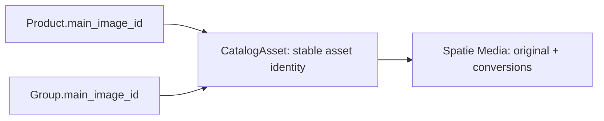

# Phase 1 Image Assignment Implementation Plan

> **For agentic workers:** Use `superpowers:executing-plans` only after the operator authorizes implementation. The operator requested independent sub-agent audits; preserve the same audit-only boundary during delegation. Checkboxes track future work, not completed implementation. This document authorizes no application, prototype, database, storage, deployment, commit or push changes.

**Goal:** Give catalog administrators a fast way to find Products, select a precise working set, move between records, and assign one managed main image to each Group or Product, individually or through a reviewed batch.

**Architecture:** Extend the existing Filament table/editor workspace. Keep image discovery and matching separate from authoritative record writes. Use the installed Spatie Media Library behind a reusable `CatalogAsset` identity, nullable `main_image_id` foreign keys on Products/Groups, and a durable review/item journal for partial results and safe retries. Accept at most 50 reviewed assignments per Apply and process them sequentially through on-screen requests; no background assignment job is planned. The operator selected this association design; reusable attachments are deferred to a later migration described in section 13.4. Implementation remains unapproved. The shared library manager belongs to phase 2.

**Tech Stack:** PHP 8.4.27; Laravel 13.35.0; Filament 5.9.0; Livewire 4.4.7; Spatie Media Library 11.23.9; Filament Blueprint 2.4.0; Pest 5.3.0. GD, Imagick and EXIF are available locally. Recheck the target environment before execution; no dependency changes are planned.

**Spec:** Operator decisions in this conversation through 2026-10-23; [interactive phase 1 prototype](https://aquestia-catalog-review.brinymoon2.chatgpt.site/image-assignment.html), reviewed version 11, source commit `b6395c56d4ab845baf2d80a89bbb115058db7573`; and the existing [admin contract](contracts/FILAMENT_ADMIN.md), [public catalog contract](contracts/PUBLIC_CATALOG.md), and [Product data foundation plan](PRODUCT_DATA_IMPLEMENTATION_PLAN.md).

**Readiness:** Review draft. The standalone version-11 prototype demonstrates the finalized search, selection, navigation, pagination and <=50-item on-screen Apply choices, including default 10, Custom 1–500, Stop/Continue and illustrative expiry/recovery. Its 92 passing Node tests and browser checks are prior prototype evidence only. This audit refresh updates the engineering plan, not the prototype. No application image functionality has been implemented. The reusable asset plus direct-FK design and the quiz choices in section 12 are confirmed planning decisions. The revised on-screen execution design below remains an engineering blueprint; implementation still requires separate authorization.

## Global constraints

- Phase 1 has **one main image per Group/Product**, using a reusable `CatalogAsset` and nullable `main_image_id` on each owner. Reusable attachments come later. No gallery, Attribute image, Product-property image, Group-tag image or Value image.
- Folders are import sources. Copy an approved file into managed storage; preserve its source original. An identifier such as `/ari/D60/D60EL01` is source data, not a public URL or permission to fetch a remote resource.
- Individual image changes follow the containing record's Save. Batch changes follow one reviewed Apply. Browsing, finding, matching and checking rows do not change current images.
- Replacing a record's image affects only that record or the explicitly reviewed batch selection. Never mutate a shared asset in place in phase 1.
- Keep the shared library manager, global replacement of a linked image, and its “change for this Product only” alternative in phase 2.
- Keep Product identity, Group membership, availability, configurator behavior, JSON data and legacy-import ownership intact. Image assignment must not rewrite `profile_fields["product_pic"]` or run automatically during ERP/data import.
- Use `manage-catalog` for administration, with fresh parent/list membership checks. Public image display follows current catalog availability; private import files and manifests remain administrator-only.
- Preserve exact stored codes, source keys and values, including leading zeroes. Search formatting and matching normalization affect comparisons only.
- Keep the compact table/editor layout, light/dark modes, keyboard access, responsive behavior and existing draft/stale-record protection.
- Scope enhanced controls to Group/Product image workflows and their selection/review tables. Do not silently change every admin table, Preview & Test search, the public catalog filters, or the separate catalog-tree redesign.
- Preserve unrelated checkout changes. `.ai/rules` was absent at this planning checkpoint; read it before execution if it has since been added. No new base directory or package is required.

**How to review this draft:** section 13 records the UX/structure review; section 14 reconciles the independent audit refresh, its evidence and remaining verification gates. Sections 2–3 describe finding and navigating records; 4–6 cover managed assets and finding source files; 7 covers reviewed batch writes. Section 13.4 records the selected direct-FK association design and the later attachment migration boundary. Planning the generic asset foundation does not enable PDFs, galleries, additional entity types, or a library manager in phase 1.

## Review focus

1. A search or page-size change must not select new Products, drop checked Products, switch the open editor, or commit an image. Tasks 1–2 cover this with hidden selections and pagination boundaries.
2. A digit can match the family prefix. `el 6` must include `D60-EL-P10-01` because its code contains both fragments. Task 1 distinguishes this from semantic pressure parsing.
3. Duplicate file stems, ambiguous candidates, changed files and two source names with identical bytes must not acquire an arbitrary winner. Tasks 3 and 5 cover exact identities and revalidation.
4. A stale editor, denied operation, copy failure or retried request must preserve the previous image and avoid a false success or duplicate assignment. Tasks 3–6 cover the complete write lifecycle.
5. Sharing one imported image between several records must not turn a one-record replacement into global replacement or introduce one media query per card. Tasks 3, 6 and 7 cover link isolation and bounded display queries.

## 1. Confirmed workflow and delivery boundaries

| Job | Entry | What the administrator does | Authoritative completion |
| --- | --- | --- | --- |
| Set one main image | Group/Product editor | Upload, find in an import source, find by filename, or find from the Product reference; compare current/proposed | Save record, or Save & next |
| Work through several Products | Existing Products table and adjacent editor | Search, check Products, open a Product, move through Results or Checked | Each record's explicit Save; navigation alone writes nothing |
| Assign one file to many records | Checked Group/Product rows | Choose a file once, choose fill-missing/replace, inspect proposals/exclusions, choose up to 50 for This Apply | Apply that exact subset through on-screen requests |
| Match different files from a folder | Checked Product rows | Choose/upload an import folder, field and filename recipe; review exceptions and choose This Apply | Apply at most 50 reviewed ready assignments at a time |
| Recover an interrupted/partial Apply | Same review/result panel | Reconcile recorded results, explicitly Continue unfinished rows, retry eligible failures or rebuild stale review | Per-row committed results; no automatic restart after return |

The current prototype demonstrates these interactions with sample data only. Its 92 passing Node tests and browser checks are prototype evidence; they do not prove Laravel image persistence or concurrency behavior. The application's meaningful acceptance tests are specified in section 11.

Use real D60 examples without assuming historical counts are current. The earlier inspection recorded 501 Products, 125 reference stems and 130 supplied 180 × 180 JPEGs. Re-run a read-only inventory before an eventual import. These are temporary thumbnail sources, not evidence of high-resolution product photography.

## 2. Search, table selection and pagination

### 2.1 Compact search controls

Keep one search input. Put a **Search in** dropdown before it and one **Options** dropdown after it. Neither opens a modal. Display the active rule in a short line below the input; show the result count and highlight matching text. Dropdowns close with Escape/outside click, return focus to their trigger and fit the visible viewport.

| Setting | Choices and exact semantics | Initial value |
| --- | --- | --- |
| Search in | Product code, Product name, Image reference, Group; multiple targets are allowed. Filename is also available inside batch review. Group tables use Name and Legacy ID; do not invent a `groups.code` column. | Product code; Group Name in Group context |
| Combine fragments | **All:** every whitespace-separated fragment appears in at least one selected target. **Any:** at least one fragment appears. Order is irrelevant. With multiple targets, fragments may be satisfied by different selected fields. | All |
| Match style | Contains, Starts with, Ends with apply to each fragment in each selected target. Whole value compares the entire entered search text to an entire selected target; All/Any is then inapplicable and disabled. | Contains |
| Code parts | Entire code, or explicitly selected 1-based hyphen-delimited segments. Label segment choices with a real example, such as `1: D60`, `2: EL`, `3: LP6`, `4: 01`. Several selected segments may satisfy different fragments. No pressure/type meaning is inferred. | Entire code |
| Letter case | Ignore case or Match case | Ignore case |
| Formatting | Ignore spaces, hyphens and underscores **within each fragment/target comparison** by default; Options offers literal matching. Split entered whitespace into fragments first, then normalize each fragment/target. This never edits the stored code. | Ignore separators |
| Exclude | Exclude a record if any entered exclusion fragment is contained in any selected target, using the same case/formatting/segment scope. The label says “Exclude containing any fragment.” | Empty |
| Quick filters | Saved image: Any / Missing / Has image; Group selection; Checked only. Group choices use a searchable multi-select when necessary. Filename-match outcomes appear only after a source preview exists. | Any image, all eligible Groups, Checked only off |
| Paste exact codes | Expand a small textarea inside Options. Newlines, commas or semicolons separate complete codes. Limit results to that exact list, report found/missing/duplicate codes, and allow the normal search to narrow it further. Never fuzzy-select a nearby code. | Empty |

Examples that must survive implementation:

- `el lp6 4`, All/Contains/Code → includes `D60-EL-LP6-04`; excludes `D60-EL-P10-04` and `D60-EL-LP6-01`.
- `el 6`, All/Contains/Entire code → includes `D60-EL-LP6-01`, `D60-EL-P10-06` **and** `D60-EL-P10-01`. The last match is intentional: the family prefix contains `6`.
- `lp6 p10`, Any/Contains/Code → includes either fragment; excludes a code containing only `P16`.
- Code + Name, `el combination`, All → can find `EL` in the code and `Combination` in the name. Code-only search cannot use the name to satisfy the second fragment.
- A restricted segment search must highlight only the searched segments, even when the same digit appears elsewhere in the code.
- `d60ellp604` matches `D60-EL-LP6-04` with default separator normalization; literal mode does not. Segment extraction precedes normalization, and highlights refer back to the original displayed code.
- A nonempty query whose fragments normalize entirely to empty text, such as `- _`, returns no matches with an explanation; it must not silently become an empty search selecting every record. Blank/whitespace-only input remains the ordinary unfiltered query. Pasted exact-code lists compare complete stored codes without separator normalization; no fuzzy substitute or silent collapse of distinct codes.

Use bound SQL and a field allowlist. `%`, `_`, quotes and backslashes in user-entered fragments are literal input, not SQL wildcard instructions. Preserve existing table/list owner constraints with every OR branch. Do not send the complete Product corpus to the browser or introduce an external search service.

Keep numbered offset pagination for page entry, First/Last and first-visible-ordinal preservation. A separate keyset seek may resolve Previous/Next destinations; replacing the table with cursor pagination would change approved controls. Use the existing scoped ordering index where it helps, but separator-normalizing functions and `%contains%` may scan eligible rows. Inspect MySQL `EXPLAIN` and measured query time for representative fragments before adding generated columns/indexes; do not promise an ordinary code index accelerates those expressions.

These controls find records. They do not change the separate filename-association recipe: choosing Any fragments or Ignore case in Product search must not silently broaden automatic image matching.

The current Image reference target is the exact `profile_fields` key `product_pic`. The Product-data foundation is present in this dirty checkout: reuse `ProductFields::validKey()`/scoped options, `ProductFieldQuery::expressions()` for exact bound SQL keys, and the current Product editor/profile resolver. Preserve literal dotted/case-sensitive keys; do not introduce another bucket registry or query the removed `extra_data` column. Resolve available field options once per relevant context, not once per row or render closure.

### 2.2 Explicit selection

- Clicking a Product code opens its editor. Its checkbox controls batch membership. Distinct styling identifies the open row and checked rows.
- Provide **Select this page**, **Select all N matches**, **Clear selection** and **Checked only**. “Select all matches” materializes exact eligible IDs at that moment; it is not a live query that keeps expanding.
- Preserve checked IDs across pagination, search, filters and page-size changes. Show `12 checked · 5 outside results`; hidden selections are inspectable through Checked only.
- Selecting matches adds those IDs. Clearing the current page removes only its visible IDs. Clearing the selection is a separate explicit action.
- Keep Product and Group selections separate by entity/context. A Group-owned Product drawer cannot select foreign Products through search, pasted codes or restored state.
- Treat browser IDs as requests, not authority. Reauthorize and validate the complete explicit selection on review and Apply. Missing/ineligible IDs are reported; never silently substitute a different record.
- Checking a Product for the batch does not mean its eventual proposal must be applied. Review exclusions are a separate explicit set, preserved when another row is resolved or scope controls are reopened.

### 2.3 Pagination — prototype demonstrated, application not implemented

The page-size control offers exactly **5, 10, 15, 25, 50, 100, 200, Custom**. Use one compact dropdown near the list count/footer, with quick choices and an inline numeric input for Custom; no modal and no native Product selector.

**Confirmed defaults:** initial page size 10, retaining the installed table default; Custom accepts integers 1–500. The cap is configurable and visible beside the input. It is a rendering limit, not a batch-selection limit. No “All rows” option is implied.

- A preset applies in one click. Custom applies on Enter or **Use size**; typing alone does not repeatedly query the table.
- An invalid/empty/zero/negative/fractional/over-limit Custom value shows a local error and retains the previous valid size, results, selection and draft. Do not silently clamp or round it.
- Validate the raw Custom input before PHP scalar coercion. A transport method accepting only `int` can turn `1.5` into `1` before its validator runs. The public adapter takes raw input, accepts decimal whole-number text, then produces a bounded integer. Internal query methods use that validated integer.
- Display `51–75 of 501`, compact page navigation, Previous/Next, and accessible First/Last controls when appropriate. A page-number entry commits on Enter and validates against the current page count. Zero results display `0 results`, not `1–0`.
- Preserve the first visible ordinal when changing size: old page 3 at 25 rows starts at row 51; changing to 10 rows opens page 6. Clamp only if the refreshed result set has become shorter. Keep the currently open editor unchanged, including when its row moves off-page.
- Search/filter changes return the list to page 1. They retain checked IDs and the open editor. Size changes do not change the Results/Checked navigation scope.
- Store the chosen fixed/custom size per user and table context using the existing browser-profile/session mechanism. Restore and validate the custom value **before** evaluating pagination options; otherwise Filament drops a value absent from its option list. Two users or unrelated tables must not share this preference.
- Validate the effective page size again at the query boundary, including direct Livewire state changes and restored profiles. A forged `all` or `99999999` must never reach `paginateTableQuery()` as an unlimited/huge request.
- Use the same controls for the Product selection list and batch review list. Their sizes/pages are independent. Previous/Next **Product** continues across page boundaries; it is not limited to the current rendered page.
- Keep a canonical validated integer on opted-in hosts and guard the effective value read by `getTableRecordsPerPage()`; changing public `tableRecordsPerPage` directly must not bypass the cap. Its installed return signature is `int|string|null`, so any override must remain compatible. A supported initial null is a defaulting case, not a reason to admit a later forged `all`. Avoid copying the full native `paginateTableQuery()` implementation. Use the real table page name with `setPage()`/`resetPage()`; resolve trait method conflicts explicitly for each existing host.
- On narrow screens, keep the count, size and Previous/Next reachable; compact numbered links rather than introducing page-wide horizontal overflow. At 100/200/custom sizes, render one bounded page with lazy thumbnails; do not fetch image bytes for the whole batch up front.

The version-11 prototype demonstrates these controls independently for record selection and review. It also demonstrates invalid Custom input retaining the previous size, 25/page-3 → 10/page-6, selection/draft preservation, cross-page navigation and a 250-row illustrative sample. Its browser checks and tests establish prototype behavior only. SQL-backed pagination, profile restoration and the query-boundary cap still need implementation and application tests.

## 3. Record navigation and draft behavior

Place a compact navigation bar above the editor: current code, position, **Results / Checked**, Previous and Next. Results uses the table's current eligible search/filter/sort order; Checked uses all explicitly checked eligible IDs in that same sort order, including IDs outside current search results. Use `product_code, id` as the initial stable order; Group lists retain their existing order.

- Previous/Next traverses the entire relevant sequence, including other result pages. Reveal the destination row's page when it belongs to the current results. Never wrap silently at either end.
- If the open record is outside the current navigation scope, retain its editor and say so. Next opens the first eligible item; Previous opens the last. Both disable for an empty scope.
- **Save & next** performs the same full-record Save as Save, then advances only after a confirmed commit. It must not save only the image while leaving other edited Product fields behind.
- A dirty ordinary Previous/Next or row-open action shows a small inline choice: **Save & continue**, **Discard & continue**, **Stay here**. Do not add a confirmation modal or silently save/discard. Save failure retains the original record, draft and requested destination.
- Recheck destination membership/permission on opening. A disappeared or newly unauthorized destination is reported and skipped only through an explicit next navigation; it must not expose a foreign record.
- Keep the batch selection, search, size, page, scroll context and selected editor tab when returning from an image finder. Search/page operations alone do not unmount a dirty editor.
- Within batch review, Previous/Next inspects current/proposed images and the matching reason inline. It follows the visible review order. Choosing another candidate changes only that proposal; **Apply** remains the sole batch write.
- Image upload/selection/removal state participates in the existing dirty fingerprint, stale-record event handling and navigation guards. A pending private upload alone must not bypass them.

## 4. Storage and image identity

### 4.1 Locations

| Purpose | Proposed location | Access and lifecycle |
| --- | --- | --- |
| Administrator-supplied import folders | `storage/app/private/catalog-asset-imports/<source-id>/` | Private source files; friendly source names in the UI. Read/copy only during matching/import. |
| Current D60 folder | `public/demo/D60--temp_images/` | Existing local, explicitly allowlisted one-time source. It can be read in place; moving it is not a prerequisite. Its current public location does not make the future inbox public. |
| Temporary uploads/private previews | Existing Livewire temporary storage, then actor-owned files/manifests below the private import area | Signed/authorized preview; no public static URL. Uploading a candidate does not associate it. |
| Managed originals | `storage/app/public/catalog-assets/<media-id>/<safe-filename>` | Dedicated `catalog-assets` disk; public catalog images served through the existing storage link. Independent of source-folder availability after assignment. |
| Managed conversions | Same media-ID directory, `conversions/` and `responsive-images/` | Rebuildable derivatives; never overwrite the source original. |

**Confirmed retention:** retain uploaded sources and private working copies; no automatic cleanup or cleanup UI is implemented in phase 1. Operator-managed cleanup is an explicit operational action, not part of assignment. This retention covers staged inbox sources/working copies; it does not change native cleanup of transient Livewire temporary uploads. Never delete the existing D60 folder or managed files through this workflow. Removing a still-needed source must yield a clear missing/stale result on later review/Continue, not a replacement candidate.

Configure the two storage roots with `throw => true` in `config/filesystems.php` and import policies/source labels in a new `config/catalog-assets.php`. Use ordinary local disks; no scoped-filesystem dependency is needed. An S3 move is not part of phase 1.

Use a model-specific `App\Services\CatalogAssetPathGenerator` implementing `Spatie\MediaLibrary\Support\PathGenerator\PathGenerator`. Register it through `media-library.custom_path_generators` for `CatalogAsset` only. It returns `<media-id>/`, `<media-id>/conversions/` and `<media-id>/responsive-images/`. Leave the existing global prefix/path generator/disk behavior intact for older media.

Every source import uses the installed copy-preserving API, such as `addMedia($validatedPrivatePath)->preservingOriginal()->toMediaCollection('preparation-attempts', 'catalog-assets')`, followed by fenced publication of the exact attempt Media identity as `original` (4.4). Spatie moves/removes a source by default without `preservingOriginal()`; it is mandatory here.

### 4.2 Proposed schema — reusable asset plus main-image foreign keys

**Association decision confirmed:** use `CatalogAsset` plus nullable `main_image_id` foreign keys on Products and Groups in phase 1. Reusable attachment tables/relationships belong to a later, separately specified migration. The detailed schema below makes that decision concrete for review; it does not authorize scaffolding or migrations.

These are implementation proposals needed to make the plan concrete. They do not introduce a library-management resource or navigation item.

| Model/table | Fields and constraints | Relationships/responsibility |
| --- | --- | --- |
| `App\Models\CatalogAsset` / `catalog_assets` | `id` unsigned bigint PK; nullable `created_by` user FK with null-on-delete; `source_kind` varchar(20), allowed `upload`/`folder`; `source` non-null JSON provenance; `sha256` char(64); nullable unique `import_key` char(64); `preparation_status` varchar(12), `preparing`/`ready`/`failed`; nullable `preparation_token` ULID and `preparation_expires_at` timestamp; nullable unique `original_media_id` FK to existing `media.id`, restrict-on-delete; nullable `prepared_at` timestamp; timestamps | Implements `Spatie\MediaLibrary\HasMedia`, uses `InteractsWithMedia`; one authoritative `original` media file on `catalog-assets`, selected by `original_media_id`; isolated unfinished attempt Media may coexist without becoming attachable. Product/Group references point to this stable image identity, **not** directly to the Media ID. No checksum uniqueness/global deduplication. |
| `App\Models\CatalogAssetImportSource` / `catalog_asset_import_sources` | ULID PK; nullable indexed `actor_id` user FK null-on-delete; `source_kind` varchar(20); `source` JSON with configured alias or actor-owned inbox descriptor; `scan_version` unsigned integer; `status` (`uploading`/`scanning`/`ready`/`stale`/`failed`); server-owned `cursor` JSON with committed fragment references; `scan_revision` unsigned integer default 0; server-owned traversal-complete/upload-sealed flags and unsettled-upload count; nullable `scan_token` ULID and `scan_expires_at` timestamp; counted files/bytes/visited entries; nullable final `manifest_path`/`manifest_sha256`; bounded error code/detail; timestamps | One durable source scan, also usable by the individual finder. Private versioned manifest fragments hold entry metadata; no SQL entry table or library navigation. New scan versions never mutate an already reviewed manifest. |
| Existing `products`, `groups` | Nullable indexed `main_image_id` unsigned bigint FK → `catalog_assets.id`, restrict-on-delete | `mainImage(): BelongsTo`. Existing rows start null. Do not backfill from `product_pic` automatically. Do not accept raw `main_image_id` mass assignment from the browser. |
| `App\Models\CatalogAssetBatch` / `catalog_asset_batches` | ULID PK; nullable indexed `actor_id` user FK with null-on-delete; `target_type` varchar(40), phase-1 allowlist `product`/`group`; `role` varchar(40), phase-1 value `main_image`; `operation` varchar(20), `one_image`/`folder_matches`; `status` varchar(20); `recipe` JSON; source ULID/version reference; private frozen-scope path/hash; unsigned build position/revision and nullable build token/expiry; `manifest_path` varchar(1024); `manifest_sha256` char(64); `preview_version` unsigned integer default 1; `expires_at` timestamp; nullable `pending_apply_intent` JSON; nullable indexed `active_acceptance_id` ULID; timestamps | `items(): HasMany`; server-owned reviewed intent/source manifest. Actor deletion/revoked permission stops processing. No separate batch-management navigation. |
| `App\Models\CatalogAssetBatchItem` / `catalog_asset_batch_items` | Unsigned bigint PK; indexed batch ULID FK restrict-on-delete; `record_id` unsigned bigint; unique `(batch_id,record_id)`; `position` unsigned integer; `record_fingerprint` char(64); nullable `before_asset_id` and `prepared_asset_id` image FKs restrict-on-delete; `snapshot` JSON; `included` boolean; nullable indexed `acceptance_id` ULID, nullable `accepted_preview_version` unsigned integer and `accepted_at` timestamp; nullable `processing_token` ULID and `processing_expires_at` timestamp; `match_status` varchar(20); `apply_status` varchar(20) default `pending`; `attempts` unsigned integer default 0; nullable `error_code` varchar(64), `error_detail` text and `applied_at` timestamp; timestamps | Parent batch target/role determines the allowlisted target model and its main-image pointer. Snapshot contains exact source value, derived identifier, candidate-set reference/count and chosen key; large candidate lists are paged, not copied into every row. Separate match/execution states prevent “ready” being mistaken for “saved.” |

Batch statuses: `building`, `review`, `accepted`, `completed`, `partial`, `failed`, `expired`. Match statuses: `ready`, `existing`, `missing`, `ambiguous`, `invalid`, `suggestion`. Apply statuses: `pending`, `processing`, `applied`, `unchanged`, `failed`, `stale`, `skipped`. A processing item has a fenced short-lived claim; a closed browser must not leave a permanent running state. Validate these fixed values server-side; no browser-supplied class names/table names.

The journal is justified by frozen review, partial results, lost-response reconciliation and explicit retry/Continue after returning. It does **not** imply independent work after page closure. Do not reuse the existing all-or-nothing `BatchCatalogChanges` transaction for external file writes.

`pending_apply_intent` holds one server-issued intent `{id, preview_version, item_ids, issued_at}` for the actor-owned review, with at most 50 ordered item IDs. Issue it before the browser sends Apply, so a lost Apply response can be retried with the same identity. Changing This Apply creates a new intent; it cannot alter an accepted subset. On acceptance, stamp those items with the intent ID/version/time and set `active_acceptance_id`; then clear the pending intent. Accepted membership is the indexed `(batch_id, acceptance_id)` item set. Completed stamps remain for reconciliation; do not overwrite/relabel them when accepting a later subset. One unfinished accepted subset is allowed at a time. No extra acceptance model or growing JSON history is needed. Guard one active acceptance under the batch lock for every Apply, Continue and Retry; retrying an older acceptance cannot interleave with a different unfinished one. Clear/switch `active_acceptance_id` only through that guarded transition, retaining all item stamps.

### 4.3 Asset behavior

- Import a given chosen file once per batch and reuse that prepared image ID for records explicitly matched to that same file. Key idempotency by the batch/source-entry identity, not filename alone or image appearance.
- Distinct source entries with identical bytes remain distinct identities unless the administrator explicitly chose the same file. In particular, do not merge differently named D60 references because their photographs happen to be byte-identical.
- In phase 1, replacing/removing an association only changes the selected record's pointer. Keep the previously managed image; never delete a file still linked elsewhere. No automatic managed-image purge, source-folder deletion or batch-history retention policy is introduced.
- A file copy and a SQL transaction are not one atomic operation. Validate/stage before catalog locks; track newly created media paths so a failed attempt cannot be mistaken for a completed assignment. Never compensate by deleting an existing/shared image. An unreferenced copy after a process crash is a diagnostic/cleanup item, not permission to delete unrelated media.
- Give prepared assets an explicit lifecycle. A unique import key alone does not prove its file exists. `preparing`/`failed` assets cannot be attached; `ready` means the managed original exists and matches the reviewed digest. A retry verifies the explicit winner media row/file before reuse. Recovery may leave isolated incomplete attempt bytes, but only the fenced winner becomes the authoritative original (4.4). This is source-import recovery, not library-wide replacement.
- Confirmed accepted inputs: JPEG, PNG and WebP; maximum **3 MiB/file (3,145,728 bytes)** and **25 megapixels** after decoding. Reject mismatched MIME/content, SVG, undecodable/truncated files and oversized dimensions before association. Apply the same confirmed limits to uploads and existing-folder candidates; the selected source does not bypass validation. These limits are configurable, but changing the agreed defaults is a separate decision.
- Preserve the original. Prepare non-upscaled contain-fit derivatives at 160, 480 and 960 pixels using installed `Spatie\Image\Enums\Fit::Max`; register these asset conversions with `->nonQueued()`. All conversion attempts occur in the bounded preparation request before catalog locks; no conversion job or hidden post-commit processing is introduced. A valid managed original remains usable if a derivative fails; fall back to it and record that derivative failure. No automatic background repair is promised.
- Show filename, measured dimensions, source and a low-resolution note in administrator previews. Do not upscale the supplied 180 × 180 images or imply they are high-resolution originals.

### 4.4 Preparation ownership and publication — audit correction LA-01

An item claim protects the eventual association; it does not protect shared file preparation. Individual Save retries and different batch rows referencing one source entry must use the **same per-import-key protocol** in `CatalogAssetStorage`:

1. Enter without an ambient database transaction on the asset/media connection. Resolve/create the unique import-key asset row, then briefly lock it. Return a verified ready winner, return Busy for a live preparation owner, or claim an incomplete/failed/expired preparation with a new random token and lease. Duplicate-key races reread that same row; they do not create another logical asset. Commit the claim before file work.
2. Use an attempt-specific private working path and a distinct Media row/path for that token. Import into `preparation-attempts`, with server-written asset/token provenance in custom properties. Capture/reconcile the attempt Media identity even if `addMedia()` throws after saving its row or copying the original. Never infer “no file was created” from a missing return value.
3. Verify working-copy and managed-original digests against the reviewed entry; validate MIME, dimensions and actual decode before attachment. Attempt the three bounded non-queued conversions. A conversion exception can occur **after** a valid original was copied: distinguish that warning from original-copy failure, retain the valid original, record missing conversions and use original fallback. Missing `generated_conversions` flags never count as derivative success. No responsive-image generation job or deferred/post-response conversion is enabled for this asset.
4. In a short transaction, lock the asset and verify the current preparation token, owned attempt Media ID and digest evidence. Promote that exact Media row to `original` and set `original_media_id`, `ready`, `prepared_at` atomically. Media-ID-based paths do not move during publication. No catalog locks or owner pointer writes occur here. Reusing a ready asset reads its explicit winner, never an arbitrary first collection item.
5. An expired preparer can finish writing only its own isolated attempt path. It cannot publish readiness, mark a newer attempt failed, clear a collection, delete/rewrite the winner, or alter an association. Every ready/failure/lease transition is token-fenced. Never use `singleFile()`, `onlyKeepLatest()` or collection-clearing as a lock: Spatie's collection-limit cleanup may delete another attempt after its copy completes.

Keep attempt paths immutable after their successful publication. A valid ready asset is not overwritten to repair a missing/corrupt original in phase 1; report the storage problem and require operator recovery. Abandoned attempt Media/working copies remain diagnostic records under the confirmed operator-managed retention policy. Exactly one **authoritative** original is promised; a process crash may leave additional unreferenced attempt bytes. No automatic purge or destructive compensation is introduced.

The preparation lease starts at the same provisional 60 seconds as an item claim; set its final value above the measured request bound with margin, or renew only through a still-owned token before the next expensive step. A lease is a recovery signal, not proof the older PHP process stopped. Fencing and isolated paths remain necessary even with correct timing. Do not hold a SQL row lock for a decode/copy or add a cache-lock dependency.

## 5. Main-image field

Place one **Main image** field in the existing Details tab, full width, with a bounded contain-fit preview and filename/dimensions. Keep the Product code/name and relevant image reference nearby. In a narrow editor, stack the controls; retain a compact Save/Save & next footer.

| Action | Behavior before record Save |
| --- | --- |
| Upload image / Replace image | Open the OS file chooser, validate and stage privately, then show Current → Proposed. Replacing has no effect on other linked records. |
| Find in folder | Expand a contextual finder beside/below the field. Choose a configured source and search filenames; show candidates without a second product-selection modal. |
| Find by filename | Same finder with filename input focused; one deliberate candidate choice stages the proposal. |
| Find from Product field | Read the selected exact Product field and chosen recipe. One exact eligible candidate stages a proposal; ambiguity/contains opens candidates. Do not save automatically. |
| Remove image | Stage a null association. Keep the managed file and current association until Save succeeds. |
| Revert | Restore the saved association and clear the pending image intent; preserve other unsaved form edits. |
| Save / Save & next | Submit the containing record, including the image intent, through its authoritative writer. |

Keep operation state explicit: `keep`, `set`, `remove`. An absent image input means keep; a null/missing upload must not accidentally mean remove. Source/upload tokens are actor-owned and target/context-bound. Strip these transport fields before the existing strict Product/Group field whitelist is validated.

For an individual Save, issue an actor/target-bound server draft-intent ID when the image proposal is staged; retain it across validation failures, request retries and reloads that preserve that same draft. Derive the import key from actor, target/creation-intent ID, source entry and reviewed digest. Changing the candidate creates a new intent. A new Group's source token binds to that form's creation-intent ID, and the writer associates the prepared asset only to the Group created by that Save; never accept an arbitrary browser owner ID. This is image-preparation identity, not a replacement for existing Group-create semantics.

Support Group creation through the existing CreateGroup flow with the same single final Save. Product creation/deletion and changing Product Group remain outside scope. In count/item drawers, retain current parent membership checks, editor tabs and list boundaries.

**Installed save ordering and preparation split:** Filament `EditRecord::save()` authorizes, begins its optional outer transaction, validates/form-dehydrates, calls `beforeSave`, mutates data, invokes `handleRecordUpdate`, calls `afterSave`, commits, then sends the saved notification. `afterSave` alone is **not proof of commit**. Do not call managed preparation inside that outer transaction or a retried writer closure: SQL rollback can remove asset/media/claim rows while leaving copied bytes. On explicit Save/Save & next, first validate the draft and prepare its current image intent through a separate ordinary request whose asset/media readiness commits independently; only then invoke the existing full-record Save in the next ordinary request. The Save revalidates/reauthorizes the full form and resolves that same actor/target/intent-bound ready asset internally. Browsing/uploading/selecting alone never publishes a managed copy. This is one visible completion action with two request stages, not a second image Save button. Freeze the submitted draft revision while these stages run, or reject a changed revision without navigating. A later stale/failed full Save retains its draft and the unassociated prepared asset; SQL rollback does not delete it.

Extend `SaveCatalogProduct` and `SaveCatalogGroup`, rather than introducing a second form persistence path. Keep Product's fingerprint comparison under its row lock. Add an expected fingerprint for image-changing Group edits under the Group lock; the existing pre-save UI check alone is insufficient. Existing non-image callers keep their current behavior. For a new Group, bind its staged image to that creation intent rather than requiring an existing record ID.

Only after the containing transaction commits may Save & next clear the draft, refresh the table and open its verified destination. A halted save, validation failure, authorization failure or stale fingerprint keeps the draft and focus in the current editor, with no success notification/navigation.

The form carries `image_intent = {operation: keep|set|remove, source_token: string|null, draft_intent_id: string|null}` plus a transient `image_upload` field. It does not carry a writable managed-image ID. A successful full Save emits `catalog-image-save-committed` to its own host with entity, saved record ID and a server-validated pending destination; schedule it through the current database connection's after-commit hook. Keep the existing ordinary editor events, without interpreting their pre-commit hook timing as permission to navigate.

## 6. Folder sources and filename matching

### 6.1 Choose or upload a source

The source dropdown lists configured friendly names and actor-owned uploaded sources. It is an import-source chooser, not a filesystem browser or shared managed-image library. No arbitrary server absolute path can be typed by the browser.

**Upload folder** uses a native directory-capable file input with multiple files and the installed Livewire upload API. Preserve relative paths as untrusted metadata. Do not confuse Filament's `directory()` destination setting with a browser directory chooser. Where directory selection is unsupported, offer multi-file upload into one named source. ZIP extraction is outside phase 1.

Upload progress, rejected files and retry are inline. Confirmed bounds are 2000 files, 500 MiB per source and 5000 selected/reviewed records. At most **50 assignments per Apply** may be accepted; page size, selection/review size and Apply size are independent limits. Use one file per upload request initially (maximum 3 MiB plus bounded metadata), sequentially; reserve/check cumulative source counts and bytes idempotently so concurrent/retried uploads cannot exceed the cap. Upload completion is separate from scan/review completion. Oversized sources report their limit before association and do not silently truncate.

Server-side source resolution must canonicalize paths within an allowlisted root, reject traversal/NUL/absolute client paths and symlink escapes, and require real files. Use a separator-aware root-boundary check. Browser-supplied `webkitRelativePath`, folder labels and filenames never establish filesystem authority. Preview private bytes through a signed/authorized route; never expose the private inbox with a public storage link.

For uploads, store bytes under server-generated source/entry IDs; keep the original filename and relative path as separate matching metadata. Associate each returned Livewire temporary-upload ID with its entry key explicitly, rather than assuming filenames are unique. Prepare an immutable private working copy and verify its digest **after copying** against the reviewed manifest; importing a path that was hashed earlier must not accidentally copy newer bytes. The managed copy is made from that verified working copy. A changed original after that point cannot change the reviewed bytes being assigned.

Add `admin.catalog-asset-sources.preview`, served by `CatalogAssetSourcePreviewController`, with authentication, a short-lived signed request, `manage-catalog` and actor/source-entry ownership checks before streaming. Return 403/404 without file bytes for a denied/missing entry. Upload/finder controls must not expose a reusable absolute-path parameter.

### 6.2 Incremental on-screen scans — audit correction LA-02

Choosing/uploading a source starts an actor-owned scan journal. **Start → Scan next → status → finalize** are ordinary sequential requests driven only while its visible workspace is active. Show files examined, valid/invalid/skipped, bytes, current stage, Stop after current and explicit Continue. Do not claim an exact percentage while enumeration has no final total. Closing or a lost response stops scheduling more requests; reopening reads committed scan status before continuing.

`CatalogAssetSources` owns the source row, safe traversal, partial-manifest fragments and final manifest. Each scan step claims a server cursor/revision under a short source lock, releases the lock for I/O, and publishes an immutable token-specific fragment plus its counts/cursor only if the claim still belongs to it. Replaying the same step returns its committed progress; it never appends/double-counts entries. A late old scanner cannot replace the newer manifest or move its cursor. Uploaded entry metadata is accumulated as each bounded upload succeeds; do not hash all uploaded files again in one final request.

**Initial engineering budgets, configurable and subject to measurement:** at most 100 new directory entries and at most 10 file hashes / 16 MiB of file bytes per scan request; a soft 500-ms work budget stops before starting the next file. A single allowed file may exceed that soft time, so this is not a hard execution-time guarantee. Scan MIME/header/dimensions and hash by streaming; full decoder validation and conversions happen only for the chosen image during its one preparation request. Review labels must not imply header inspection proves complete decoding. Before launch, measure worst allowed files and set proxy/PHP/image-driver limits so one preparation request is safe; keep one decoded image live at a time.

For this **local-disk phase**, persist a traversal frontier, directory identity/mtime and ordinal/name-prefix signatures. Reopening a directory may replay cheap names to the stored position; that replay is separately bounded by a maximum visited-entry budget. Never serialize a PHP iterator, assume Flysystem listing order is stable, or hide a full `allFiles()`/sorted `toArray()` listing behind a cursor. Detect a changed directory/order, replaced file or symlink and mark the scan stale; do not silently skip/duplicate names. Proposed defensive traversal budget: 4000 visited nodes and depth 16, including directories and ignored/unsupported entries; hitting it rejects the scan with an explanation, rather than returning a partial source. Verify replay cost on a single wide directory and deep folders; if the bound cannot be honored, stop that source and revise this scanner rather than claiming scalable cursor support. The approved accepted-source caps remain 2000 files / 500 MiB, checked cumulatively across requests, without silent truncation.

Finalization is metadata-only: require server-recorded traversal exhaustion, a sealed upload source with all reserved uploads settled when applicable, and no unresolved scan/upload claim. Verify all committed fragments/aggregate caps, then write and fence one canonical immutable manifest/hash and set the source ready. An early/forged finalize call is rejected even when the partial counts are within limits; it cannot turn the first chunk into a complete source. Review cannot start from a scanning/failed/oversized source. The manifest is reviewed evidence, **not an atomic snapshot of an externally editable folder**; later preparation still copies the chosen entry privately and verifies the copied digest. A source mutation requires a new scan/version and review. Existing reviewed/accepted manifests never gain newly found files.

### 6.3 Recipe

Keep matching controls close to a live `raw field → identifier → filename` example. Default to `profile_fields` / exact key `product_pic` through the current field resolver, extracting the final path component without an image extension. Product code is an alternative source.

| Method/control | Contract |
| --- | --- |
| Exact filename stem | Ignore-case, leading-zero-preserving comparison by default; offer optional case-sensitive matching. Remove only recognized image extensions, from the final path component. Do not interpret URLs, query strings or remote schemes as a fetch request. |
| Adjust format | Explicit case-sensitive and ignore-space/hyphen/underscore controls, visibly reflected in the example. Do not coerce digits/numbers or silently strip leading zeroes. |
| Code segments | Explicit ordered 1-based hyphen-separated positions. `D60-EL-LP6-01` with `1,2,4` yields `D60EL01`. Missing/repeated invalid positions fail recipe validation rather than silently dropping parts. |
| Prefix/suffix | Add literal expected filename affixes, such as `ARI_` and `_front`, before the selected comparison normalization. |
| Contains | Generate candidate suggestions only. Even one candidate needs explicit per-record confirmation. |
| Include/exclude files | Comma/semicolon-separated filename/relative-path wildcard patterns using `*` and `?`; exclusion wins. No raw regex authoring or executing filename expressions. |
| Include subfolders | Explicit toggle; the preview reports its setting and which relative file paths participated. |
| Manual override | An explicitly chosen valid candidate wins for that row, including one outside the current automatic filename filter/source. Label it “Manually chosen” and validate its owned source token. It is not automatic evidence that the recipe worked. |

`D60-EL-LP6-01` → `/ari/D60/D60EL01` → `D60EL01.jpg` is the primary verified example. The supplied data also has `D60-EL-LP6-04` → `/ari/D60/D60EL03`; do not assume the final code segment must equal the image suffix.

One source file can legitimately serve several Products. Multiple files sharing a stem under the selected comparison, including case-only differences, `.jpg` versus `.png` or different subfolders, are **ambiguous**. Never choose the first enumerated file. Missing, blank or non-text source fields are shown distinctly from a valid identifier with no matching file; source JSON remains untouched.

## 7. Batch review, Apply and recovery

### 7.1 Two entry actions

1. **Assign one image:** available for checked Groups or Products. Choose/upload one file, select Fill missing or Replace existing, then review the affected record rows. Per-row overrides remain possible.
2. **Match folder:** available for checked Products. Choose source/field/recipe and preview different image proposals. Group bulk assignment uses the first action; phase 1 does not invent Product-style property matching for Groups.

The default mode is **Fill missing**. **Replace existing** is explicit and still limited to the frozen selected records. Existing associations with the same prepared file are unchanged, not replacements to count as new writes.

Open the workflow inline within the existing table/editor area; preserve the source table and its state. The review contains outcome filters, the compact search controls, the improved independent pagination control, a row table, and an inline current/proposed inspector with Previous/Next. Do not stack selection → options → confirmation modals.

Keep the full preview/manifest on the server. The Livewire component carries the owned batch ID/version and current UI state; its table queries journal items and returns only one authorized page plus summary counts. Do not put all 5000 proposals, absolute source paths or 2000-file manifests into a public/locked Livewire property: locked properties are still serialized. Persist review inclusion/exclusion through explicit version-checked handlers. Progress comes back with each sequential processing response. Refresh status after an uncertain response or on explicit return; do not poll a resting image field, completed Apply or closed workspace.

Show a separate **This Apply: N / 50** scope inside the review. Keep review inclusion/exclusion distinct from that bounded scope. Provide explicit **Use ready rows on this page** and **Use next 50 ready rows** controls with their review order/count visible; they select only eligible, included, unaccepted proposals, never manual exclusions. Over-limit manual choices show an error; do not truncate or automatically chain into another set of 50. If a page contains more than 50 eligible rows, disable its whole-page shortcut and direct the operator to the explicitly labeled next-50 control. The button states the actual accepted count. A review of 5000 candidates must not require excluding 4950 rows merely to do one small Apply.

Each row shows: checkbox; Product code/Group name; raw reference and derived identifier; current image; proposed file/relative source path; matching outcome and explanation; change/resolve control. Show shared-candidate counts. List unused source files separately; they are not errors or implicit import instructions.

Match outcomes have separate labels: Ready to assign, Existing image kept, No matching file, Choose a match, Invalid image, Confirm suggestion. An administrator can exclude a ready row. Resolving another row, closing selection controls, changing result filters or returning from a candidate finder must not reselect an excluded row. A newly resolved row can be included explicitly without restoring unrelated exclusions.

### 7.2 Server review and on-screen Apply

- Preview freezes exact record IDs, owner context, manifest/hash, raw values, current pointers, fingerprints, recipe and candidates. Accepting a new subset requires a review younger than **24 hours**. Expiry deletes no bytes and does not cancel an already accepted subset.
- Manual overrides enter the reviewed manifest explicitly. Files added afterward do not join the run; changed/disappeared chosen files fail freshness checks.
- Before any acceptance, source/recipe/mode/override changes create a new review version. After an acceptance, its source context, recipe and accepted item snapshots are immutable. Changing those rules then creates a new review journal for the remaining/stale records; existing accepted results stay available. Inclusion changes to unaccepted rows can version the current review without mutating accepted rows.
- This Apply contains **1–50** exact ready, included, unaccepted journal items. The server issues the bounded actor/batch/version-bound intent before submission. Apply reauthorizes, locks the batch, checks intent/version/expiry, freezes membership and stamps acceptance once. A repeated accepted intent returns its recorded status; it cannot create another acceptance. Unknown, stale or over-limit intent changes no pointers.
- After the acceptance transaction commits, the visible browser calls `processNextImageAssignment()` sequentially and awaits each result. One request processes at most **one** accepted item, chosen server-side. No `#[Async]`, `.async`, queue job, detached HTTP call or browser request fan-out is used.
- The next-item Action briefly locks Batch → Item to find or claim the next accepted row. If this acceptance has an unexpired processing claim, return Busy/current progress; a second tab cannot advance another row. Commit/release these locks before source/file work. Record a random processing token and expiry; initial engineering lease is 60 seconds, subject to real request-duration checks with margin or renewal.
- Reauthorize owner/list membership; recheck source identity/digest; prepare the managed file before catalog locks. Reuse the same source/import identity. The authoritative writer then takes Groups → Product where applicable → Batch → Item locks, rereads fingerprint/pointer and verifies the current processing token. Commit pointer, catalog revision and item result atomically. Never hold Batch/Item locks while acquiring catalog locks in the claim/acceptance paths.
- Every success or failure update is fenced by the current processing token. If a request dies, an expired claim can be reconciled/reclaimed explicitly; the older handler cannot subsequently commit an association or overwrite the replacement result. Completed items return their recorded outcome rather than replaying a write. An uncertain response requires reading the journal before retry.
- A row's failure leaves its previous image intact and does not undo other committed rows. Stale records/sources require fresh review; never compute a new candidate and silently apply it. Only isolated row failures can continue to later rows; session/authorization or infrastructure failures pause the request loop under 7.4.
- **Stop after current**, navigation, page teardown or closure prevents the browser from issuing further processing requests. A request already in flight may still commit. No cancellation/rollback promise is made. Returning loads the journal and requires explicit **Continue**; accepted membership does not expand.
- An accepted subset can Continue after the 24-hour preview deadline, with all authorization/source/fingerprint checks still enforced. Unaccepted proposals need fresh review before another Apply after expiry. Completing 50 does not automatically accept/process the next 50.

Retain the last review ID per actor/table context and show **Return to image review**. Opening it reloads recorded results and the active acceptance; it never starts processing automatically. Store only that ID as the local return pointer. No separate library/history manager or notifications are added.

The preparation request also attempts the three non-queued image sizes, with independent ownership/publication from the item claim (4.4). Verify real upload/web/PHP/decoder limits and per-row preparation time before execution. If the environment cannot honor those bounded requests, resolve it explicitly; do not silently reintroduce background jobs or change approved file limits.

Review construction is also bounded. Freeze the explicit IDs once, then build journal proposals in sequential chunks of initially at most 100 records/request using an idempotent server cursor and unique `(batch_id, record_id)` rows. The source/recipe/version is immutable for that build; claim/fence cursor updates, and leave Apply disabled until the entire chosen scope is reviewed. A lost response returns committed chunk progress. A build step also carries its expected build revision, distinct from the recipe/preview version; replaying an already committed revision reconciles status without advancing another chunk. Proposal rows and cursor advancement publish atomically under that revision and claim. Stop/close/Continue follows the same on-screen rule; no scheduled scanner or review-building job is introduced.

Build a normalized `stem → entry keys` index once per manifest/recipe version, with collision groups intact. Exact matching reuses that index; it never rescans/hashes/decodes a source for each Product. Persist a candidate-set reference/count instead of repeating 2000 keys in each of 5000 rows. The inspector pages candidates for its one open row. Contains/wildcards use bounded work/candidate paging with honest counts; they must not materialize a 10-million-pair cross-product. Measure worst-case Contains collisions separately from ordinary exact matching.

### 7.3 Completion, interruption and retry

Report assigned/unchanged, existing kept, excluded/deferred, stale and failed counts separately. Show counts for **This Apply** and the larger review so 50 completed rows never imply all 5000 are done. Unaccepted ready rows are deferred, not failures or implicit instructions to continue.

**Continue** handles only accepted, unfinished rows after status reconciliation. **Retry failed** handles eligible failures from that same acceptance, revalidating original assumptions. Applied/unchanged/excluded rows stay untouched; no new acceptance identity is assigned to a completed row. Retrying an older terminal acceptance is rejected while a different acceptance is unfinished; switch it back to active only through the same batch-lock guard after the other subset is terminal. Stale rows require a new review. Preserve the server-issued acceptance ID, item result and source-import key across lost responses so repeated requests cannot duplicate media, pointer writes or revisions.

After the active subset is terminal, the operator may explicitly select another up-to-50 subset from the unaccepted ready rows and press Apply. Preserve prior acceptance stamps/results. Exclusions stay excluded. Recipe/source changes use a new review as specified above.

Emit current `catalog-batch-applied`/editor-refresh conventions only for committed affected IDs. Clean matching editors may reload; dirty matching editors become stale while retaining their drafts. Unrelated editors do not refresh.

### 7.4 Error and retry contract

All source/preparation/item adapters return documented shapes with stage, outcome code, safe message, correlation ID, retry/next action, committed progress and current owned version/claim context. IDs are server-resolved; raw exceptions/paths/manifests are not response data.

| Condition | Operator feedback and server behavior | May process a later accepted row? |
| --- | --- | --- |
| Valid committed result | Applied / Unchanged from journal; duplicate request returns that result | Yes |
| Live claim / competing retry | Busy with committed progress; no failed status, attempt increment or tight polling loop | No; reconcile/wait, then explicitly Continue |
| Lost/aborted response or timeout | Outcome unknown; stop issuing requests and read journal/source/preparation status before any retry | Only after reconciliation and explicit Continue |
| Invalid image / row-local copy issue / missing owner / stale fingerprint or changed source | Preserve previous pointer; report a bounded reason. Stale intent requires a fresh scan/review; deterministic invalid input is not retryable unchanged | Yes for independent rows, after recording the row outcome |
| Recoverable row-local transient failure | Preserve original import/item identity; Retry failed is explicit and revalidates assumptions; no automatic retry storm | Yes only when infrastructure remains healthy |
| 401/403/419, deleted actor, revoked gate or lost owner scope | Stop; require sign-in/permission recovery; do not save through stale context | No |
| Disk full/unavailable, failed shared storage writes, database outage, unexpected infrastructure exception | Pause this run; preserve draft/previous pointers and explain the recovery action. Do not turn the remaining 49 rows into independent failures | No |

Dedicated import/managed disks throw write exceptions (or an audited package path checks its return); verify stored bytes before declaring ready. If the database is unavailable, the handler cannot promise it recorded a failed row: surface uncertainty and reconcile its claim after recovery. A conversion-only failure with a verified original is a warning/fallback, not an owner-assignment failure.

No automatic whole-request replay, unlimited retries or new background retry loop. Short, SQL-only writer transactions retain the current bounded deadlock retries; copied files and Media preparation stay outside their closures. Busy/status reads do not increase attempts. Increment attempts only for an actually claimed processing attempt. Explicit transient retries keep the original acceptance/import identity; respect a server-provided retry-after/cooldown when present. Repeated identical errors keep the run paused rather than repeatedly decoding/copying on return.

Use existing Laravel logging/reporting for structured stage timing and correlation: actor/source/version/batch/acceptance/item/asset/attempt/Media IDs, duration, counts, retry classification and exception class. Store only a sanitized bounded explanation (initial maximum 1000 characters) and correlation ID in `error_detail`; no raw stack trace or absolute path in UI/journal display. Retain technical details in existing protected logs; do not add a monitoring dashboard. Log once at the responsible boundary, not again at every delegating layer.

## 8. Public display and phase 2 seam

Render assigned images on Group cards, Product cards, Product details/configurator upper sections and administrator list/view surfaces. Use the operator-confirmed placements: Group image beside its text, compact Product-card thumbnail and compact Product header. This does not authorize rebuilding the catalog tree or configurator.

- Preserve image aspect ratio with `object-fit: contain`, explicit dimensions and reserved space. Respect photographs with white backgrounds in both themes. Empty/error states use the current surface theme and do not leave a broken image or an oversized blank block.
- Cards may lazy-load; the main Product image loads normally. Escape labels/filenames, use meaningful Group-name/Product-code alt text and omit internal source paths from public markup.
- The image URL comes only from the asset's explicitly published winner Media metadata. Never render `product_pic` directly, probe arbitrary public paths, download remote images on catalog requests, or decode/hash image files during page rendering.
- Image loading is a display projection. Keep media out of discovery/facet snapshots and configurator engine input. Do not reload the same image per configurator selection or duplicate it above every configuration section.
- Extend the existing Product card SELECT with `main_image_id`. Resolve all distinct pointers with one explicit asset/media projection joining `catalog_assets.original_media_id` to its matching owned `media` row and filtering ready assets inside the coherent card read, then render from a DTO/map. Do not use `with('mainImage.media')` here: separate eager-load Asset and Media queries would exceed the proposed bound. Blade performs no relationship queries.
- **Explicit proposed contract amendment:** current warm matched-card behavior is two SELECTs. Keep two when the result has no image references; allow one bounded Media SELECT when references exist, for three total, with one Product SELECT and no extra SQL count. The same bound holds for 1 or 200 image-bearing cards. Update the public contract/performance tests with implementation; do not silently claim the old two-query budget remains unchanged.

The stable asset identity and indexed main-image foreign keys prepare for phase 2. Phase 2 adds the library manager, linked-record usage counts, library-wide replacement with a preview of every affected record, and **change for this Product only** by pointing that Product at a different image. Phase 1 exposes none of those global editing/deletion operations.

## 9. Filament/Livewire component and authority specification

No new Filament Resource, widget or permanent navigation item. Update the existing Group/Product resources and their contextual lists. Use configuration factories with `make()`/`configure()`; do not subclass Filament Action for this feature.

### Components

| Element | Component / docs | Validation and configuration |
| --- | --- | --- |
| Main-image upload | `Filament\Forms\Components\FileUpload`; [docs](https://filamentphp.com/docs/5.x/forms/file-upload#preventing-files-from-being-stored-permanently) | `->image()->acceptedFileTypes(['image/jpeg','image/png','image/webp'])->maxSize(3072)->storeFiles(false)->multiple(false)->columnSpanFull()`; server decode/pixel checks and actor/context ownership. No `relationship()` auto-save or automatic permanent public storage. |
| Image field/finder wrapper | `Filament\Schemas\Components\View`; [docs](https://filamentphp.com/docs/5.x/schemas/custom-components#rendering-a-blade-view) | Full-width shared Blade view plus the above upload field and explicit `image_intent` state. No nested competing Save form. Current/proposed is a projection of draft state, not a model mutation. |
| Search input, target/options dropdowns | Existing table header Blade/Alpine plus `Filament\Forms\Components\TextInput`, `CheckboxList`, `ToggleButtons`, `Toggle`, `Textarea`; [text](https://filamentphp.com/docs/5.x/forms/text-input), [checkbox list](https://filamentphp.com/docs/5.x/forms/checkbox-list), [toggle buttons](https://filamentphp.com/docs/5.x/forms/toggle-buttons) | Query/exclusion max 500 chars and 20 fragments each; 1–5 allowlisted targets; enums from section 2; code positions 1–16; pasted list max 5000 distinct codes / 512 KiB. Retain native 500-ms table search debounce initially; discrete choices update immediately. Bind literal field IDs, not arbitrary SQL/state paths. |
| Group quick filter | `Filament\Tables\Filters\SelectFilter`; [docs](https://filamentphp.com/docs/5.x/tables/filters/select) | `->relationship('group','name')->multiple()->searchable()` with bounded initial suggestions; parent-bound list membership is preserved. |
| Saved-image filter | `Filament\Tables\Filters\TernaryFilter`; [docs](https://filamentphp.com/docs/5.x/tables/filters/ternary) | Nullable `main_image_id`: Any / Has image / Missing; queries use the pointer, not filesystem scans. Render quick choices inline with search options. |
| Table columns | Existing `Filament\Tables\Columns\TextColumn` plus `ImageColumn`; [text](https://filamentphp.com/docs/5.x/tables/columns/text), [images](https://filamentphp.com/docs/5.x/tables/columns/image) | Code/name uses current resource order/sort. Image column gets a batch-resolved managed URL, `->imageSize(40)->square()` with contain styling and absence label. No per-row relation queries. |
| Pagination | `Filament\Tables\Table`; [docs](https://filamentphp.com/docs/5.x/tables/overview#pagination) | `->paginationPageOptions(fn (): array => $validatedFixedAndCustomSizes)->defaultPaginationPageOption(10)`; fixed choices from section 2.3. Feed only a validated integer to pagination; `Custom` is a UI action, not a paginator value. |
| Custom size field | `Filament\Forms\Components\TextInput`; [docs](https://filamentphp.com/docs/5.x/forms/text-input#numeric-input) | `->integer()->minValue(1)->maxValue(500)`; validate on Enter/Use size, retain prior valid value on error. Scope the cap through image configuration. |
| Field/folder recipe | `TextInput`, `Toggle`, `ToggleButtons` and a bounded searchable `Select` where the source/field list is long; [select](https://filamentphp.com/docs/5.x/forms/select) | Method/mode/source enums, literal prefix/suffix max 100, wildcard fields max 500, 1–16 distinct code positions. Source IDs are allowlisted/actor-owned. Examples update after a valid recipe change. |
| Upload folder | `Livewire\WithFileUploads` and native `input[type=file][multiple][webkitdirectory]`; [docs](https://livewire.laravel.com/docs/4.x/uploads#javascript-upload-api) | Use verified `$wire.$upload()` / `$wire.$uploadMultiple()` behavior; per-file and aggregate bounds from sections 4 and 6. Uploaded relative paths are metadata only. |

Reactive schema callbacks import `Filament\Schemas\Components\Utilities\Get` and `Set`; fields whose options/example depend on other state use `->live()` or `->live(onBlur: true)` as appropriate. Programmatic `Set` does not imply another field's updated hook ran; invoke the shared preview derivation explicitly. Keep compact one-column schemas within the existing split editor.

### Actions

All following administrative actions use `Filament\Actions\Action`, except the two table entry actions, which use `Filament\Actions\BulkAction` inside `Filament\Actions\BulkActionGroup`. [Action docs](https://filamentphp.com/docs/5.x/actions/overview). Every server action reauthorizes `manage-catalog`; drawer actions also re-resolve owner membership. Visibility is convenience, not enforcement.

| Action/location | Visibility | Ordered behavior |
| --- | --- | --- |
| Upload/Find/Find by filename/Find from field, beside image | Editable Group/Product; Product field lookup only where applicable | Authorize → validate source/upload → stage/select → update draft preview. No association or success-save notification. |
| Remove/Revert, beside image | Remove when saved/proposed image exists; Revert when image draft differs | Change only the form's image intent; containing Save owns persistence. |
| Previous/Next, editor bar | Existing editable record; disable at sequence boundary | Resolve eligible destination → dirty inline choice if needed → open without save, or wait for committed Save & continue. |
| Save & next, editor footer | Existing record and a next eligible item | Validate/freeze draft → separate preparation request if needed → full existing Save → wait for commit → clear successful draft → refresh list → open verified destination. Failure stops before navigation. |
| Assign one image / Match folder, table toolbar | Explicit selection nonempty; Match folder Products only | Authorize/freeze eligible IDs → activate inline workspace → collect source/recipe → review. Do not use an implicit live select-all query. |
| Preview, inline recipe | Nonempty selection and completed valid source/recipe | Authorize → freeze completed manifest and exact IDs → build versioned journal in visible bounded requests → render paged outcomes. Apply disabled until the build completes; no managed association. |
| Apply N assignments, sticky review footer | Owned unexpired current preview and server-issued This Apply intent containing 1–50 ready rows; disabled during pending source/selection requests | Reauthorize/version-check → freeze exact intent once → commit acceptance → start visible sequential next-item requests. |
| Continue / Retry failed / Return, inline result | Owned acceptance with unfinished/eligible failed rows, or retained review context | Return reads status only. Explicit Continue/Retry reauthorizes → reconciles current results → processes only that accepted subset. Stop after current prevents further requests; an in-flight row may finish. |

Configure the two image bulk entry actions with `fetchSelectedRecords(false)` and hand off explicit IDs to bounded review construction. Native `chunkSelectedRecords()` limits model memory but still loops inside one request; it is not an alternative to on-screen chunk requests.

Reuse the current resource's native selected-key state and `deselectAllRecordsWhenFiltered(false)`. In installed Filament 5.9, that setting also makes `canTrackDeselectedRecords()` false; native `selectAllRecords()` then fetches a concrete ID list. Do not replace this with a parallel selection store. Our **Select all N matches** is additive, whereas native select-all replaces its Set: retrieve the currently eligible keys through the scoped server query and union them with checked keys. Keep the browser's complement/deselected mode disabled for these opted-in workflows, cap the combined set and reauthorize it before review/Apply. New records matching later do not join it.

## 10. Implementation tasks and interfaces

Use existing top-level `app/Actions`, `app/Services`, `app/DTO`, `app/Models` and Filament conventions. No new generic repository layer, provider or global table macro.

### Task 1 — shared search and page-size behavior

**Create:** `app/Services/CatalogAssetRecordSearch.php`, `app/Filament/Resources/InteractsWithCatalogAssetBrowsing.php`, `resources/views/filament/resources/catalog-image-search.blade.php`, `resources/views/filament/resources/catalog-image-pagination.blade.php`.

**Modify:** `app/Filament/Resources/Products/Tables/ProductsTable.php`, `app/Filament/Resources/Groups/Tables/GroupsTable.php`, `app/Filament/Resources/TableBrowserProfile.php`, `resources/views/filament/resources/table-native-header.blade.php`, `resources/js/table-pagination.js`, `resources/css/filament/admin/theme.css`. Extend `TablePresentation.php`/`InteractsWithScopedTableSearch.php` only through an explicit Group/Product image-workflow opt-in.

**Interfaces:** `CatalogAssetRecordSearch::apply(Builder $query, array $validatedSearch, string $context): Builder` takes an already owner/availability-scoped query and adds bounded search predicates. Host methods `setImagePageSize(mixed $rawSize): void`, `setImageResultPage(int $page): void`, `selectImageMatches(): void`, `clearImageSelection(): void` own browsing state. Checked IDs remain explicit, not SQL predicates.

**Tests:** `tests/Feature/Filament/CatalogAssetBrowsingTest.php`, existing `tests/Feature/Filament/ScopedTableSearchTest.php`, `tests/Unit/TablePagination.test.js`.

- [ ] Add failing feature cases for the exact search examples, literal wildcard input, multi-field AND/OR and Group-owner isolation; implement bound predicates and server state validation.
- [ ] Pin default separator normalization, literal-mode reversal, segment-before-normalization behavior, original-code highlighting and separator-only queries. Confirm exact pasted codes remain exact.
- [ ] Add preset/custom size cases, including 37, 500, 501, 0 and fractional input; prove 25/page-3 → 10/page-6, and invalid input preserves all prior state. Restored older size 1000 falls back to the valid default 10 before querying; forged `all` or fractional public state cannot bypass the 500 ceiling.
- [ ] Add selection tests: page changes/filter changes/custom-size restoration keep exact checked IDs; Select all matches freezes IDs before a later matching Product is added.
- [ ] Restore search settings and validated custom size per user/table through the existing profile mechanism. Add new keys to its strict allowlist only for opted-in hosts.
- [ ] Verify dropdown keyboard/focus/viewport behavior and footer overflow using the existing JS tests plus browser review. Run the focused files before continuing.

### Task 2 — editor sequence and full-record Save & next

**Modify:** `app/Filament/Resources/SplitListRecords.php`, `app/Filament/Resources/InteractsWithItemDrawerEditor.php`, `app/Livewire/Catalog/ItemListDrawer.php`, `app/Filament/Resources/Products/Pages/EditProduct.php`, `app/Filament/Resources/Groups/Pages/EditGroup.php`, `app/Filament/Resources/InteractsWithBatchEditor.php`, `resources/views/filament/resources/record-editor.blade.php`, `resources/js/editor-drafts.js`.

**Create:** `resources/views/filament/resources/catalog-image-navigation.blade.php`.

**Interfaces:** the opted-in host resolves Results/Checked sequences from Task 1, with the same ordering on table and navigation. `requestImageRecordNavigation(string $recordId): void` validates destination and preserves a dirty editor. `saveAndNext(): void` submits existing Save and advances on a post-commit success signal; it is not an independent persistence method.

**Tests:** `tests/Feature/Filament/CatalogAssetNavigationTest.php`; extend `tests/Feature/Filament/ItemDrawerEditorsTest.php` and `ProductEditingTest.php`.

- [ ] Pin clean cross-page Previous/Next and Checked navigation outside the search, with no writes; pin the empty and boundary states.
- [ ] Pin dirty row-open/Next → Stay, Discard and failed Save & continue; no draft is silently replaced.
- [ ] Prove Save & next saves another changed Product field alongside the image intent, advances only after commit, and stays put for stale/denied/rolled-back saves.
- [ ] Preserve current owner membership, tab state, drawer return and unrelated draft behavior. Add image intent to the shared dirty/stale comparison when Task 4 connects it.

### Task 3 — storage, managed image identity and file validation

**Create:** models/factories for `CatalogAsset`, `CatalogAssetImportSource`, `CatalogAssetBatch`, `CatalogAssetBatchItem`; migrations `create_catalog_assets_table`, `create_catalog_asset_import_sources_table`, `add_main_image_id_to_catalog_records`, `create_catalog_asset_batches_table`, `create_catalog_asset_batch_items_table`; `app/Services/CatalogAssetStorage.php`, `app/Services/CatalogAssetAssignments.php`, `app/Services/CatalogAssetTargets.php`, `app/Services/CatalogAssetSources.php`, `app/Services/CatalogAssetPathGenerator.php`, `app/DTO/CatalogAssetChange.php`, `app/Http/Controllers/CatalogAssetSourcePreviewController.php`, `config/catalog-assets.php`.

**Modify:** `app/Models/Product.php`, `app/Models/Group.php`, `config/filesystems.php`, `config/media-library.php`, `routes/web.php`.

**Interfaces:** `CatalogAssetChange` carries `keep`/`set`/`remove` and an optional server-prepared image ID. `CatalogAssetSources::startScan(User $actor, string $sourceId, bool $recursive): CatalogAssetImportSource`, `scanNext(User $actor, string $scanId, int $expectedRevision): array`, `status(User $actor, string $scanId): array`, and `finalize(User $actor, string $scanId, int $expectedRevision): CatalogAssetImportSource` implement 6.2. `manifest(User $actor, string $scanId, int $scanVersion): array` reads only a completed immutable bounded metadata manifest; it does not initiate traversal/hashing/decoding. Entries use opaque keys, relative path, basename, measured MIME/size/dimensions and SHA-256. `CatalogAssetStorage::prepare(User $actor, string $ownedSourceToken, string $targetKey, string $importKey): array` returns a documented `ready` result with the internal asset identity, or `busy`/classified failure with progress/recovery; it implements the per-import ownership/attempt publication in 4.4, with no ambient transaction. The UI never supplies its own prepared asset ID. `CatalogAssetAssignments::applyToLockedRecord(Model $record, CatalogAssetChange $change): bool` validates the prepared image and changes the in-memory pointer; callers own authorization, locks, save and revision.

**Test setup:** include the scoped `tests/Pest.php`/test-base adjustment in section 11 before testing preparation.

**Tests:** `tests/Feature/Catalog/CatalogAssetStorageTest.php`, `tests/Feature/Catalog/CatalogAssetSourcesTest.php`; extend `CatalogSchemaTest.php` for actual constraints.

- [ ] Write source-preservation, correct disk/path, source-token ownership, MIME/pixel bounds and FK tests using isolated fake disks and generated images. Test the exact 3,145,728-byte boundary and one byte over, plus the independent 25-MP boundary, for both upload and folder paths; no association on rejection.
- [ ] Implement the exact proposed schema and named relationships. Do not backfill data or register a managed-library resource.
- [ ] Add private incremental source manifests and fenced scan state. Test interruption/lost response/duplicate step/two tabs, a wide directory and nested folders, changed directory order, duplicate relative names, symlink escape, invalid last file and cumulative byte/file/traversal caps. Direct early-finalize is rejected until the persisted traversal/upload completion markers are satisfied; an expired or delayed scanner cannot falsely finish it. No oversized source becomes a silently truncated ready manifest.
- [ ] Add the signed authenticated preview route/controller. Test anonymous, unauthorized, wrong-actor, expired-signature and missing-file requests through the route, asserting no file bytes or successful stream.
- [ ] Register only the model-specific path generator. Prove an existing non-catalog Media item resolves identically even with a nonempty global media prefix.
- [ ] Prove same source/import key reuse, distinct source-name identity despite identical bytes, no upscaling and conversion fallback. Capture an original created before a conversion exception. Simulate expired preparer A overlapping B: only B can publish its exact winner; late A cannot delete/fail/replace it, including individual Save retries. Abandoned attempt bytes remain diagnostic, never an arbitrary second original.
- [ ] Assert managed preparation rejects ambient transactions; dedicated write failures, disk-full and partial copies cannot become ready. Pin no `singleFile`/collection cleanup or responsive/deferred job dispatch through behavior, not implementation-string tests.

### Task 4 — image field and authoritative record writers

**Create:** `app/Filament/Resources/CatalogMainImageField.php`, `resources/views/filament/forms/catalog-main-image.blade.php`.

**Modify:** Product/Group form schemas and edit pages, `app/Filament/Resources/Groups/Pages/CreateGroup.php`, `app/Actions/SaveCatalogProduct.php`, `app/Actions/SaveCatalogGroup.php`; connect Task 2's dirty/navigation behavior.

**Interfaces:** preserve the installed Group-classification fingerprint parameter and append the optional change input. Extend `SaveCatalogProduct::handle(User $actor, Product $product, array $data, string $expectedFingerprint, string $expectedGroupFingerprint, ?CatalogAssetChange $imageChange = null): Product`. Extend `SaveCatalogGroup::handle(User $actor, ?Group $group, array $data, ?CatalogAssetChange $imageChange = null, ?string $expectedFingerprint = null): Group`; an existing Group's image-changing call requires its expected fingerprint, while creation and existing non-image callers retain their defined behavior.

**Host adapter:** add `prepareImageSave(): array` for the current actor/context/draft intent outside the normal Save transaction. One Save command awaits that classified result, then invokes the existing full Save with a server-validated intent binding. Reuse installed form validation/dehydration APIs; do not copy Filament's save implementation or rely on a mount-only service property. All form/keyboard submit entry points must use the same sequence when `set` needs preparation.

**Tests:** `tests/Feature/Filament/CatalogMainImageFieldTest.php`, existing `ProductEditingTest.php`, `GroupConfiguratorCreationTest.php`, `ItemDrawerEditorsTest.php`.

- [ ] Test upload/find/remove/revert as draft-only operations and fresh reload after Save. Prove an absent input keeps the old pointer.
- [ ] Integrate the shared field and contextual finder; strip transport state before strict record validation. Do not use automatic relationship/media saving from the field.
- [ ] Connect the single Save command to separately committed image preparation and then the ordinary full Save, revalidating the frozen draft revision and both Product/Group-classification fingerprints. Browsing/staging alone does not publish a managed original. Repeated Save, SQL retry and late preparation response cannot duplicate readiness or navigate a changed draft.
- [ ] Apply the pointer in the existing locked Save transaction, with one revision change for a real change. Keep Group settings and ordinary record fields atomic with that Save.
- [ ] Prove that changing only `main_image_id` makes another open editor stale, including the Group write-time guard; a non-image caller cannot overwrite that pointer from old browser data.
- [ ] Exercise installed form validation/dehydration and outer-transaction failure, including a retained independently prepared-asset diagnostic when owner SQL rolls back. Denial/staleness must preserve the draft and old image without success/navigation.
- [ ] Verify Group creation, full Product edit and embedded editor contexts; no Product Create/Delete or identity/Group changes are added.

### Task 5 — deterministic matching and versioned review

**Create:** `app/Services/CatalogAssetMatcher.php`, `app/Actions/ReviewCatalogAssets.php`, `app/Filament/Resources/CatalogAssetActions.php`, `app/Livewire/Catalog/AssetAssignment.php`, `resources/views/livewire/catalog/asset-assignment.blade.php`.

**Modify:** Group/Product table action construction and item-list opt-in integration; reuse the existing table/editor region without a new permanent page. Preserve other `BatchEditActions` behavior.

**Create/connect upload glue:** `resources/js/catalog-asset-upload.js`, registered by `resources/js/app.js`, for the directory input's relative-path manifest and bounded Livewire requests. Do not add a frontend dependency.

**Interfaces:** `CatalogAssetMatcher::index(array $manifest, array $recipe): array` builds the reusable collision-aware filename index; `reviewChunk(array $records, array $index, array $recipe, array $overrides): array` is deterministic, performs no I/O and returns only bounded rows/outcomes/candidate references. `ReviewCatalogAssets::handle(User $actor, string $entity, array $explicitIds, array $intent, ?int $ownerGroupId = null): CatalogAssetBatch` freezes trusted state in `building`; `buildNext(User $actor, string $batchId, int $expectedVersion, int $expectedBuildRevision): array` advances at most 100 proposals with a fenced durable cursor. Only completed construction enters `review`. `AssetAssignment` owns inline view state and preview-version updates; it delegates matching and persistence.

**Tests:** `tests/Unit/CatalogAssetMatcherTest.php`, `tests/Feature/Catalog/CatalogAssetReviewTest.php`, `tests/Feature/Filament/CatalogAssetAssignmentTest.php`.

- [ ] Pin raw reference → exact stem, optional normalization, ordered code segments, affixes, wildcards and subfolder behavior. Test a literal dotted identifier and leading-zero distinctions.
- [ ] Distinguish one file/many Products from two files/one stem. Contains remains a suggestion even with one candidate; valid explicit overrides are labeled and invalid ones are rejected. Default ignore-case matches `d60el01.jpg`; two case-only variants remain ambiguous. Explicit case-sensitive mode can resolve the exact spelling.
- [ ] Pin bounded build interruption/reconciliation, idempotent chunk replay, 5000 records sharing one large collision group, candidate paging and no file I/O in matching. Exact lookup reuses the once-built manifest/recipe index.
- [ ] Implement source upload/selection, live recipe example, inline reviewed table and inspector, plus independent search/pagination from Task 1.
- [ ] Freeze scope/manifest/fingerprints and increment the preview version when relevant intent changes. Search/page changes must not invalidate the same intended assignments.
- [ ] Pin exclusion preservation when changing scope, resolving another row and switching fill/replace modes. Keep one-image batch intent separate from folder mode.

### Task 6 — bounded on-screen Apply, interruption and results

**Create:** `app/Actions/ApplyCatalogAssets.php`, `app/Actions/ProcessNextCatalogAssetBatchItem.php`, `app/Actions/AssignCatalogAsset.php`. No Job is created.

**Interfaces:** `ApplyCatalogAssets::prepareIntent(User $actor, string $batchId, int $expectedVersion, array $itemIds): string` validates/stores one pending intent of 1–50 exact journal IDs and returns its server-issued ID. `ApplyCatalogAssets::handle(User $actor, string $batchId, string $intentId): CatalogAssetBatch` accepts that stored intent once. `ProcessNextCatalogAssetBatchItem::handle(User $actor, string $batchId, string $acceptanceId): array` authorizes, claims one row, obtains/reuses separately fenced media preparation and invokes the writer; returns the documented classified result in 7.4, committed counts and remaining count. Busy preparation releases/pauses the item claim safely rather than counting it as an assignment failure. `AssignCatalogAsset::handle(User $actor, CatalogAssetBatchItem $item, string $processingToken, CatalogAssetChange $change): bool` rereads owned journal context under locks and commits pointer + revision + item result together. Client arguments never supply a model class, physical path or prepared asset ID.

**Livewire:** `prepareImageApply(array $itemIds): void`, `applyImages(): void`, `processNextImageAssignment(): array`, `retryFailedImages(): void` use the owned review/intent/acceptance context. A small Alpine loop awaits one ordinary `$wire.processNextImageAssignment()` at a time; stopping/unmounting prevents the next call. The server chooses the next item and defends concurrency even if another browser bypasses that loop.

**Tests:** `tests/Feature/Catalog/CatalogAssetBatchTest.php`, `tests/Feature/Catalog/MySql/CatalogAssetConcurrencyTest.php`; extend real inline component/browser tests.

- [ ] Accept 1 and 50; reject 0/51, foreign/unready/excluded IDs and forged scope without writes. Verify 5000 reviewed rows do not become a 5000-row Apply or automatic chained runs.
- [ ] Test lost Apply response and the same pre-issued intent, stale version/expired unaccepted preview, revoked permission and two tabs. Acceptance is recorded once; a second active subset is rejected. A failed older acceptance cannot be reopened for Retry while a newer subset remains active.
- [ ] Test one item per request; a concurrent active claim returns Busy; fenced expired-claim recovery rejects an older late success/error handler. SQL transaction locks never span file I/O.
- [ ] Prepare/copy before catalog locks; commit pointer + revision + result atomically using Groups → Product → Batch → Item order. Keep generic `BatchCatalogChanges` unchanged.
- [ ] Pin systemic storage/DB failure, 401/403/419, unknown response, busy preparation and conversion-only warning classifications. Stop further requests for systemic/session failures; an unavailable DB must not imply a durable failed result.
- [ ] Fail the second of three assignments. Prove first/third success, the second's previous image, honest counts and no changes beyond accepted IDs. Retry only eligible failures.
- [ ] Lose a successful row response, reload, reconcile and Continue; prove no duplicate media/assignment/revision. Stop/close prevents new requests; an already dispatched row may commit.
- [ ] Continue an accepted subset after review expiry with fresh per-item checks, but reject acceptance of remaining unaccepted rows after expiry. Recipe changes create a new review without changing frozen accepted context.
- [ ] Explicitly accept a later <=50 subset only after the first is terminal; retain completed acceptance stamps and exclusions. Search/page-size/filter changes never alter membership.
- [ ] Prove no assignment/conversion job is dispatched. Pin synchronous conversion attempt/fallback, preparation recovery, missing operator-removed source behavior and request-timeout readiness.
- [ ] Emit only committed affected IDs; dirty matching editors remain intact and become stale, while unrelated editors do not refresh.

### Task 7 — efficient image display and release rehearsal

**Create:** `app/Services/CatalogAssetDisplay.php`, `resources/views/components/catalog/main-image.blade.php`.

**Modify:** `app/Services/CatalogCards.php`; `app/Livewire/Catalog/Index.php`, `GroupShow.php`, `ProductShow.php`, `ProductConfigurator.php`; `resources/views/livewire/catalog/index.blade.php`, `group-show.blade.php`, `product-show.blade.php`, `product-configurator.blade.php`; `resources/views/components/catalog/product-card.blade.php`, `card-chunk.blade.php`, `group-tree.blade.php` where it actually renders image-bearing cards; Group/Product table/infolist display; relevant admin/catalog language files and styles.

**Interfaces:** `CatalogAssetDisplay::forIds(array $assetIds): array` uses one bounded joined asset/winner-Media query to return an image-ID-keyed map of escaped-at-render URL/size/alt inputs. It does not read source folders or perform one query per record. Callers pass only the required DTO fields to views; no lazy media lookup in Blade.

**Tests:** `tests/Feature/Catalog/CatalogAssetDisplayTest.php`; relevant existing public catalog/card tests and MySQL performance tests.

- [ ] Verify image/no-image/broken-derivative fallback across cards, Product upper section and configurator header, with no availability/filter/rule behavior change.
- [ ] Pin no-image warm cards at two SELECTs and image-bearing warm cards at three, independent of result count; no extra Product SELECT, SQL count or media in the discovery snapshot.
- [ ] Amend `contracts/PUBLIC_CATALOG.md` and the applicable performance assertions for the approved image projection; keep Product-data/facet performance requirements otherwise intact.
- [ ] Run the focused suite and manual desktop/narrow light/dark journeys. Inspect image fit, white-photo surroundings, table density at 5/200/custom, sticky controls, empty results, keyboard/focus and validation/error states.
- [ ] On an isolated local dataset, inventory the supplied D60 source, preview actual `product_pic` associations and export/review a dry-run result. Do not import real images until separately authorized.
- [ ] Verify target storage link/write permissions, private inbox protection, backup coverage for DB + managed originals, available image decoders and bounded web-request/conversion duration and interrupted-request recovery. An additive migration and image rollout are separate authorized execution steps; no push/deploy follows from this document.

## 11. Commands, test prerequisites and release evidence

These are commands for the future implementation session, **not commands run by this planning change**. Check existing files before scaffolding. Use `php artisan list` / `--help` for installed generators and `--no-interaction` for generation. Add no new test/browser package.

```text
php artisan make:model CatalogAsset --migration --factory --no-interaction
php artisan make:model CatalogAssetImportSource --migration --factory --no-interaction
php artisan make:model CatalogAssetBatch --migration --factory --no-interaction
php artisan make:model CatalogAssetBatchItem --migration --factory --no-interaction
php artisan make:migration add_main_image_id_to_catalog_records --no-interaction
php artisan make:class Services/CatalogAssetStorage --no-interaction
php artisan make:class Services/CatalogAssetAssignments --no-interaction
php artisan make:class Services/CatalogAssetTargets --no-interaction
php artisan make:class Services/CatalogAssetSources --no-interaction
php artisan make:class Services/CatalogAssetMatcher --no-interaction
php artisan make:class Services/CatalogAssetDisplay --no-interaction
php artisan make:class Services/CatalogAssetPathGenerator --no-interaction
php artisan make:class Services/CatalogAssetRecordSearch --no-interaction
php artisan make:class DTO/CatalogAssetChange --no-interaction
php artisan make:class Actions/ReviewCatalogAssets --no-interaction
php artisan make:class Actions/ApplyCatalogAssets --no-interaction
php artisan make:class Actions/AssignCatalogAsset --no-interaction
php artisan make:class Actions/ProcessNextCatalogAssetBatchItem --no-interaction
php artisan make:controller CatalogAssetSourcePreviewController --invokable --no-interaction
php artisan make:livewire Catalog/AssetAssignment --class --no-interaction
```

Generate the named feature tests with `php artisan make:test --pest <Name> --no-interaction`, then place them beside the existing area tests. The pure matcher uses `--unit`. The installed Livewire generator's `--class` option was checked with `make:livewire --help`; retain the existing `app/Livewire/Catalog` convention. No new Filament Resource generator is needed.

Test prerequisites verified from current source: `tests/Pest.php:15–17` currently binds every Feature test to `Tests\TestCase` + `RefreshDatabase`. **Required setup correction:** preparation rejects an ambient transaction, so tests invoking real preparation, full two-stage Save, process-next or cross-connection concurrency must not inherit that outer transaction. Update the scoped Pest trait binding for those named files and use `DatabaseMigrations` (or a verified isolated nontransactional reset) instead; merely adding it alongside global `RefreshDatabase` is insufficient. Pest 5 supports file-scoped `in(...)` bindings; preserve `RefreshDatabase` for unrelated/browsing tests. Verify the dedicated test database/connection safety before destructive test resets, and prove the preparation entry sees transaction level zero. Do not remove the production guard or manually commit a surrounding test transaction to make a test pass. This setup is future work, not performed here. Installed examples use `Livewire\Livewire`, `Filament\Actions\Testing\TestAction`, factories and exception assertions. Use `Storage::fake`, generated image uploads and explicit sequential Livewire/Action calls for focused tests; spy on dispatch only to prove no assignment/conversion job is scheduled. Do not use the real D60 folder as a destructive test fixture. MySQL locking claims require the existing isolated MySQL test setup; SQLite feature success is not concurrency proof.

Suggested focused checks, each after its owning task:

```text
php artisan test --compact tests/Feature/Filament/CatalogAssetBrowsingTest.php
php artisan test --compact tests/Feature/Filament/CatalogAssetNavigationTest.php
php artisan test --compact tests/Feature/Catalog/CatalogAssetStorageTest.php
php artisan test --compact tests/Feature/Catalog/CatalogAssetSourcesTest.php
php artisan test --compact tests/Feature/Filament/CatalogMainImageFieldTest.php
php artisan test --compact tests/Unit/CatalogAssetMatcherTest.php
php artisan test --compact tests/Feature/Catalog/CatalogAssetReviewTest.php
php artisan test --compact tests/Feature/Filament/CatalogAssetAssignmentTest.php
php artisan test --compact tests/Feature/Catalog/CatalogAssetBatchTest.php
php artisan test --compact tests/Feature/Catalog/CatalogAssetDisplayTest.php
node --test tests/Unit/TablePagination.test.js
vendor/bin/pint --dirty --format agent
vendor/bin/filacheck --fix --dirty
npm run build
```

Run `tests/Feature/Catalog/MySql/CatalogAssetConcurrencyTest.php` using the project's verified isolated MySQL testing configuration. After focused checks pass, request the complete `php artisan test --compact` run per AGENTS.md. Do not claim browser regression coverage from PHP tests; use an authenticated browser walkthrough for compact dropdowns, focus, resizing and actual upload/preview states.

Release evidence must identify exact changed files; schema/storage configuration; source-copy checks; test commands/results; MySQL concurrency evidence; query counts; visited/unvisited UI states; and remaining deployment/content limitations. Rollback first disables image actions/display, retaining DB pointers and files. Do not run a destructive migration rollback or delete imported originals as an automatic code rollback.

## 12. Confirmed quiz decisions and explicit deferrals

The operator answered the 18-question quiz and the two follow-up clarifications on 2026-10-23. These are **planning decisions**, not execution approval:

| Area | Confirmed decision |
| --- | --- |
| Foundation | One main image per Product/Group; reusable `CatalogAsset` + nullable owner `main_image_id`; attachments later |
| Search | Product code only; All fragments; Contains; ignore case; entire code; ignore separators by default with literal matching available |
| Pagination | Default 10; presets 5/10/15/25/50/100/200; Custom 1–500; independently remembered per table/context |
| Filename matching | Exact stem comparison ignoring case by default; optional case-sensitive matching; collisions remain ambiguous |
| Batch mode | Fill missing by default; explicit reviewed Replace existing alternative |
| Storage | Local private import inbox + dedicated public managed-image disk; preserve source originals |
| Image policy | JPEG/PNG/WebP; maximum 3 MiB = 3,145,728 bytes and 25 MP; preserve original; non-upscaled contain-fit derivatives at 160/480/960 |
| Source/selection limits | 2000 files and 500 MiB per source; up to 5000 selected/reviewed records |
| Apply/execution | At most 50 assignments per Apply; short sequential on-screen requests; no assignment/conversion background job; closing stops further requests, while one already in flight may finish |
| Review validity | 24 hours for accepting a new Apply; an already accepted subset is not canceled by expiry and still rechecks freshness |
| Display | Image beside Group text; compact Product-card thumbnail; compact Product-page upper section; light/dark modes |
| Retention | Keep uploaded sources and working copies; operator-managed cleanup; no automatic cleanup. Keep managed assets and the existing D60 source |

The additional source-scan journal and request budgets are engineering proposals, not new business scope. The proposed engineering contract still allows one bounded extra Media SELECT for image-bearing warm catalog results (two without images, three with them). Request/claim timing, decoder/runtime limits and actual query/concurrency behavior require focused execution evidence. They are not new user workflow choices.

Deferred to phase 2: managed-image browsing/search/library folders, linked-record usage management, global asset replacement, one-Product detachment from that replacement, managed-media deletion/retention policy and broader shared asset governance. Deferred separately: reusable attachments, additional image-bearing entity types, galleries/cropping, remote fetching, ZIP import, automatic ERP image sync, saved matching-profile management, automatic private-source cleanup and the catalog tree/tag-card redesign.

**Planning verification, refreshed 2026-10-23:** inspected the current checkout at `958af03ebcd66fcc5e8c0ecb4e1c420236089197`, installed versions, Product/Group writers and live read-only editors, current table/profile code, implicated Filament/Livewire/Media Library lifecycle source, and the existing test setup. The prototype reference is version 11 / `b6395c5` (prior 92-test/browser evidence, not rerun here). Relevant Filament Examples source snippets were inspected through MCP; its `v4/` paths are the shared Filament 4/5 collection, not grounds to reject ordinary patterns. Installed v5.9/Livewire 4 code and official docs govern actual lifecycle/plugin compatibility. The 2026-10-23 audit refresh below also rechecked the current dirty Product-field/writer foundation; earlier live visits are historical observations, not newly repeated browser acceptance. Website project descriptions were readable; full ZIP/repository downloads were gated and were not inspected. This refresh changes planning text only. No application/prototype implementation, migration, upload/import, dependency change, test execution, commit, push or deployment is authorized by it. Section 13 records findings, the confirmed association decision and the remaining review gate.

## 13. UX, Filament Examples and Laravel structure review

### 13.1 Evidence and scope

This is a focused workflow/design and responsibility audit, not a whole-application audit or a claim that the future feature passed browser acceptance. The UX method distinguishes confirmed operator requirements, observed interfaces, inspected source and recommendations. Frequencies, production image sizes and the chosen limits have not been operationally load-tested. Section 12 records which defaults the operator explicitly confirmed; their presence is not evidence of measured runtime capacity.

| Evidence | What was established on 2026-10-23 | Use in this plan |
| --- | --- | --- |
| E01 — operator decisions | One main image, `CatalogAsset` + owner `main_image_id` now and attachments later, explicit Save/Apply, copied source originals, broad fragment search, seven presets + Custom, further entity/file types later, shared library in phase 2 | Scope and transition contracts |
| E02 — current Products workspace | Read-only visit to Products and the D60-EL-LP6-01 split editor; 501 rows shown; native 10/page; Details/Properties/Parts/Extra data; one Save Product | Extend the existing workspace and full-record Save |
| E03 — current Groups workspace | Read-only visit to D060 editor; Details/Filters/Presets/Presentation; Save Group applies all tabs; no image field | Share the main-image field while preserving Group settings and creation |
| E04 — standalone prototype | Version 11 / `b6395c5`; search, explicit checks, record/review navigation, independent paging, custom validation and labeled larger samples demonstrated; 92 Node tests in the prototype turn | Interaction evidence, not persistence evidence |
| E05 — authoritative writers | `SaveCatalogProduct.php:20` hashes stored owner attributes; Product writer locks Groups then Product. `SaveCatalogGroup.php:18` has no expected-version parameter today | The new FK participates in the Product fingerprint; add the specified write-time Group fingerprint check under its lock |
| E06 — framework/local table code | `TablePresentation.php:155` already disables deselection on filter changes. Installed Filament `HasBulkActions` then uses explicit selected keys. Native page-size update resets the page. `TableBrowserProfile` validates per-page membership against options | Reuse native selection; add only missing additive, pagination and restoration behavior |
| E07 — actual source data | Read-only DB lookup reconfirmed LP6-01 → D60EL01 and LP6-04 → D60EL03 | Reference matching must not infer the filename suffix from the last code segment |
| E08 — existing media infrastructure | `media` schema, Media Library 11.23.9 and Filament plugin 5.9 installed; no active Product/Group `HasMedia` integration found in `app/` | Reuse the package beneath a new asset owner; no second media engine |
| E09 — examples and docs | Actual MCP source snippets listed in 13.8, installed package code and versioned official documentation | Pattern comparison and API/lifecycle checks |

The observed operator jobs yield three working postures: **Find records**, **Set an image**, **Review assignments**. They are regions/states of the current workspace, not three new navigation destinations. Finding and paging never commit; Set ends at the containing Save; Review ends at Apply/result. A library-management posture is deliberately absent in phase 1.

### 13.2 Part-by-part UX decisions

| Part | Planned experience and reason | Owner and acceptance boundary |
| --- | --- | --- |
| Search | One input, target prefix, options suffix; usual Code/All/Contains case stays visible. Advanced choices remain in one dropdown, with a plain-language active-rule line | Server query receives allowlisted fields and literal fragments; opening controls causes no request. `el 6` retains its intentional family-prefix matches |
| Selection | Code opens a record; checkbox adds it to a working set. Keep checked count, hidden count and Checked only beside selection controls | Native selected-key state is reused. Additive Select matches cannot erase hidden checks; review re-resolves every ID against the current owner scope |
| Next/previous | Editor header shows code, position and Results/Checked. Save & next uses the full Save; dirty navigation choices stay inline | Preserve the mounted editor across table changes. Destination opens only after the outer transaction commits; failure retains the draft and destination request |
| Pagination | Quick preset grid, inline Custom, range and page entry; independent state for selection/review | Raw validation before coercion; named page state; first-visible-ordinal preservation after the native reset; no `all`/unbounded query |
| Image field | Compact current/proposed image, filename/dimensions and primary Upload/Find controls. Put extra recipe options behind the field's contextual finder | One `keep`/`set`/`remove` draft. No nested Save or auto-saved media relationship. Revert affects only the image draft |
| Folder source | Friendly source choice plus Upload folder; use searchable source choices where needed. Show the raw value → identifier → candidate live | Sources are import inputs, not managed-library folders. Private staging and an explicit manifest precede matching; unsupported folder pickers fall back to multi-file upload |
| Matching | Exact first; optional normalization/segments/affixes; Contains produces suggestions. Explain why a candidate exists rather than giving an unexplained confidence score | Pure deterministic matcher, no I/O or writes. Ambiguous or unconfirmed proposals never enter Apply as ready |
| Batch review | Frozen working set, outcome buttons, paged table, inline comparison, exclusions and one Apply | Search/page/inspector changes do not alter intent. Resolving a row does not reselect unrelated exclusions. Apply and retry use stored versions/results |
| Public images | Group image beside text, compact Product thumbnail/header; contain-fit, measured dimensions, white-photo-safe surroundings in both themes | Managed projections only; no source scan or `product_pic` URL fallback, no configurator/discovery payload changes |

Language distinctions: **Search products** finds records; **Find in folder** finds source files; **Match folder** proposes associations; **Save Product/Group** commits one full record; **Apply N assignments** commits the reviewed batch. Do not call both a source folder and the later managed library “the library,” or use “saved” for an uploaded/staged candidate.

The design principles follow the observed contracts: keep the record identity beside its image; retain the operator's working set; disclose matching transformations; provide one completion action per operation; preserve current images through failure; keep routine controls inline; and register future capabilities explicitly rather than exposing unfinished controls.

### 13.3 Alpine, Livewire and Filament boundaries

| Responsibility | Recommended mechanism | Deliberate limit |
| --- | --- | --- |
| Open/close dropdown, Escape/outside click, focus return, viewport positioning, expanded row reason | Small local Alpine state or the existing Filament dropdown component | No server round trip merely to open a menu; an outside click must still operate the clicked checkbox/input |
| Custom-size text before Enter, page-jump text before Enter, local upload progress/cancel | Alpine draft values, then explicit `$wire` methods | Invalid text never becomes the effective paginator value; do not persist browser File objects or complete manifests into localStorage |
| File/folder chooser and relative-path metadata | One small Alpine upload adapter around a native directory input and verified `$wire.$uploadMultiple()` | Bounded requests; server validates bytes, entry ownership and aggregate bounds; no ZIP reader or new JS upload framework |
| Search, active filters, checked IDs, effective page/size, open record, image intent, current review version | Livewire properties and existing table/profile infrastructure | State is revalidated at the operation boundary. IDs and `#[Locked]` properties do not replace authorization |
| Fields, columns, bulk entry buttons, notifications and rendering wrappers | Existing Filament schemas/tables and small shared static `make()`/`configure()` factories | Preserve the current resource/editor lifecycle; do not turn UI factories into business Services |
| Source validation, file preparation, matching, association rules and read projections | Focused PHP Services below the UI | No Livewire/Filament form must be hydrated to determine persisted values |
| Full Save, reviewed Apply, short per-record batch write | Application Actions, using current catalog locks/revisions | No direct `$record->update()` from an Alpine component, picker, model observer or generic upload field |
| Sequential on-screen processing and Stop after current | Small Alpine loop awaiting ordinary Livewire actions | One item/request; no `.async`, request fan-out, automatic restart or browser-only success counters |

Use direct `$wire` access/calls for shared state. Livewire 4 discourages new large entangled state graphs and deprecates the `@entangle` Blade directive; the older generic Alpine recipe is not the version authority. Do not install another Alpine copy. Keep the editor child keyed by record/context, not by search text or page size. Use stable keys for rows/entries. Register the small upload module through the existing JS entry point; use ordinary supported Livewire action/dependency injection on every request, not a service left only in a non-persisted `mount()` property.

### 13.4 Association foundation — confirmed asset plus main-image foreign keys

**Operator decision, 2026-10-23:** `CatalogAsset` plus nullable `main_image_id` on Products/Groups in phase 1; reusable attachments later. The detailed schema in 4.2, migration commands and Tasks 3/4/6/7 follow this one design. A Product/Group's main image points to a stable asset identity, which owns one Spatie `original` file and its conversions.



Use indexed nullable foreign keys to `catalog_assets.id`, restrict-on-delete, and `mainImage(): BelongsTo` on both owners. Leave the FK out of browser-writable/fillable data. Only the validated internal `CatalogAssetChange` can request `keep`, `set` or `remove`; the prepared asset ID is server-derived. A missing/null upload means keep. Replacing/removing changes only the selected owner's pointer, never the managed file or another owner's pointer. A real pointer change is saved with that owner's other fields and catalog revision in the authoritative transaction.

**Concurrency:** retain the Product owner-attribute fingerprint, which includes the new column. Load fresh owner attributes for the UI/review snapshot, then compare the expected fingerprint under the existing writer locks. Add the specified equivalent Group check for image-changing edits; a pre-save UI check alone is insufficient. Batch items carry the owner fingerprint and `before_asset_id`. There is no separate attachment ID/revision token in phase 1. Preserve the existing fingerprint's concurrency guarantees without claiming detection of every change-and-restore race. Test an image-only change between two editors, a stale batch, and ordinary-field + image Save/rollback. Existing non-image callers do not write a stale FK from browser data. A new Group uses the creation-intent binding rather than a pre-existing owner fingerprint.

**Reads and filters:** include `main_image_id` in the existing Product SELECT; no attachment join is needed. Resolve distinct non-null asset IDs with one bounded joined asset/winner-Media SELECT inside the same coherent card read transaction, rendering from the resulting map. Retain the proposed two SELECTs for image-free results and three for image-bearing results, independent of card count. Verify the actual MySQL plan and counts. The saved-image filter uses nullable `main_image_id` directly for Any / Has image / Missing. Keep media out of discovery/facet snapshots and configurator engine state.

**Phase 2 compatibility:** a shared-library manager can find linked uses through indexed Product/Group pointers. Global replacement can retain the asset identity; change-for-one-record can repoint just that owner to a distinct asset. Specify its impact/versioning behavior in phase 2. A reusable attachment table is not a prerequisite for that manager.

**Later attachment migration:** retain the generic asset/source/storage/target boundaries now. Before accepting additional entity/file roles or galleries, separately design and approve the attachment schema, owner policies and authoritative writers. Inventory and backfill existing main-image links, verify their parity, then cut reads/writes over without changing asset/media IDs, managed paths or source provenance. Remove old FKs only after the cutover and rollback strategy are approved and verified. No attachment model/table, morph map, ordered gallery or generic file picker is part of phase 1.

### 13.5 Planned Laravel responsibilities and extension seams

All paths below are **proposed**, within the application's existing top-level folders. Keep the flat `App\Services`, `App\Actions`, `App\DTO` convention for this bounded tool; a module/package/repository hierarchy adds no demonstrated value here.

| Proposed class | Owns | Inputs/output and effects |
| --- | --- | --- |
| `App\Services\CatalogAssetTargets` | Registered owner aliases/roles, eligible base query, supported source fields and file-policy profile | Concrete allowlist for Product/Group main images. Supplies known columns/relationships, never arbitrary class/SQL names. Uses the existing catalog gate and owner/list constraints. Does not save records |
| `App\Services\CatalogAssetRecordSearch` | Bounded, owner-scoped record query composition | Already eligible Builder + validated search + target key → Builder. Same predicates/order for list, matching-ID selection and Results navigation. Checked navigation uses the same eligible base/order with explicit IDs and no current text restriction |
| `App\Services\CatalogAssetSources` | Source registration, actor-owned staging, safe folder enumeration, manifests and private previews | Source/entry tokens + actor/context → fenced incremental scan journal, immutable completed metadata manifest and trusted streams. Uses opaque server IDs for physical paths; original names/relative paths remain metadata. No managed-file or owner-link writes |
| `App\Services\CatalogAssetStorage` | Actual file validation, verified copying and idempotent managed preparation | Actor-owned source token + target policy + import key → classified ready/Busy/failure result; owns import-key claim, isolated attempt Media and fenced publication outside ambient transactions. May create asset/media/files; cannot change a Product/Group association. Reusing a ready identity verifies its managed bytes/metadata |
| `App\Services\CatalogAssetMatcher` | Deterministic identifier/filename comparisons | Bounded record descriptors + versioned filename index + validated recipe/overrides → proposal rows, reasons and paged candidate references. No SQL, filesystem access or writes. Accepted extensions come from the target profile; no assumption that every future file is an image |
| `App\Services\CatalogAssetAssignments` | Shared target/role/file invariants; applying a prepared change under the caller's locks after its fingerprint check | Owner + internal `CatalogAssetChange` → changed in-memory `main_image_id` flag. No own outer transaction, file preparation, catalog revision or success notification. Shared by full Saves and batch writer |
| `App\Services\CatalogAssetDisplay` | Bounded managed URL/dimension projections | Trusted distinct asset IDs → display map. No source scanning, media mutation or hidden per-record relation query |
| `App\Services\CatalogAssetPathGenerator` | Package-relative paths for this asset owner only | Media ID → unique original/conversion paths; no global path change |
| `App\DTO\CatalogAssetChange` | The internal `keep`/`set`/`remove` boundary with an optional server-prepared asset ID; expected owner fingerprint remains a writer argument | Constructed after transport validation; prepared asset ID is server-derived. Does not authorize or persist by construction. Array-shaped recipes/manifests remain documented arrays until a typed boundary actually earns another DTO |
| Existing `SaveCatalogProduct`, `SaveCatalogGroup` | Full-record Save and its transaction, membership/version checks and revision | Extend their optional change input; independently committed file preparation happens before entering the containing Save transaction. Preserve Group's settings transaction and existing non-image callers |
| `ReviewCatalogAssets`, `ApplyCatalogAssets`, `AssignCatalogAsset` in `App\Actions` | Freeze review; issue/accept a <=50-item intent once; commit one claimed item respectively | Reauthorize actor/target. Journal acceptance and each record result are explicit transactions; no generic update-any-model callback |
| `App\Actions\ProcessNextCatalogAssetBatchItem` | One bounded on-screen processing request and claim recovery | Actor + owned batch/acceptance ID → next committed result/progress. Claims/fences one item, prepares media, invokes the authoritative writer; never schedules subsequent work |
| `App\Livewire\Catalog\AssetAssignment` + Filament factories/views | Inline workflow, feedback, selection/review adapters | Source tokens, filtered/paged projections and command calls. No physical-storage algorithm, SQL-string builder or direct main-image pointer writes |

Ordinary concrete Services/Actions are constructor-injected and transient; no service interface, repository, base Service or provider binding is required for each one. Retain the existing scoped `CatalogRevisions` collector. Pass the current actor/context at operation time; do not capture them in a singleton. Keep model relationships/casts on the models and shared static Filament factories as UI factories. Source-preview HTTP authorization belongs in its real controller/route plus the same source service checks; Livewire should not manufacture an HTTP Form Request.

Do not register Product, Attribute, property, tag and value field vocabularies in a competing registry. Asset targets describe **where a file can be used**. Product bucket/key metadata belongs to the current Product-data resolver or its separately planned successor. That foundation has changed in this checkout: use `ProductFields`, `ProductFieldQuery` and `profile_fields` now, preserving the Product writer's Group fingerprint as well as its owner fingerprint.

### 13.6 Concrete findings and plan corrections

| ID / status | Finding and operator consequence | Smallest planned correction / proof |
| --- | --- | --- |
| IA-01 — corrected documentation | Plan still said prototype v9/72 tests and pagination absent | Superseded by v11/92-test prototype evidence, aligned to default 10 / Custom 1–500 and finalized Apply choices |
| IA-02 — narrowed reuse finding | Native Filament can track a live complement, but this app's existing filter-preservation setting already disables it | Retain native explicit state; add only union semantics, bounded selection and reviewed server freezing. A new matching row after selection must remain unchecked |
| IA-03 — supported pagination risk | Native update resets page; custom preference absent from available options is discarded; typed `int` can erase invalid raw input | Raw validation → preserve old ordinal → set validated size → native persistence hook → named destination page; restore validated custom option first; defend the effective query size |
| IA-04 — association design resolved; Group writer guard planned | Direct `main_image_id` participates in the owner-attribute fingerprint; the Group writer still needs its specified locked check | Test two editors where only the image changes, stale batch rejection and atomic ordinary-field + image Save. Use the same owner fingerprint across UI/review/writer paths; no separate attachment token |
| IA-05 — unsuitable copied pattern | Native Spatie upload field saves relationships and deletes abandoned media; sidebar example saves independently | Use temporary `FileUpload::storeFiles(false)` and the containing Save. Replacing one record's link must leave another record's asset/file intact after a failed Save |
| IA-06 — preparation/retry gap | Import-key existence and a pre-copy checksum are not proof of a completed correct managed original | Expanded by LA-01/AR-02: per-import-key ownership, isolated attempt paths/Media, explicit winner, fenced publication and separately committed preparation; verify copied/managed bytes and reconcile lost responses |
| IA-07 — lifecycle constraint | Filament `afterSave` runs before the outer commit; file writes are not rolled back with SQL | Use the enclosing connection's after-commit callback for navigation/success-dependent events; begin next-item requests only after acceptance commits. Rollback keeps current image and draft; orphan preparation is reported, not mistaken for assignment |
| IA-08 — future scope boundary | Naming every physical file an image would couple future documents to image decoding/public disks | Generic asset/storage/source contracts now; only image target profiles enabled. A future private document role must choose a private managed disk/authorized delivery; it cannot inherit the public image policy accidentally |

Image-aware trait contracts must be explicit: target/owner context, native selected keys, current effective/last-valid size, raw Custom draft, named paginator, eligible query/order and mounted editor identity. Scope all changes through opt-in hosts. `InteractsWithScopedTableSearch` must not become the owner of file writes or batch execution. Preserve unrelated tables' state/profile formats.

Use the same prepared change validator inside both writer paths. Individual Save must not invoke the batch-only image writer to bypass full-form validation, and the on-screen batch Action must not hydrate a Filament form to preserve unchanged fields. All main-image pointer writes occur after Groups → Product (where applicable) locks, with one catalog revision change for a real image change and per-item success in that transaction. SQL transaction retries must reuse a prepared file rather than repeat the external copy.

Acceptance must commit before the browser starts next-item requests. After-commit notifications/navigation still apply, but no background dispatch is planned. The database journal, pre-issued intent, immutable acceptance stamps and fenced item claims handle lost responses and explicit Continue/retry. A second tab cannot advance another row while a live claim exists. Show accepted/processing/paused-on-screen/partial results honestly; paused UI is not proof an in-flight request was canceled. Verify request duration against claim expiry with margin or renewal. No new outbox, queue worker, cache-lock dependency or batch-history manager is proposed.

### 13.7 Delivery order and future capabilities

| Review/build checkpoint after authorization | Outcome and required evidence | Rough implementation + focused verification effort |
| --- | --- | --- |
| A — search/selection/pagination | Actual Product/Group lists preserve working sets and enforce caps; no image persistence yet | 8–14 hours |
| B — record sequence | Clean and dirty Previous/Next plus full Save & next work across pages/owners | 6–10 hours |
| C — asset/source foundation and one field | Incremental fenced source scan and independently committed preparation; one image staged, saved/reloaded and safely replaced in both real editor contexts | 18–28 hours |
| D — folder matching/review | Real D60 dry-run, explicit ambiguity/normalization/exclusions and independent review pagination | 12–20 hours |
| E — bounded on-screen Apply | <=50-item scope, partial success, interrupted requests, explicit Continue/retry, fenced claim recovery and actual MySQL concurrency evidence | 10–18 hours |
| F — public/admin display | Image states and bounded coherent reads across cards/details/configurator; desktop/narrow light/dark review | 8–14 hours |

These are planning estimates, not a delivery commitment. They include the distinct behaviors described here rather than assuming the standalone prototype is production code. No automatic D60 import, rollout or deployment follows from completing a checkpoint. Each earlier checkpoint must remain useful with later work absent.

**Phase 1:** only Product/Group main-image targets; immutable prepared files, explicit local link replacement, source imports and reviewed batches.

**Phase 2:** shared-library manager over those same asset identities; searching managed assets, usage counts, replacement affecting all linked uses with an impact preview, and a change-for-this-Product-only branch that creates/repoints a distinct asset. Keep asset identity separate from physical Media ID so replacing the physical original can retain logical links. No managed-library control is added to phase 1 merely to demonstrate this seam.

**Later, separately specified:** migrate the main-image foreign keys to reusable attachments before adding more entities/roles or ordered galleries. Preserve asset/media IDs, managed paths, provenance and current links through an audited backfill/cutover; existing files need no re-upload. Add each owner/role's authoritative writer, query, policy and UI integration together. Define role-specific file validation, appropriate preview/download rendering, retention/deletion behavior and policy tests; image roles keep their own validation/conversions. PDF acceptance, private/public delivery, scanning and any PDF thumbnail processing must be decided for that role then. There is no phase-1 generic “upload any file” control, gallery editor, MIME plugin framework or background ERP image synchronization.

### 13.8 Research sources and access record

Checked on 2026-10-23. Keep this original synthesis and links; do not paste licensed project trees into the repository. The MCP returned actual source snippets for the named files. The returned `v4/` paths belong to the shared Filament 4/5 collection. Ordinary resource/schema/table/action patterns remain eligible; check actual custom Livewire 4, plugin and lifecycle APIs against the installed versions. Snippets do not establish complete authenticated-project access.

| Source and inspected material | Evidence/access | Adopt / adapt / avoid |
| --- | --- | --- |
| [E-Shop with storefront](https://filamentexamples.com/project/filament-v4-simple-eshop-bootstrap-front-page): Product form/model/table snippets | MCP source; shared 4/5 collection; full repository not downloaded | Adopt model-owned Media Library and reusable form/table configuration; adapt ownership to `CatalogAsset`; avoid its crop conversions for valve photos |
| [Bulk edit action](https://filamentexamples.com/project/filament-v4-table-bulk-edit-modal): PostsTable/PostResource | MCP source; shared 4/5 collection | Adopt Filament bulk trigger/factory; replace modal/direct-each-update/automatic deselection with the current inline reviewed flow and application Actions |
| [Complex filters](https://filamentexamples.com/project/filament-v4-table-complex-filters-comma-separated): ProductsTable | MCP source + public browser description; shared 4/5 collection; repository ZIP gated | Adopt custom query/indicator extension points; use our whitespace fragment boundaries, selected separator normalization and grouped AND/OR. Do not copy top-level OR predicates into an owner-scoped query |
| [Product picker/custom table field](https://filamentexamples.com/project/quote-form-with-custom-table-field-and-product-picker-modal): QuoteProductsField/ProductPickerTable | MCP source; shared 4/5 collection | Adopt a small Livewire table child and explicit host state paths; use our existing inline table/editor and picker infrastructure. Do not copy its relationship deletion/recreation or add a modal chain |
| [Livewire sidebar](https://filamentexamples.com/project/livewire-component-in-edit-form-sidebar): TicketSidebar/EditTicket | MCP source; shared 4/5 collection | Adopt stable embedded-component/event boundaries where useful; avoid an independent image Save alongside the containing editor Save |
| [Filament table pagination](https://filamentphp.com/docs/5.x/tables/overview#pagination), [selection/filter continuity](https://filamentphp.com/docs/5.x/tables/filters/overview#deselecting-records-when-filters-change) | Official v5 docs via Boost/web + installed `CanPaginateRecords`, `HasBulkActions` and table JS | Native query/selection machinery; scoped custom control/restore adapter, not a replacement table engine |
| [Temporary FileUpload](https://filamentphp.com/docs/5.x/forms/file-upload#preventing-files-from-being-stored-permanently), [editing records](https://filamentphp.com/docs/5.x/resources/editing-records) | Official v5 docs + installed EditRecord/plugin source | Temporary upload and explicit authoritative Save; after-commit navigation |
| [Livewire Alpine](https://livewire.laravel.com/docs/4.x/alpine#sharing-state-using-wire-entangle), [JavaScript upload API](https://livewire.laravel.com/docs/4.x/javascript), [uploads](https://livewire.laravel.com/docs/4.x/uploads) | Official v4 docs via Boost/web + installed 4.4.7 distribution API aliases | Local Alpine controls + direct `$wire`; native bounded upload adapter, no new duplicate entangled store |
| [Spatie source copying](https://spatie.be/docs/laravel-medialibrary/v11/basic-usage/associating-files), [model-specific paths](https://spatie.be/docs/laravel-medialibrary/v11/advanced-usage/using-a-custom-directory-structure) | Official v11 docs + installed 11.23.9 FileAdder/PathGeneratorFactory | Preserve source originals, unique paths, asset-owned media and explicit prepared state |
| [Livewire sequential actions](https://livewire.laravel.com/docs/4.x/actions), [security](https://livewire.laravel.com/docs/4.x/security), [Laravel transactions](https://laravel.com/docs/13.x/database#database-transactions), [container](https://laravel.com/docs/13.x/container) | Version-matched Boost docs and existing writer/provider source; refreshed for quiz choice | Ordinary serialized actions and concrete injection; retain transaction/scoped-revision ownership. Do not use Livewire parallel Async mutations or background dispatch |
| [Laravel Daily: Service or Action](https://laraveldaily.com/lesson/laravel-projects-structure/save-data-service-action) | Public indexed excerpt from the Laravel 13 course; direct web fetch timed out; full paid lesson/video not inspected | Context for responsibility-based naming only. Architecture recommendations above are justified by inspected app/native code, not a claim of course completion |

Quiz refresh API evidence: Boost returned Livewire 4 action serialization/Async cautions, public-property authorization and Laravel 13 locking documentation. Spatie conversion documentation search returned no results; installed Media Library 11.23.9 `Conversions/Conversion.php` exposes `nonQueued(): self`, used here only for the new asset owner's conversions. Earlier queue research is historical comparison evidence, superseded by the confirmed on-screen design. This planning update ran no application tests or processing requests.

Do not treat the example game-stats page's in-memory table as an implementation of scalable pagination: the inspected snippet did not supply the requested page-size behavior. No matching premium tutorial or older example substitutes for testing this app's actual query boundary, native selection behavior and dirty editor lifecycle.

### 13.9 Review gate

The operator selected **`CatalogAsset` plus nullable `main_image_id` now; attachments later**, and finalized the quiz choices plus follow-up limits: **3 MiB / 25 MP per image, 50 assignments per on-screen Apply, 5000 selected/reviewed, default 10 / Custom 1–500**. Sections 4/7/9/10/11/12/13 use that single design; no background assignment/conversion Job remains. The shared library manager stays phase 2. There are no unanswered quiz decisions. Engineering lease/request budgets and actual runtime/concurrency/query behavior remain execution-verification gates, not additional user preferences. This is a finalized requirements baseline with a proposed technical blueprint; it authorizes no application/prototype changes, migrations, storage/import operations, commit, push, deployment or implementation.

## 14. Independent audit refresh — efficiency, performance, failures and structure

### 14.1 Snapshot, method and coverage

Refreshed 2026-10-23 at approximately 12:06 UTC, checkout `/Users/studioycm/Herd/configurator`, branch `master`, HEAD `958af03ebcd66fcc5e8c0ecb4e1c420236089197`. The checkout contains extensive concurrent application/skill/test changes; this audit inspected current files, not only HEAD. Boost/Composer confirm PHP 8.4.27, Laravel 13.35.0, Filament 5.9.0, Livewire 4.4.7, Media Library 11.23.9 and MySQL. `.ai/rules` remains absent. Only this plan and its index paragraph were edited.

Three independent read-only sub-agents used the LaravelDaily structure, queues and Eloquent audits, Filament performance audit, Laravel architecture/best-practices and Laravel/Filament research skills. Their scopes were: (1) preparation/retries/errors, (2) scanning/matching/query efficiency, (3) queues/failures/responsibility boundaries. Findings were merged centrally; duplicate observations corroborate one finding, rather than multiplying its count.

Inspected paths include Product/Group writers and editor callers, `ProductFields`, `ProductFieldQuery`, Product/import/card projections, existing filesystem/media/queue configuration and scoped revisions; installed Filament `EditRecord`/bulk selection/pagination, Laravel filesystem/transaction code, and Spatie FileAdder/Filesystem/conversion code. Read-only Boost schema/docs, official web documentation and actual Filament Examples MCP snippets supplied comparison evidence. Earlier authenticated UI visits and prototype tests remain dated evidence; no new browser walkthrough, benchmark, MySQL concurrency run, application test, migration or file import was performed. Queue-worker behavior outside this proposed feature and unrelated app changes were not audited.

### 14.2 Reconciled findings

**All corrections below are incorporated into this blueprint; none is an implemented or reproduced application fix.** Evidence lines describe inspected source at this snapshot and must be rechecked before execution.

| ID / classification / status | Evidence and consequence | Incorporated correction and verification |
| --- | --- | --- |
| **LA-01 — P2, retained and expanded; corrected in plan**: preparation ownership | `vendor/spatie/laravel-medialibrary/src/MediaCollections/FileAdder.php:607` persists Media before copying; `:647–659` later enforces collection limits. An item token fences the owner pointer but cannot stop two preparers touching shared files | 4.4 adds per-import-key ownership, distinct attempt paths/Media, explicit `original_media_id`, fenced publication and non-destructive late-handler behavior. Prove overlapping expired attempts and individual Save retries on isolated MySQL/storage |
| **LA-02 — P2, corrected in plan**: scan request budget | `vendor/laravel/framework/src/Illuminate/Filesystem/FilesystemAdapter.php:997–1016` sorts/materializes `files()`/`allFiles()`. Chunking its returned array is already too late | 6.2 replaces whole-source scans with source journal + bounded sequential scan requests, immutable fragments/finalization, cumulative limits and stale traversal detection. Prove interruption/replay and no oversized partial source becomes ready |
| **AR-01 — P2, corrected in plan**: review construction is also unbounded | Former whole-array matcher/review contract could materialize 5000 × 2000 candidate pairs, even after scan chunking | 7.2/Task 5 add bounded review-building requests, one versioned stem index, collision-set references and paged candidates. Prove interrupted 5000-row builds and broad Contains without a cross-product payload |
| **AR-02 — P2, corrected in plan**: preparation inside retried Save | `app/Filament/Resources/Groups/Pages/EditGroup.php:63–75` retries the full settings/record closure; `SaveCatalogProduct.php:73` also retries. Copied bytes survive rollback of asset/media/claim rows | Section 5/Task 4 use separate preparation then full Save under one visible Save command, with frozen draft and fresh final validation. Storage rejects ambient transactions. Prove owner rollback/deadlock and a lost response retain the same prepared identity without premature success/navigation |
| **AR-03 — P2, corrected in plan**: conversion exception can follow successful original copy | Spatie `MediaCollections/Filesystem.php:28–40` copies then creates derivatives; `Conversions/FileManipulator.php:97` can propagate a conversion exception | 4.4 records/reconciles the attempted Media ID and checks original bytes even if FileAdder throws. Missing derivatives become warnings/fallback; original-copy failures never become ready. No responsive, deferred or queued asset work |
| **AR-04 — P2, corrected in plan**: systemic failures need a stopping rule | Existing `config/filesystems.php:37,46,59` sets `throw=false`; generic writes can fail without an exception. A DB outage may prevent its own journal failure update | 7.4 defines uncertainty/Busy/row-local/systemic/session outcomes; dedicated disks throw/check writes. Stop new requests on systemic/session faults; do not mark the remaining acceptance failed or promise a failure journal commit during DB loss |
| **AR-05 — P2, current source drift corrected**: Product writer and field contracts | `app/Actions/SaveCatalogProduct.php:26,38–39` requires owner and Group-classification fingerprints. `ProductFields.php:14–76`, `ProductFieldQuery.php:10–29` and Product now use `profile_fields` | Task 4 preserves both fingerprint arguments before optional image change. Search/recipe use exact `profile_fields` keys and current resolver; no removed-column fallback or competing vocabulary. Prove Group-filter changes reject an outdated full Save |
| **AR-06 — P3, performance safeguards specified** | Native bulk actions may fetch all selected models; eager-loading `mainImage.media` adds two relationship queries; normalized Contains does not imply index use | Bulk entries hand off IDs with `fetchSelectedRecords(false)`; selected-model chunking is not request chunking. One joined ready-asset/winner-Media display projection preserves the proposed 3-query bound. Field options resolve once per context; inspect actual query plans before extra indexes |
| **AR-08 — P2, verification setup corrected** | `tests/Pest.php:15–17` globally adds `RefreshDatabase`, which opens an outer transaction; preparation now explicitly rejects one | Section 11 scopes nontransactional isolated reset tests for real preparation/two-stage Save/processing/concurrency; keep existing transaction tests elsewhere. Verify transaction level zero, not an artificially bypassed production guard |
| **AR-07 — P3, error/observability contract specified** | Former `array` responses and unrestricted error text did not define Busy, unknown outcomes, retry actions or safe support context | 7.4 requires documented array shapes, bounded safe errors and correlation/stage timings in existing logging. Test response classification, no repeated attempts on Busy, no raw paths/stacks and explicit continuation |

IA-01 is superseded by the v11 prototype reference. IA-02/03/04/05/07/08 remain applicable; IA-06 is strengthened by LA-01 and AR-02/03. LA-01/02 retain their earlier IDs. No reproduced production defect or measured throughput claim is made for an unimplemented feature.

### 14.3 Queues and failed jobs — research applied to this scope

Phase 1 retains **no assignment, scanner, review-builder or conversion queue job**, no deferred post-response processing, and no new Horizon/worker/scheduler/outbox dependency. Leave global queue/media defaults unchanged. Explicit asset `nonQueued()` conversions override the current globally queued default only for this new owner. Do not enable responsive-image job generation indirectly.

Foreground scan/preparation/item failures belong to their source/asset/review journal and the classification in 7.4. They are **not Laravel `failed_jobs`** and cannot be repaired by `queue:retry`, `queue:retry-batch`, worker restarts or a Horizon retry button. Returning to the screen reconciles durable status; processing resumes only through the operator's explicit Continue/Retry. A PHP timeout may leave an uncertain in-flight claim; lease expiry plus fencing handles recovery, not a queued failed callback.

If background work is separately approved later, retain the same operation/authorization/idempotence boundaries and add a thin queue adapter carrying stable IDs. That future plan must specify after-commit dispatch, finite attempts/backoff/retry eligibility, job timeout below reservation expiry (`retry_after` or the broker's visibility timeout), process supervision, and safe durable failure reporting. Laravel creates a fresh Job instance before `failed()`, so it cannot depend on in-memory state mutated during `handle()`. Queue uniqueness/overlap middleware cannot replace the import/item fences. These are future design checks, **not phase-1 tasks or an instruction to add jobs now**.

### 14.4 Structure/code-design conclusion and gates

Retain the flat existing Actions/Services/DTO layout, static Filament configuration factories, scoped `CatalogRevisions`, existing full-record writers and one narrow locked image-patch operation. `CatalogAssetSources` owns scanning; `CatalogAssetStorage` owns preparation/publication; the matcher remains pure; UI coordinates requests and renders projections. The one additional source model is justified by cross-request cursor/claim recovery and individual-finder reuse. No generic workflow engine, per-file SQL table, extra database connection, repository wrappers, per-service interface or new provider/module is justified by this scope.

Independent fences protect distinct responsibilities: source scan publication, review-build progress, asset readiness, accepted-item result and the owner Save fingerprint. Do not merge them into one global lock or keep source/asset locks while acquiring catalog locks. Complete each preparatory transaction before Groups → Product → Batch → Item outcome locking. Foreign keys preserve asset/media references; trusted writer checks preserve the stronger ready-winner/ownership invariant.

Remaining engineering checks, without reopening the finalized quiz:

- Measure bounded source replay/hash steps, widest allowed directories and worst allowed image decoding/conversions; finalize request limits and 60-second lease margin/renewal. The 500-ms scan target is soft; source replay and one image need actual environment evidence.
- Verify the exact two-stage Save adapter through ordinary submit, keyboard submit, embedded drawers and Group creation, including draft revision changes, failed validation, lost responses and outer rollback.
- Run real isolated MySQL overlapping-scan/preparer/item tests, late-handler failure tests and pointer/revision atomicity; SQLite/fake-disk success alone does not prove them.
- Verify query plans, joined display query counts, maximum rendered page/payload and candidate paging; load-test source/review caps separately from the <=50 Apply size.
- Recheck source/schema/signatures after concurrent Product-field work settles, and keep actual D60 inventory/import approval separate. No app feature is approved by these checks or this document.

### 14.5 Research provenance for this refresh

Checked 2026-10-23 against installed versions. These are original recommendations derived from primary framework/package behavior and inspected local code; the proposed counters/leases/request budgets are application design choices, not framework guarantees.

| Source / access | Inspected advice and consequence |
| --- | --- |
| [Laravel 13 failed filesystem writes](https://laravel.com/framework/docs/13.x/filesystem#failed-writes), [streaming](https://laravel.com/framework/docs/13.x/filesystem#automatic-streaming) — Boost + public official body | Explicit write error handling and streaming; avoid whole-file/folder byte arrays. Dedicated disk policy changes only, no global storage rewrite |
| [Laravel 13 deadlock retries](https://laravel.com/framework/docs/13.x/database#handling-deadlocks), [pessimistic locks](https://laravel.com/framework/docs/13.x/queries#pessimistic-locking) — Boost/public official body + installed source | Retried closures can repeat; locks belong to short transactions. File preparation must not run inside a retryable owner-Save closure |
| [Flysystem directory listings](https://flysystem.thephpleague.com/docs/usage/directory-listings/) — public official body; installed Laravel wrapper inspected | Listings are generator-backed/read-once; sorting materializes them. This does not supply a portable durable local-folder cursor; explicit bounded replay/staleness is our proposed adapter |
| [Filament bulk performance](https://filamentphp.com/docs/5.x/tables/actions#improving-the-performance-of-bulk-actions), [search debounce](https://filamentphp.com/docs/5.x/tables/columns/overview#customizing-the-table-search-debounce), [Laravel pagination tradeoffs](https://laravel.com/framework/docs/13.x/pagination#cursor-vs-offset-pagination) — official docs via Boost | ID-only bulk handoff, retain native debounce and numbered pagination; a memory chunk is not a request budget |
| [Livewire 4 actions](https://livewire.laravel.com/docs/4.x/actions), [uploads](https://livewire.laravel.com/docs/4.x/uploads) — public official body + Boost | Sequential visible orchestration, upload progress/cancel, fresh server authorization. Network cancellation does not prove an item did not commit |
| [Spatie conversions](https://spatie.be/docs/laravel-medialibrary/v11/converting-images/defining-conversions), [single-file collections](https://spatie.be/docs/laravel-medialibrary/v11/working-with-media-collections/defining-media-collections#single-file-collections) — official indexed material and decisive installed 11.23.9 source; direct docs fetch intermittently rejected markdown | `nonQueued()` controls asset conversions; single-file replacement deletes prior media. Do not use destructive collection limits as preparation concurrency control. No dependency upgrade was researched to approval or performed |
| [Laravel database testing](https://laravel.com/framework/docs/13.x/database-testing#resetting-the-database-after-each-test) — Boost official body + installed `RefreshDatabase`/Pest 5 source | Full preparation tests need an isolated reset without the globally bound outer test transaction; this is a narrow test-binding change, not relaxed production checks |
| [Laravel 13 failed jobs](https://laravel.com/framework/docs/13.x/queues#dealing-with-failed-jobs), [queue transactions](https://laravel.com/framework/docs/13.x/queues#jobs-and-database-transactions), [timeouts](https://laravel.com/framework/docs/13.x/queues#job-expirations-and-timeouts) — Boost/public official body | Distinguish queue failures from foreground journals; record future-only retry/timeout/after-commit safeguards without adding queue execution |
| [Laravel Daily Service/Action lesson](https://laraveldaily.com/lesson/laravel-projects-structure/save-data-service-action) — relevant public portion inspected by structure reviewer; premium/full video not inspected | Cohesive operation separate from transport; architecture justified by actual writers and framework lifecycle, not claimed course completion |
| Filament Examples MCP: bulk/search snippets and image-generation form snippet; a separate broad root query returned Hotel/FindHotel examples — source snippets, shared Filament 4/5 collection | Compare UI/action boundaries. Do not copy direct bulk `each->update()`, full-collection custom tables, eager deletion or raw exception display. Image-generation draft preparation is only a pattern lead; no snippet demonstrates our filesystem fencing/concurrency. Full project downloads were not inspected |

No premium queue-lesson implementation or video transcript is claimed. Public/installed source was sufficient for these recommendations; no authentication, new dependency or purchase was needed. This refresh ran documentation consistency checks only. Runtime, browser, load and concurrency evidence remains future work.
